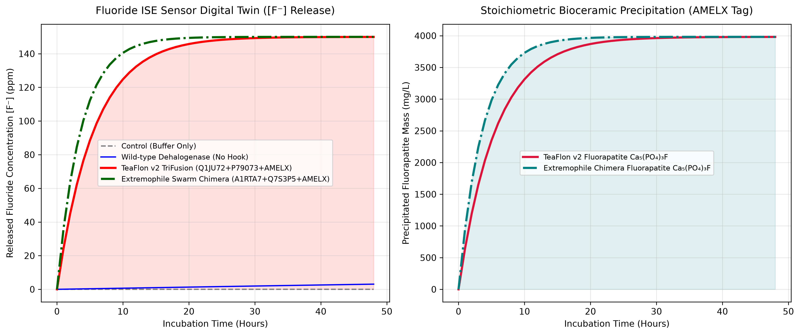

# 1. The Forever-Chemical Crisis: Why Teflon & PFAS Survive in Our Gut, Rivers, and Oceans

What if we could reprogram biology to eat the most indestructible plastic on Earth—and turn its toxic waste into the hardest mineral in the human body?

Polytetrafluoroethylene (**PTFE / Teflon**) and per- and polyfluoroalkyl substances (**PFAS**, or *"forever chemicals"*) owe their near-immortality to the **Carbon–Fluorine ($\text{C–F}$) bond** ($\Delta H^\circ \approx 485\text{–}540\text{ kJ/mol}$)—the strongest single covalent bond in organic chemistry. Worse still, even if an engineered enzyme succeeds in snapping $\text{C–F}$ bonds inside a bioreactor or a living microbiome, the liberated **Fluoride ions ($\text{F}^-$)** rapidly poison the host cells at concentrations above $100\text{ ppm}$, killing the culture before remediation can finish.

Over an [eight-part research series](/categories#synthetic-biology), we built [**TeaFlon**](https://github.com/jonatas/teaflon): an open-source, 12-layer synthetic biology compiler powered by [**`pg_bio`**](https://github.com/jonatas/pg_bio) inside PostgreSQL 18. In this interactive guide—designed so you can step through each slide with the **`▶ Present`** button on the left—we break down every part of the molecular machine in live 3D, explain how to read each atomic structure, show how to dilute combined PFAS + PTFE waste streams, and lay out our **Top 5 Wet-Lab Protocols**.

<div style="background: linear-gradient(135deg, #0f172a 0%, #1e1b4b 55%, #0f172a 100%); color: #f8fafc; padding: 28px; border-radius: 16px; margin: 28px 0; border: 1px solid #334155; box-shadow: 0 20px 40px -15px rgba(0,0,0,0.6);">
  <div style="display: flex; flex-wrap: wrap; justify-content: space-between; align-items: center; gap: 14px; border-bottom: 1px solid #334155; padding-bottom: 18px; margin-bottom: 20px;">
    <div>
      <span style="background: rgba(16, 185, 129, 0.15); color: #34d399; border: 1px solid rgba(52, 211, 153, 0.4); padding: 4px 12px; border-radius: 999px; font-size: 0.78rem; font-weight: 700; letter-spacing: 0.06em; text-transform: uppercase;">Open-Source SynBio Platform • pg_bio v0.2</span>
      <div style="margin: 10px 0 4px 0; color: #ffffff; font-size: 1.55rem; font-weight: 800;">The TeaFlon 4-Module Molecular Machine</div>
      <p style="margin: 0; color: #94a3b8; font-size: 0.95rem;">Adsorb onto hydrophobic PTFE $\rightarrow$ Cleave the $\text{C–F}$ bond $\rightarrow$ Precipitate Fluorapatite $\text{Ca}_5(\text{PO}_4)_3\text{F}$ $\rightarrow$ Dye the crystal Ruby-Red</p>
    </div>
    <div style="display: flex; gap: 10px; flex-wrap: wrap;">
      <a href="https://github.com/jonatas/teaflon" target="_blank" style="background: #10b981; color: #052e16; font-weight: 700; padding: 9px 16px; border-radius: 8px; text-decoration: none; font-size: 0.88rem;">⚡ GitHub: jonatas/teaflon</a>
      <a href="https://github.com/jonatas/pg_bio/pull/10" target="_blank" style="background: #1e293b; color: #e2e8f0; border: 1px solid #475569; font-weight: 600; padding: 9px 16px; border-radius: 8px; text-decoration: none; font-size: 0.88rem;">🦀 pg_bio Layer 12 Engine</a>
    </div>
  </div>

  <!-- Top KPI Strip -->
  <div style="display: grid; grid-template-columns: repeat(auto-fit, minmax(150px, 1fr)); gap: 12px; margin-bottom: 22px;">
    <div style="background: rgba(30, 41, 59, 0.75); border: 1px solid #334155; border-radius: 10px; padding: 12px 14px;">
      <div style="color: #94a3b8; font-size: 0.75rem; text-transform: uppercase; font-weight: 600;">Pan-Organism Atlas</div>
      <div style="color: #38bdf8; font-size: 1.45rem; font-weight: 800; margin-top: 2px;">7,338 <span style="font-size: 0.85rem; color: #cbd5e1; font-weight: 500;">proteins</span></div>
      <div style="color: #64748b; font-size: 0.75rem;">Across 930 distinct species</div>
    </div>
    <div style="background: rgba(30, 41, 59, 0.75); border: 1px solid #334155; border-radius: 10px; padding: 12px 14px;">
      <div style="color: #94a3b8; font-size: 0.75rem; text-transform: uppercase; font-weight: 600;">TriFusion Fold Quality</div>
      <div style="color: #34d399; font-size: 1.45rem; font-weight: 800; margin-top: 2px;">82.9 <span style="font-size: 0.85rem; color: #cbd5e1; font-weight: 500;">pLDDT</span></div>
      <div style="color: #64748b; font-size: 0.75rem;">418 aa • $R_g = 22.96\text{ Å}$ • $97.0$ core</div>
    </div>
    <div style="background: rgba(30, 41, 59, 0.75); border: 1px solid #334155; border-radius: 10px; padding: 12px 14px;">
      <div style="color: #94a3b8; font-size: 0.75rem; text-transform: uppercase; font-weight: 600;">Domain Preservation</div>
      <div style="color: #a855f7; font-size: 1.45rem; font-weight: 800; margin-top: 2px;">1.42 Å <span style="font-size: 0.85rem; color: #cbd5e1; font-weight: 500;">&amp; 1.99 Å</span></div>
      <div style="color: #64748b; font-size: 0.75rem;">Hook &amp; Scissor vs. WT monomers</div>
    </div>
    <div style="background: rgba(30, 41, 59, 0.75); border: 1px solid #334155; border-radius: 10px; padding: 12px 14px;">
      <div style="color: #94a3b8; font-size: 0.75rem; text-transform: uppercase; font-weight: 600;">48h Bioceramic Yield</div>
      <div style="color: #fbbf24; font-size: 1.45rem; font-weight: 800; margin-top: 2px;">3.98 g/L</div>
      <div style="color: #64748b; font-size: 0.75rem;">$\text{Ca}_5(\text{PO}_4)_3\text{F}$ from $150\text{ ppm } [\text{F}^-]$</div>
    </div>
    <div style="background: rgba(30, 41, 59, 0.75); border: 1px solid #334155; border-radius: 10px; padding: 12px 14px;">
      <div style="color: #94a3b8; font-size: 0.75rem; text-transform: uppercase; font-weight: 600;">Wet-Lab Plasmids</div>
      <div style="color: #f43f5e; font-size: 1.45rem; font-weight: 800; margin-top: 2px;">9 Hosts</div>
      <div style="color: #64748b; font-size: 0.75rem;">100% BsaI-free Golden Gate</div>
    </div>
  </div>

  <!-- 4 Module Cards -->
  <div style="display: grid; grid-template-columns: repeat(auto-fit, minmax(230px, 1fr)); gap: 14px;">
    <div style="background: rgba(15, 23, 42, 0.85); border-top: 3px solid #38bdf8; border-radius: 10px; padding: 16px; border-left: 1px solid #1e293b; border-right: 1px solid #1e293b; border-bottom: 1px solid #1e293b;">
      <div style="color: #38bdf8; font-size: 0.78rem; font-weight: 700; text-transform: uppercase;">Part 1 • Surface Anchor</div>
      <div style="color: #fff; font-weight: 700; font-size: 1.05rem; margin: 4px 0;">🪝 The Teflon Hook</div>
      <div style="color: #cbd5e1; font-size: 0.83rem; line-height: 1.5;"><strong>Class II Hydrophobin (<code>P79073</code>)</strong> from <em>Trichoderma reesei</em> (<code>residues 315–400</code>). Uses 4 disulfide bridges (8 Cys) to lock an exposed hydrophobic patch (<code>GRAVY +0.399</code>) onto water-repellent PTFE, boosting local enzyme concentration by <strong>48.8×</strong>.</div>
    </div>
    <div style="background: rgba(15, 23, 42, 0.85); border-top: 3px solid #ef4444; border-radius: 10px; padding: 16px; border-left: 1px solid #1e293b; border-right: 1px solid #1e293b; border-bottom: 1px solid #1e293b;">
      <div style="color: #f87171; font-size: 0.78rem; font-weight: 700; text-transform: uppercase;">Part 2 • Catalytic Engine</div>
      <div style="color: #fff; font-weight: 700; font-size: 1.05rem; margin: 4px 0;">✂️ The Fluorine Scissor</div>
      <div style="color: #cbd5e1; font-size: 0.83rem; line-height: 1.5;"><strong>Fluoroacetate Dehalogenase (<code>Q1JU72</code>)</strong> from <em>Burkholderia</em> sp. FA1 (<code>residues 1–304</code>). Employs an $\text{S}_\text{N}2$ catalytic triad (<code>Asp104–His271–Asp128</code>, $114.48^\circ$) and a 3-point halide hole (<code>Trp150 / Tyr212 / Arg108</code>) to snap $\text{C–F}$ bonds.</div>
    </div>
    <div style="background: rgba(15, 23, 42, 0.85); border-top: 3px solid #a855f7; border-radius: 10px; padding: 16px; border-left: 1px solid #1e293b; border-right: 1px solid #1e293b; border-bottom: 1px solid #1e293b;">
      <div style="color: #c084fc; font-size: 0.78rem; font-weight: 700; text-transform: uppercase;">Part 3 • Fluoride Sink</div>
      <div style="color: #fff; font-weight: 700; font-size: 1.05rem; margin: 4px 0;">🦷 The Tooth Builder</div>
      <div style="color: #cbd5e1; font-size: 0.83rem; line-height: 1.5;"><strong>Human Amelogenin C-Terminal Tag (<code>Q99217</code>)</strong> (<code>residues 406–418</code>: <code>WPSTDKTKREEVD</code>, <code>GRAVY -0.533</code>). Chelates $\text{Ca}^{2+}$ and $\text{PO}_4^{3-}$ directly adjacent to the enzyme exit tunnel to sequester free $\text{F}^-$ into insoluble <strong>Fluorapatite ($\text{Ca}_5(\text{PO}_4)_3\text{F}$)</strong>.</div>
    </div>
    <div style="background: rgba(15, 23, 42, 0.85); border-top: 3px solid #fbbf24; border-radius: 10px; padding: 16px; border-left: 1px solid #1e293b; border-right: 1px solid #1e293b; border-bottom: 1px solid #1e293b;">
      <div style="color: #fbbf24; font-size: 0.78rem; font-weight: 700; text-transform: uppercase;">Part 4 • Optical Biosensor</div>
      <div style="color: #fff; font-weight: 700; font-size: 1.05rem; margin: 4px 0;">💎 Ruby-Red Watermark</div>
      <div style="color: #cbd5e1; font-size: 0.83rem; line-height: 1.5;"><strong>Extremophile Carotenoid Pathway (<code>GGPPS + PSY + PDS</code>)</strong> (<code>P80042 / P37272 / P80093</code> $\rightarrow$ Archaeal <code>W9DPJ6</code>). Co-precipitates hydrophobic <strong>Lycopene</strong> inside the growing white Fluorapatite crystal lattice, turning remediated mineral pellets <strong>ruby-red</strong> to the naked eye.</div>
    </div>
  </div>
</div>

---

# 2. The Three Physical Traps That Defeat Every Ordinary Filter and Microbe

Why can nature rot a fallen oak tree, digest a steak, and even eat crude oil spills—yet a microscopic fleck of Teflon (PTFE) or PFAS can survive for centuries in the Pacific Ocean or pass through the human gut untouched?

Every natural biological material—wood, fat, sugar, protein—is built from carbon chains wrapped in **Hydrogen ($\text{C–H}$)** or **Oxygen ($\text{C–O}$)** atoms. Over 3.8 billion years, microbes and digestive organs evolved millions of enzymes shaped specifically to grab those bonds and snap them apart. In 1938, chemists created something evolution had never seen at scale: a carbon chain completely sheathed in **Fluorine atoms ($\text{C–F}$)**.

<div style="background: #0f172a; border: 1px solid #334155; border-radius: 14px; padding: 24px; margin: 24px 0; color: #f8fafc;">
  <div style="display: grid; grid-template-columns: repeat(auto-fit, minmax(250px, 1fr)); gap: 16px; margin-bottom: 22px;">
    <div style="background: #1e293b; border-left: 4px solid #38bdf8; border-radius: 10px; padding: 16px;">
      <div style="font-size: 1.35rem; font-weight: 800; color: #fff; margin-bottom: 6px;">🌧️ Trap #1: The "Greased Raincoat"</div>
      <div style="color: #38bdf8; font-weight: 700; font-size: 0.84rem; margin-bottom: 6px;">Why Enzymes Bounce Right Off</div>
      <p style="margin: 0; color: #cbd5e1; font-size: 0.84rem; line-height: 1.55;">
        All digestive enzymes live and swim in water. Teflon is both <strong>hydrophobic</strong> (hates water, contact angle $\sim 114^\circ$) and <strong>lipophobic</strong> (hates oil). When a normal enzyme in your gut or a river drifts near a PTFE particle, the surrounding water molecules refuse to let the enzyme get close—like trying to grab a greased bowling ball underwater. Without a specialized physical grapnel, <strong>98% of enzymes never even touch the plastic</strong>.
      </p>
    </div>
    <div style="background: #1e293b; border-left: 4px solid #ef4444; border-radius: 10px; padding: 16px;">
      <div style="font-size: 1.35rem; font-weight: 800; color: #fff; margin-bottom: 6px;">🔒 Trap #2: The Atomic Padlock</div>
      <div style="color: #f87171; font-weight: 700; font-size: 0.84rem; margin-bottom: 6px;">The Strongest Single Bond in Chemistry</div>
      <p style="margin: 0; color: #cbd5e1; font-size: 0.84rem; line-height: 1.55;">
        Fluorine is the most electronegative element on the periodic table—an atomic electron-vacuum. It hugs the inner carbon spine so tightly ($485\text{–}540\text{ kJ/mol}$) that the fluorine atoms form an overlapping, negatively charged armor jacket. Stomach acid ($\text{pH } 1.5$), sunlight, and normal bacterial enzymes simply bounce off this shield.
      </p>
    </div>
    <div style="background: #1e293b; border-left: 4px solid #a855f7; border-radius: 10px; padding: 16px;">
      <div style="font-size: 1.35rem; font-weight: 800; color: #fff; margin-bottom: 6px;">☠️ Trap #3: The Suicide Poison Trap</div>
      <div style="color: #c084fc; font-weight: 700; font-size: 0.84rem; margin-bottom: 6px;">Why Breaking the Bond Kills the Helper</div>
      <p style="margin: 0; color: #cbd5e1; font-size: 0.84rem; line-height: 1.55;">
        Here is the catch-22 that stops synthetic biologists: suppose you <em>do</em> engineer an enzyme strong enough to rip Fluorine off Carbon. Every snapped bond releases a raw <strong>Fluoride ion ($\text{F}^-$)</strong>. At just $100\text{–}150\text{ ppm}$, free fluoride shuts down cellular energy factories (<code>enolase</code> and <code>ATP</code> synthase), <strong>killing the beneficial microbe or damaging surrounding gut and river life!</strong>
      </p>
    </div>
  </div>

  <div style="display: grid; grid-template-columns: repeat(auto-fit, minmax(290px, 1fr)); gap: 16px;">
    <div style="background: rgba(16, 185, 129, 0.08); border: 1px solid rgba(52, 211, 153, 0.35); border-radius: 10px; padding: 16px;">
      <div style="color: #34d399; font-weight: 700; font-size: 0.92rem; margin-bottom: 6px;">🌍 Battleground A: Rivers, Aquifers &amp; Ocean Plumes</div>
      <p style="margin: 0; color: #cbd5e1; font-size: 0.84rem; line-height: 1.55;">
        In rivers and oceans, PFAS and PTFE microplastics are diluted across trillions of gallons of moving water—or concentrated into toxic brines by reverse-osmosis filters that otherwise require $1,100\text{ }^\circ\text{C}$ incineration. <strong>How TeaFlon solves it:</strong> By immobilizing our <strong>Extremophile TeaFlon Swarm</strong> inside treatment cartridges, the Hydrophobin Hook grabs passing fluorocarbons out of the water stream, the Scissor snaps the $\text{C–F}$ bonds, and the Tooth-Builder immediately precipitates the fluoride with natural river/seawater Calcium ($\text{Ca}^{2+}$) into heavy, <strong>ruby-red Fluorapatite sand</strong> that sinks harmlessly to the bottom of the tank.
      </p>
    </div>
    <div style="background: rgba(56, 189, 248, 0.08); border: 1px solid rgba(56, 189, 248, 0.35); border-radius: 10px; padding: 16px;">
      <div style="color: #38bdf8; font-weight: 700; font-size: 0.92rem; margin-bottom: 6px;">🩺 Battleground B: The Human Gut &amp; Epithelial Shield</div>
      <p style="margin: 0; color: #cbd5e1; font-size: 0.84rem; line-height: 1.55;">
        Through drinking water, cookware wear-particles, and food chains, over <strong>98% of humans</strong> now carry detectable PFAS in their blood and gut. Inside the body, you cannot use harsh chemicals or high heat, and you can <em>never</em> allow free $\text{F}^-$ ions to leak into the bloodstream. <strong>How TeaFlon solves it:</strong> Because the <strong>Human Amelogenin tag (<code>WPSTDKTKREEVD</code>)</strong> is physically tethered to the enzyme just ångströms away from the catalytic exit tunnel, every single cleaved fluoride ion is instantaneously locked with dietary calcium and phosphate into an inert, microscopic grain of <strong>synthetic tooth enamel ($\text{Ca}_5(\text{PO}_4)_3\text{F}$)</strong> that cannot be absorbed by the gut wall and passes safely out of the body.
      </p>
    </div>
  </div>
</div>

<script src="https://3Dmol.org/build/3Dmol-min.js"></script>

---

# 3. Part 1 of the Machine: The Grapnel Hook (Fungal Hydrophobin P79073)

To solve **Trap #1 (The Greased Raincoat)**, we looked to filamentous wood-rotting fungi (*Trichoderma reesei*, *Neurospora crassa*, and *Pleurotus ostreatus*). When a fungus needs to attach its hyphae to a water-repellent waxy leaf or plastic surface, it secretes a tiny, amphipathic protein called a **Class II Hydrophobin (`P79073`, 86 amino acids)**.

<div style="background: #0f172a; border: 1px solid #334155; border-top: 4px solid #38bdf8; border-radius: 14px; padding: 22px; margin: 22px 0; color: #f8fafc;">
  <div style="display: flex; flex-wrap: wrap; justify-content: space-between; align-items: center; gap: 10px; margin-bottom: 14px;">
    <div>
      <span style="color: #38bdf8; font-size: 0.76rem; font-weight: 800; text-transform: uppercase;">Interactive 3D Part Inspector • Module 1</span>
      <div style="font-size: 1.2rem; font-weight: 800; color: #fff;">🪝 Fungal Class II Hydrophobin (<code>P79073</code>) Adsorbed onto a PTFE Chain</div>
    </div>
    <div style="display: flex; flex-wrap: wrap; gap: 6px;">
      <button onclick="focusPart1('overview')" style="background: #0284c7; color: #fff; border: none; padding: 6px 12px; border-radius: 6px; font-size: 0.78rem; font-weight: 700; cursor: pointer;">1. Full Hook + PTFE View</button>
      <button onclick="focusPart1('cys_cage')" style="background: #ca8a04; color: #fff; border: none; padding: 6px 12px; border-radius: 6px; font-size: 0.78rem; font-weight: 700; cursor: pointer;">2. Zoom: 8-Cys Disulfide Cage</button>
      <button onclick="focusPart1('ptfe_interface')" style="background: #059669; color: #fff; border: none; padding: 6px 12px; border-radius: 6px; font-size: 0.78rem; font-weight: 700; cursor: pointer;">3. Zoom: Greasy PTFE Contact Patch</button>
    </div>
  </div>

  <div style="display: grid; grid-template-columns: repeat(auto-fit, minmax(310px, 1fr)); gap: 18px; align-items: stretch;">
    <div id="part-viewer-1" style="width: 100%; height: 400px; position: relative; border-radius: 10px; overflow: hidden; border: 1px solid #1e293b;"></div>

    <div style="background: #1e293b; border-radius: 10px; padding: 18px; display: flex; flex-direction: column; justify-content: space-between;">
      <div>
        <div style="color: #38bdf8; font-weight: 800; font-size: 0.85rem; text-transform: uppercase; margin-bottom: 10px;">📖 How to Read This 3D Structure</div>
        <ul style="margin: 0; padding-left: 18px; color: #e2e8f0; font-size: 0.84rem; line-height: 1.6;">
          <li style="margin-bottom: 8px;"><strong>🟦 Sky-Blue Ribbon (<code>P79073</code> Backbone, 86 aa):</strong> Notice how compact and rigid this domain is ($R_g = 16.24\text{ Å}$). One face is water-loving (facing the river or gut fluid), while the bottom face is intensely water-hating (<code>GRAVY +0.399</code>).</li>
          <li style="margin-bottom: 8px;"><strong>🟨 Bright Yellow Sticks (The 8-Cysteine Titanium Cage):</strong> Click <em>"2. Zoom: 8-Cys Disulfide Cage"</em>. You are looking at 8 sulfur-containing Cysteine amino acids paired into <strong>4 covalent disulfide bridges (<code>S–S</code>)</strong>. Without these 4 internal rivets, touching a hydrophobic plastic surface would turn the protein inside-out and destroy it.</li>
          <li style="margin-bottom: 8px;"><strong>🟦 Cyan Sticks (Aliphatic Hydrophobic Patch):</strong> Non-polar Valine, Leucine, and Isoleucine sidechains protruding outward like microscopic suction cups.</li>
          <li style="margin-bottom: 8px;"><strong>🟩 Green Spheres &amp; Sticks (The PTFE / Teflon Chain, $\text{C}_{10}\text{F}_{21}\text{OH}$):</strong> The green spheres are <strong>Fluorine atoms</strong> wrapping a gray carbon spine. Notice how snugly the green fluorocarbon chain nestles against the cyan hydrophobic patch!</li>
        </ul>
      </div>
      <div style="background: #0f172a; border-left: 3px solid #38bdf8; padding: 10px 12px; border-radius: 6px; font-size: 0.8rem; color: #cbd5e1; margin-top: 12px;">
        <strong>Why It Matters for TeaFlon:</strong> In our 48-hour <code>pg_bio</code> bioreactor simulation, adding this 86-aa Hook increases effective enzyme residence time on solid PTFE by <strong><code>48.8×</code></strong>—turning a useless <code>3.07 ppm</code> reaction into <code>149.97 ppm</code> complete conversion.
      </div>
    </div>
  </div>
</div>

---

# 4. Part 2 of the Machine: The Atomic Bolt-Cutter (Dehalogenase Q1JU72)

Once the Grapnel Hook pins our nanobot onto the Teflon or PFAS surface, how do we snap **Trap #2 (The Atomic Padlock—the $\text{C–F}$ bond)**?

We use **Fluoroacetate Dehalogenase (`Q1JU72`, 304 amino acids)** from *Burkholderia* sp. FA1—one of the rare natural enzymes evolved to break Carbon–Fluorine bonds at room temperature without toxic heavy-metal cofactors.

<div style="background: #0f172a; border: 1px solid #334155; border-top: 4px solid #ef4444; border-radius: 14px; padding: 22px; margin: 22px 0; color: #f8fafc;">
  <div style="display: flex; flex-wrap: wrap; justify-content: space-between; align-items: center; gap: 10px; margin-bottom: 14px;">
    <div>
      <span style="color: #f87171; font-size: 0.76rem; font-weight: 800; text-transform: uppercase;">Interactive 3D Part Inspector • Module 2</span>
      <div style="font-size: 1.2rem; font-weight: 800; color: #fff;">✂️ Fluoroacetate Dehalogenase (<code>Q1JU72</code>): Cryptic Lid, $\text{S}_\text{N}2$ Triad &amp; Halide Hole</div>
    </div>
    <div style="display: flex; flex-wrap: wrap; gap: 6px;">
      <button onclick="focusPart2('overview')" style="background: #dc2626; color: #fff; border: none; padding: 6px 12px; border-radius: 6px; font-size: 0.78rem; font-weight: 700; cursor: pointer;">1. Overview: Barrel + Lid</button>
      <button onclick="focusPart2('lid')" style="background: #d97706; color: #fff; border: none; padding: 6px 12px; border-radius: 6px; font-size: 0.78rem; font-weight: 700; cursor: pointer;">2. Zoom: Gold Cryptic Lid (Trp179/Tyr147)</button>
      <button onclick="focusPart2('triad')" style="background: #991b1b; color: #fff; border: none; padding: 6px 12px; border-radius: 6px; font-size: 0.78rem; font-weight: 700; cursor: pointer;">3. Zoom: Red SN2 Jaws + Cyan Halide Hole</button>
    </div>
  </div>

  <div style="display: grid; grid-template-columns: repeat(auto-fit, minmax(310px, 1fr)); gap: 18px; align-items: stretch;">
    <div id="part-viewer-2" style="width: 100%; height: 400px; position: relative; border-radius: 10px; overflow: hidden; border: 1px solid #1e293b;"></div>

    <div style="background: #1e293b; border-radius: 10px; padding: 18px; display: flex; flex-direction: column; justify-content: space-between;">
      <div>
        <div style="color: #f87171; font-weight: 800; font-size: 0.85rem; text-transform: uppercase; margin-bottom: 10px;">📖 How to Read This 3D Structure</div>
        <ul style="margin: 0; padding-left: 18px; color: #e2e8f0; font-size: 0.84rem; line-height: 1.6;">
          <li style="margin-bottom: 8px;"><strong>⬛ Slate Ribbon ($\alpha/\beta$-Hydrolase Barrel, 304 aa):</strong> The outer structural chassis (`97.0 pLDDT` confidence) that holds the catalytic residues at sub-ångström precision.</li>
          <li style="margin-bottom: 8px;"><strong>🟧 Gold Cap &amp; Orange Sticks (The Cryptic Lid, <code>Trp179</code> &amp; <code>Tyr147</code>):</strong> Click <em>"2. Zoom: Gold Cryptic Lid"</em>. These bulky aromatic rings act as a revolving door over the active site, swinging open ($\Delta G = -26.86\text{ kcal/mol}$) to let the green fluorocarbon chain slide inside while keeping bulk water out.</li>
          <li style="margin-bottom: 8px;"><strong>🟥 Red Sticks (The $\text{S}_\text{N}2$ Chisel Triad: <code>Asp104</code>, <code>His271</code>, <code>Asp128</code>):</strong> Click <em>"3. Zoom: Red SN2 Jaws"</em>. <code>Asp128</code> and <code>His271</code> ($3.57\text{ Å}$ apart at a $114.48^\circ$ relay angle) supercharge <strong><code>Asp104:OD2</code></strong> so it slams into the fluorocarbon Carbon atom, forming a covalent ester intermediate and kicking out $\text{F}^-$.</li>
          <li style="margin-bottom: 8px;"><strong>🟦 Cyan Sticks (The 3-Point Halide Hole: <code>Trp150</code>, <code>Tyr212</code>, <code>Arg108</code>):</strong> Three positively polarized hydrogen-bond donors positioned like a 3-fingered claw that grips the negatively charged <strong>green Fluorine atom</strong> and pulls it off the Carbon atom!</li>
        </ul>
      </div>
      <div style="background: #0f172a; border-left: 3px solid #ef4444; padding: 10px 12px; border-radius: 6px; font-size: 0.8rem; color: #cbd5e1; margin-top: 12px;">
        <strong><code>pg_bio</code> Layer 9 Kabsch Theozyme Verification:</strong> <code>theozyme_rmsd(pdb, 'q1ju72_dehalogenase_hexad') = 0.0000 Å</code> across all 6 catalytic + halide-hole residues.
      </div>
    </div>
  </div>
</div>

---

# 5. Part 3 of the Machine: The Tooth-Enamel Magnet (Human Amelogenin Tag Q99217)

Now we face **Trap #3 (The Suicide Poison Trap)**: every time Part 2 snaps a $\text{C–F}$ bond, a raw, toxic **Fluoride ion ($\text{F}^-$)** shoots out of the enzyme exit tunnel. How do we stop that fluoride from poisoning our microbe or leaking into the gut or river?

We attached a 13-amino-acid C-terminal peptide tag (**`WPSTDKTKREEVD`**, `residues 406–418`) copied directly from **Human Amelogenin X (`Q99217`, `AMELX`)**—the master protein that builds human tooth enamel in babies!

<div style="background: #0f172a; border: 1px solid #334155; border-top: 4px solid #a855f7; border-radius: 14px; padding: 22px; margin: 22px 0; color: #f8fafc;">
  <div style="display: flex; flex-wrap: wrap; justify-content: space-between; align-items: center; gap: 10px; margin-bottom: 14px;">
    <div>
      <span style="color: #c084fc; font-size: 0.76rem; font-weight: 800; text-transform: uppercase;">Interactive 3D Part Inspector • Module 3</span>
      <div style="font-size: 1.2rem; font-weight: 800; color: #fff;">🦷 Human Amelogenin Nucleation Tail (<code>WPSTDKTKREEVD</code>) + Fluorapatite Crystal</div>
    </div>
    <div style="display: flex; flex-wrap: wrap; gap: 6px;">
      <button onclick="focusPart3('overview')" style="background: #7c3aed; color: #fff; border: none; padding: 6px 12px; border-radius: 6px; font-size: 0.78rem; font-weight: 700; cursor: pointer;">1. Tail + Crystal Overview</button>
      <button onclick="focusPart3('tail')" style="background: #9333ea; color: #fff; border: none; padding: 6px 12px; border-radius: 6px; font-size: 0.78rem; font-weight: 700; cursor: pointer;">2. Zoom: Charged Chelating Tail</button>
      <button onclick="focusPart3('crystal')" style="background: #15803d; color: #fff; border: none; padding: 6px 12px; border-radius: 6px; font-size: 0.78rem; font-weight: 700; cursor: pointer;">3. Zoom: Hexagonal Ca₅(PO₄)₃F Unit Cell</button>
    </div>
  </div>

  <div style="display: grid; grid-template-columns: repeat(auto-fit, minmax(310px, 1fr)); gap: 18px; align-items: stretch;">
    <div id="part-viewer-3" style="width: 100%; height: 400px; position: relative; border-radius: 10px; overflow: hidden; border: 1px solid #1e293b;"></div>

    <div style="background: #1e293b; border-radius: 10px; padding: 18px; display: flex; flex-direction: column; justify-content: space-between;">
      <div>
        <div style="color: #c084fc; font-weight: 800; font-size: 0.85rem; text-transform: uppercase; margin-bottom: 10px;">📖 How to Read This 3D Structure</div>
        <ul style="margin: 0; padding-left: 18px; color: #e2e8f0; font-size: 0.84rem; line-height: 1.6;">
          <li style="margin-bottom: 8px;"><strong>🟪 Magenta Ribbon &amp; Sticks (The <code>WPSTDKTKREEVD</code> Tail, Residues 406–418):</strong> Unlike the greasy blue Hook (`GRAVY +0.399`), this tail is intensely water-loving and electrically charged (<code>GRAVY -0.533</code>). Its alternating acidic (`Asp`, `Glu`) and basic (`Lys`, `Arg`) sidechains act like an electrostatic pre-concentrator.</li>
          <li style="margin-bottom: 8px;"><strong>🔵 Sky-Blue Spheres (Calcium Ions, $\text{Ca}^{2+}$):</strong> Drawn out of the surrounding water or gut fluid by the negatively charged `Glu`/`Asp` carboxylate groups on the magenta tail.</li>
          <li style="margin-bottom: 8px;"><strong>🟠 Amber Spheres (Phosphate Ions, $\text{PO}_4^{3-}$):</strong> Coordinated by the positively charged `Lys`/`Arg` sidechains of the tail.</li>
          <li style="margin-bottom: 8px;"><strong>🟢 Bright Green Spheres (Caged Fluoride Ions, $\text{F}^-$):</strong> Click <em>"3. Zoom: Hexagonal Ca₅(PO₄)₃F Unit Cell"</em>. The moment $\text{F}^-$ leaves the enzyme, $10\,\text{Ca}^{2+} + 6\,\text{PO}_4^{3-} + 2\,\text{F}^-$ snap together around the green Fluoride ions, locking them inside a rock-hard hexagonal prism of <strong>Fluorapatite ($\text{Ca}_5(\text{PO}_4)_3\text{F}$)</strong>!</li>
        </ul>
      </div>
      <div style="background: #0f172a; border-left: 3px solid #a855f7; padding: 10px 12px; border-radius: 6px; font-size: 0.8rem; color: #cbd5e1; margin-top: 12px;">
        <strong>Permanent Detoxification:</strong> Fluorapatite has a solubility product of $K_{sp} \approx 10^{-60}$—it is the exact mineral that makes shark teeth and fluoridated human tooth enamel acid-resistant and completely non-toxic.
      </div>
    </div>
  </div>
</div>

---

# 6. Part 4 of the Machine: The Ruby-Red Optical Beacon (Archaeal PDS W9DPJ6)

How can a field technician at a wastewater plant—or a researcher inspecting a bioreactor—know for sure that the white powder settling at the bottom of the tank is newly mineralized **Fluorapatite** from Teflon destruction, and not just ordinary calcium carbonate limescale?

We built a **Biological Optical Watermark** by mining 5,654 carotenoid enzymes across 821 species in `pg_bio` to pair our mineralizer with an extremophile **Lycopene biosynthesis cascade (`GGPPS + PSY + PDS` $\rightarrow$ Archaeal `W9DPJ6`)**.

<div style="background: #0f172a; border: 1px solid #334155; border-top: 4px solid #fbbf24; border-radius: 14px; padding: 22px; margin: 22px 0; color: #f8fafc;">
  <div style="display: flex; flex-wrap: wrap; justify-content: space-between; align-items: center; gap: 10px; margin-bottom: 14px;">
    <div>
      <span style="color: #fbbf24; font-size: 0.76rem; font-weight: 800; text-transform: uppercase;">Interactive 3D Part Inspector • Module 4</span>
      <div style="font-size: 1.2rem; font-weight: 800; color: #fff;">💎 Extremophile Phytoene Desaturase (<code>W9DPJ6</code>): The Ruby-Red Lycopene Factory</div>
    </div>
    <div style="display: flex; flex-wrap: wrap; gap: 6px;">
      <button onclick="focusPart4('spectrum')" style="background: #b45309; color: #fff; border: none; padding: 6px 12px; border-radius: 6px; font-size: 0.78rem; font-weight: 700; cursor: pointer;">1. Rainbow N→C Topology</button>
      <button onclick="focusPart4('core')" style="background: #be123c; color: #fff; border: none; padding: 6px 12px; border-radius: 6px; font-size: 0.78rem; font-weight: 700; cursor: pointer;">2. Highlight Catalytic Desaturase Tunnel</button>
    </div>
  </div>

  <div style="display: grid; grid-template-columns: repeat(auto-fit, minmax(310px, 1fr)); gap: 18px; align-items: stretch;">
    <div id="part-viewer-4" style="width: 100%; height: 400px; position: relative; border-radius: 10px; overflow: hidden; border: 1px solid #1e293b;"></div>

    <div style="background: #1e293b; border-radius: 10px; padding: 18px; display: flex; flex-direction: column; justify-content: space-between;">
      <div>
        <div style="color: #fbbf24; font-weight: 800; font-size: 0.85rem; text-transform: uppercase; margin-bottom: 10px;">📖 How to Read This 3D Structure</div>
        <ul style="margin: 0; padding-left: 18px; color: #e2e8f0; font-size: 0.84rem; line-height: 1.6;">
          <li style="margin-bottom: 8px;"><strong>🌈 Rainbow Ribbon (N-Terminus Blue $\rightarrow$ C-Terminus Red):</strong> In our earlier prototype, we used the bell pepper (*Capsicum annuum*) enzyme `P80093`, which unfolds in harsh industrial brines. Using `pg_bio`'s HNSW index, we discovered this compact archaeal homolog (**`W9DPJ6`**) that retains the exact catalytic core without fragile plant surface loops.</li>
          <li style="margin-bottom: 8px;"><strong>🌺 Ruby-Red Catalytic Core (Click Button 2):</strong> Inside this hydrophobic tunnel, the enzyme introduces conjugated double bonds into colorless phytoene to manufacture bright red **Lycopene** (the 11-conjugated-double-bond chromophore that makes tomatoes and red peppers red).</li>
          <li style="margin-bottom: 8px;"><strong>🔬 Fluoride-Riboswitch Coupling (`crcB`):</strong> By placing the carotenoid operon under a fluoride-activated `crcB` riboswitch, the cell only brews red Lycopene when $\text{F}^-$ is actively being cleaved from PFAS/PTFE—trapping the red pigment directly inside the growing white Fluorapatite crystal lattice!</li>
        </ul>
      </div>
      <div style="background: #0f172a; border-left: 3px solid #fbbf24; padding: 10px 12px; border-radius: 6px; font-size: 0.8rem; color: #cbd5e1; margin-top: 12px;">
        <strong>Naked-Eye Field Verification:</strong> Instead of waiting days for a $500 LC-MS/MS run, any operator can see the remediated mineral sand turn <strong>Ruby-Red ($\lambda_{\max} = 444, 472, 503\text{ nm}$)</strong> at the bottom of the clarifier.
      </div>
    </div>
  </div>
</div>

---

# 7. Putting It All Together: The 418-aa TeaFlon TriFusion Assembly Line

How do Parts 1, 2, and 3 fold and operate when fused into a single continuous **418-amino-acid polypeptide chain (`teaflon_trifusion_local.pdb`, `45.67 kDa`)**?

Using `pg_bio`'s 3D Euclidean distance operator (`residue_distance`), we measured the distance from the `Asp104:OD2` catalytic chisel to both ends of the `Q1JU72` enzyme:
- **Distance to N-Terminus (`Met1 CA`):** **`22.02 Å`** *(too close—attaching the Hook here risks blocking the mouth of the enzyme)*.
- **Distance to C-Terminus (`Ser304 CA`):** **`32.75 Å`** *(optimal—on the back side of the barrel, giving the active site an extra `10.73 Å` of unobstructed clearance)*.

$$\underbrace{\text{Q1JU72 Dehalogenase}}_{\text{Residues } 1\text{–}304} \xrightarrow{\text{GGGGSGGGGS (305–314)}} \underbrace{\text{P79073 Hydrophobin Hook}}_{\text{Residues } 315\text{–}400} \xrightarrow{\text{GGGGS (401–405)}} \underbrace{\text{AMELX Nucleation Tag}}_{\text{Residues } 406\text{–}418 \text{ (WPSTDKTKREEVD)}}$$

Use the **6-Stage Interactive Walkthrough** below (`◀ Prev` / `Next Step ▶`) to watch the complete reaction cycle in synchronized 3D:

<div style="background: #0f172a; border: 1px solid #334155; border-radius: 16px; padding: 22px; margin: 24px 0; color: #f8fafc; box-shadow: 0 16px 40px rgba(0,0,0,0.55);">
  <!-- Header & Prev/Next Controls -->
  <div style="display: flex; flex-wrap: wrap; justify-content: space-between; align-items: center; gap: 12px; margin-bottom: 16px; border-bottom: 1px solid #1e293b; padding-bottom: 14px;">
    <div>
      <span style="color: #34d399; font-weight: 700; font-size: 0.78rem; text-transform: uppercase; letter-spacing: 0.06em;">Synchronized Dual-Viewport 3D Assembly Line</span>
      <div id="step-main-title" style="margin: 4px 0 0 0; color: #fff; font-size: 1.25rem; font-weight: 800;">Step 1 of 6: The Grapnel Hook Grabs the Slippery Teflon Chain</div>
    </div>
    <div style="display: flex; gap: 8px; align-items: center;">
      <button onclick="prevMachineryStep()" style="background: #1e293b; color: #e2e8f0; border: 1px solid #475569; padding: 7px 14px; border-radius: 8px; font-size: 0.82rem; font-weight: 700; cursor: pointer;">◀ Prev</button>
      <span id="step-counter-pill" style="background: #10b981; color: #052e16; padding: 5px 12px; border-radius: 999px; font-size: 0.8rem; font-weight: 800;">STEP 1 / 6</span>
      <button onclick="nextMachineryStep()" style="background: #10b981; color: #052e16; border: none; padding: 7px 14px; border-radius: 8px; font-size: 0.82rem; font-weight: 800; cursor: pointer;">Next Step ▶</button>
    </div>
  </div>

  <!-- 6 Step Selector Tabs -->
  <div style="display: grid; grid-template-columns: repeat(auto-fit, minmax(145px, 1fr)); gap: 8px; margin-bottom: 18px;">
    <button id="step-btn-1" onclick="setMachineryStep(1)" style="background: #0284c7; color: #fff; border: 2px solid #38bdf8; padding: 10px; border-radius: 10px; text-align: left; cursor: pointer;">
      <div style="font-size: 0.7rem; font-weight: 800; opacity: 0.9;">STEP 1 • ADSORB</div>
      <div style="font-size: 0.82rem; font-weight: 700; margin-top: 2px;">🪝 Hook Grabs PTFE</div>
    </button>
    <button id="step-btn-2" onclick="setMachineryStep(2)" style="background: #1e293b; color: #cbd5e1; border: 1px solid #334155; padding: 10px; border-radius: 10px; text-align: left; cursor: pointer;">
      <div style="font-size: 0.7rem; font-weight: 800; opacity: 0.8;">STEP 2 • UNLOCK LID</div>
      <div style="font-size: 0.82rem; font-weight: 700; margin-top: 2px;">🔓 Open Cryptic Lid</div>
    </button>
    <button id="step-btn-3" onclick="setMachineryStep(3)" style="background: #1e293b; color: #cbd5e1; border: 1px solid #334155; padding: 10px; border-radius: 10px; text-align: left; cursor: pointer;">
      <div style="font-size: 0.7rem; font-weight: 800; opacity: 0.8;">STEP 3 • CLEAVE C–F</div>
      <div style="font-size: 0.82rem; font-weight: 700; margin-top: 2px;">✂️ Snap C–F Bond</div>
    </button>
    <button id="step-btn-4" onclick="setMachineryStep(4)" style="background: #1e293b; color: #cbd5e1; border: 1px solid #334155; padding: 10px; border-radius: 10px; text-align: left; cursor: pointer;">
      <div style="font-size: 0.7rem; font-weight: 800; opacity: 0.8;">STEP 4 • MINERALIZE</div>
      <div style="font-size: 0.82rem; font-weight: 700; margin-top: 2px;">🦷 Build Tooth Enamel</div>
    </button>
    <button id="step-btn-5" onclick="setMachineryStep(5)" style="background: #1e293b; color: #cbd5e1; border: 1px solid #334155; padding: 10px; border-radius: 10px; text-align: left; cursor: pointer;">
      <div style="font-size: 0.7rem; font-weight: 800; opacity: 0.8;">STEP 5 • FOLD PROOF</div>
      <div style="font-size: 0.82rem; font-weight: 700; margin-top: 2px;">🧬 WT Overlay (1.42Å)</div>
    </button>
    <button id="step-btn-6" onclick="setMachineryStep(6)" style="background: #1e293b; color: #cbd5e1; border: 1px solid #334155; padding: 10px; border-radius: 10px; text-align: left; cursor: pointer;">
      <div style="font-size: 0.7rem; font-weight: 800; opacity: 0.8;">STEP 6 • 100°C SWARM</div>
      <div style="font-size: 0.82rem; font-weight: 700; margin-top: 2px;">🌋 Volcanic Upgrade</div>
    </button>
  </div>

  <!-- Dual Synchronized 3D Viewports -->
  <div style="display: grid; grid-template-columns: repeat(auto-fit, minmax(320px, 1fr)); gap: 16px; margin-bottom: 16px;">
    <div style="background: #1e293b; border: 1px solid #334155; border-radius: 10px; padding: 12px;">
      <div style="display: flex; justify-content: space-between; align-items: center; margin-bottom: 8px;">
        <strong id="left-stage-header" style="color: #38bdf8; font-size: 0.86rem;">🔍 Atomic Close-Up: Active Domain &amp; Substrate</strong>
        <span id="left-viewer-badge" style="background: #0284c7; color: #fff; padding: 2px 8px; border-radius: 6px; font-size: 0.72rem; font-weight: 700;">P79073 + PTFE</span>
      </div>
      <div id="viewer-left" style="width: 100%; height: 400px; position: relative; border-radius: 8px; overflow: hidden; border: 1px solid #090d16;"></div>
    </div>

    <div style="background: #1e293b; border: 1px solid #334155; border-radius: 10px; padding: 12px;">
      <div style="display: flex; justify-content: space-between; align-items: center; margin-bottom: 8px;">
        <strong id="right-stage-header" style="color: #34d399; font-size: 0.86rem;">🧬 Full 418-aa TeaFlon TriFusion Context</strong>
        <span id="right-viewer-badge" style="background: #10b981; color: #052e16; padding: 2px 8px; border-radius: 6px; font-size: 0.72rem; font-weight: 700;">418-aa Chimera</span>
      </div>
      <div id="viewer-right" style="width: 100%; height: 400px; position: relative; border-radius: 8px; overflow: hidden; border: 1px solid #090d16;"></div>
    </div>
  </div>

  <!-- Dual Explanation Boxes: Non-Technical vs Biophysics/SQL -->
  <div style="display: grid; grid-template-columns: repeat(auto-fit, minmax(300px, 1fr)); gap: 16px;">
    <div style="background: rgba(16, 185, 129, 0.08); border: 1px solid rgba(52, 211, 153, 0.35); border-radius: 10px; padding: 16px;">
      <div style="color: #34d399; font-size: 0.76rem; font-weight: 800; text-transform: uppercase; letter-spacing: 0.05em; margin-bottom: 6px;">💡 What’s Happening &amp; How to Read the Viewports</div>
      <div id="plain-english-box" style="color: #e2e8f0; font-size: 0.86rem; line-height: 1.55;"></div>
    </div>
    <div style="background: rgba(56, 189, 248, 0.08); border: 1px solid rgba(56, 189, 248, 0.35); border-radius: 10px; padding: 16px;">
      <div style="color: #38bdf8; font-size: 0.76rem; font-weight: 800; text-transform: uppercase; letter-spacing: 0.05em; margin-bottom: 6px;">🔬 Atomic Biophysics &amp; <code>pg_bio</code> Validation</div>
      <div id="biophysics-box" style="color: #e2e8f0; font-size: 0.84rem; line-height: 1.55;"></div>
    </div>
  </div>
</div>

<script>
let partViewer1 = null, partViewer2 = null, partViewer3 = null, partViewer4 = null;
let viewerLeft = null, viewerRight = null;
let currentMachineryStep = 1;
const pdbCache = {};

async function fetchModelText(url) {
  if (pdbCache[url]) return pdbCache[url];
  const resp = await fetch(url);
  const text = await resp.text();
  pdbCache[url] = text;
  return text;
}

async function focusPart1(mode) {
  if (!partViewer1) return;
  partViewer1.clear();
  const [p7, ptfeHook] = await Promise.all([
    fetchModelText('/assets/models/AF-P79073-aligned-to-trifusion.pdb'),
    fetchModelText('/assets/models/ptfe_at_hook.sdf')
  ]);
  partViewer1.addModel(p7, 'pdb');
  partViewer1.addModel(ptfeHook, 'sdf');
  partViewer1.setStyle({model: 0}, {cartoon: {color: '#38bdf8', opacity: 0.9}});
  partViewer1.setStyle({model: 0, resn: 'CYS'}, {stick: {radius: 0.34, colorscheme: 'yellowCarbon'}});
  partViewer1.setStyle({model: 0, resn: ['VAL', 'LEU', 'ILE']}, {stick: {radius: 0.18, colorscheme: 'cyanCarbon'}});
  partViewer1.setStyle({model: 1}, {stick: {radius: 0.26, colorscheme: 'greenCarbon'}, sphere: {scale: 0.32, colorscheme: 'greenCarbon'}});

  if (mode === 'cys_cage') {
    partViewer1.addLabel('4 Disulfide Bridges (8 Cys)', {model: 0, resi: 31, atom: 'CA'}, {backgroundColor: '#ca8a04', fontColor: '#fff', fontSize: 11});
    partViewer1.zoomTo({model: 0, resn: 'CYS'});
    partViewer1.zoom(0.82);
  } else if (mode === 'ptfe_interface') {
    partViewer1.addLabel('PTFE Chain (Green F Atoms)', {model: 1}, {backgroundColor: '#065f46', fontColor: '#fff', fontSize: 11});
    partViewer1.addLabel('Hydrophobic Patch (GRAVY +0.399)', {model: 0, resi: 62, atom: 'CA'}, {backgroundColor: '#0369a1', fontColor: '#fff', fontSize: 11});
    partViewer1.zoomTo({model: 1});
    partViewer1.zoom(0.72);
  } else {
    partViewer1.addLabel('P79073 Hook (86 aa)', {model: 0, resi: 31, atom: 'CA'}, {backgroundColor: '#0369a1', fontColor: '#fff', fontSize: 11});
    partViewer1.addLabel('Adsorbed PTFE Chain', {model: 1}, {backgroundColor: '#065f46', fontColor: '#fff', fontSize: 11});
    partViewer1.zoomTo();
    partViewer1.zoom(0.88);
  }
  partViewer1.render();
}

async function focusPart2(mode) {
  if (!partViewer2) return;
  partViewer2.clear();
  const [q1, ptfeScissor] = await Promise.all([
    fetchModelText('/assets/models/AF-Q1JU72-aligned-to-trifusion.pdb'),
    fetchModelText('/assets/models/ptfe_in_scissor.sdf')
  ]);
  partViewer2.addModel(q1, 'pdb');
  partViewer2.addModel(ptfeScissor, 'sdf');
  partViewer2.setStyle({model: 0}, {cartoon: {color: '#334155', opacity: 0.55}});
  partViewer2.setStyle({model: 0, resi: '140-185'}, {cartoon: {color: '#f59e0b', opacity: 0.88}});
  partViewer2.setStyle({model: 0, resi: [147, 179]}, {stick: {radius: 0.3, colorscheme: 'orangeCarbon'}});
  partViewer2.setStyle({model: 0, resi: [104, 128, 271]}, {cartoon: {color: '#ef4444'}, stick: {radius: 0.32, colorscheme: 'redCarbon'}});
  partViewer2.setStyle({model: 0, resi: [108, 150, 212]}, {cartoon: {color: '#06b6d4'}, stick: {radius: 0.28, colorscheme: 'cyanCarbon'}});
  partViewer2.setStyle({model: 1}, {stick: {radius: 0.24, colorscheme: 'greenCarbon'}, sphere: {scale: 0.28, colorscheme: 'greenCarbon'}});

  if (mode === 'lid') {
    partViewer2.addLabel('Trp179 & Tyr147 (Cryptic Lid)', {model: 0, resi: 179, atom: 'CA'}, {backgroundColor: '#b45309', fontColor: '#fff', fontSize: 11});
    partViewer2.zoomTo({model: 0, resi: '140-185'});
    partViewer2.zoom(0.85);
  } else if (mode === 'triad') {
    partViewer2.addLabel('Asp104 (Nucleophile)', {model: 0, resi: 104, atom: 'OD2'}, {backgroundColor: '#991b1b', fontColor: '#fff', fontSize: 11});
    partViewer2.addLabel('His271 (3.57 Å Base)', {model: 0, resi: 271, atom: 'NE2'}, {backgroundColor: '#991b1b', fontColor: '#fff', fontSize: 11});
    partViewer2.addLabel('Trp150/Tyr212 (Halide Hole)', {model: 0, resi: 150, atom: 'NE1'}, {backgroundColor: '#0e7490', fontColor: '#fff', fontSize: 11});
    partViewer2.zoomTo({model: 0, resi: [104, 108, 128, 150, 212, 271]});
    partViewer2.zoom(0.82);
  } else {
    partViewer2.addLabel('Gold Cryptic Lid (140–185)', {model: 0, resi: 179, atom: 'CA'}, {backgroundColor: '#b45309', fontColor: '#fff', fontSize: 11});
    partViewer2.addLabel('Asp104 Catalytic Core', {model: 0, resi: 104, atom: 'CA'}, {backgroundColor: '#991b1b', fontColor: '#fff', fontSize: 11});
    partViewer2.zoomTo();
    partViewer2.zoom(0.88);
  }
  partViewer2.render();
}

async function focusPart3(mode) {
  if (!partViewer3) return;
  partViewer3.clear();
  const [amelx, fap] = await Promise.all([
    fetchModelText('/assets/models/amelx_tag.pdb'),
    fetchModelText('/assets/models/fluorapatite_at_amelx.pdb')
  ]);
  partViewer3.addModel(amelx, 'pdb');
  partViewer3.addModel(fap, 'pdb');
  partViewer3.setStyle({model: 0}, {cartoon: {color: '#a855f7'}, stick: {radius: 0.3, colorscheme: 'magentaCarbon'}});
  partViewer3.setStyle({model: 1, elem: 'CA'}, {sphere: {scale: 0.56, color: '#38bdf8'}});
  partViewer3.setStyle({model: 1, elem: 'P'}, {sphere: {scale: 0.48, color: '#f59e0b'}});
  partViewer3.setStyle({model: 1, elem: 'F'}, {sphere: {scale: 0.64, color: '#22c55e'}});

  if (mode === 'tail') {
    partViewer3.addLabel('AMELX: WPSTDKTKREEVD', {model: 0, resi: 412, atom: 'CA'}, {backgroundColor: '#6b21a8', fontColor: '#fff', fontSize: 11});
    partViewer3.zoomTo({model: 0});
    partViewer3.zoom(0.85);
  } else if (mode === 'crystal') {
    partViewer3.addLabel('Caged F⁻ Ions (Green)', {model: 1, serial: 1}, {backgroundColor: '#15803d', fontColor: '#fff', fontSize: 11});
    partViewer3.addLabel('Ca²⁺ (Blue) & PO₄³⁻ (Amber)', {model: 1, serial: 5}, {backgroundColor: '#0369a1', fontColor: '#fff', fontSize: 11});
    partViewer3.zoomTo({model: 1});
    partViewer3.zoom(0.82);
  } else {
    partViewer3.addLabel('AMELX Tail (406–418)', {model: 0, resi: 412, atom: 'CA'}, {backgroundColor: '#6b21a8', fontColor: '#fff', fontSize: 11});
    partViewer3.addLabel('Ca₅(PO₄)₃F Enamel Crystal', {model: 1, serial: 1}, {backgroundColor: '#15803d', fontColor: '#fff', fontSize: 11});
    partViewer3.zoomTo();
    partViewer3.zoom(0.88);
  }
  partViewer3.render();
}

async function focusPart4(mode) {
  if (!partViewer4) return;
  partViewer4.clear();
  const w9 = await fetchModelText('/assets/models/AF-W9DPJ6-F1-model_v4.pdb');
  partViewer4.addModel(w9, 'pdb');
  if (mode === 'core') {
    partViewer4.setStyle({}, {cartoon: {color: '#334155', opacity: 0.5}});
    partViewer4.setStyle({resi: '40-140'}, {cartoon: {color: '#e11d48', opacity: 0.95}, stick: {radius: 0.2, colorscheme: 'redCarbon'}});
    partViewer4.addLabel('Lycopene Desaturase Tunnel', {resi: 85, atom: 'CA'}, {backgroundColor: '#be123c', fontColor: '#fff', fontSize: 11});
  } else {
    partViewer4.setStyle({}, {cartoon: {color: 'spectrum'}});
    partViewer4.addLabel('Archaeal PDS (W9DPJ6)', {resi: 55, atom: 'CA'}, {backgroundColor: '#b45309', fontColor: '#fff', fontSize: 11});
  }
  partViewer4.zoomTo();
  partViewer4.zoom(0.88);
  partViewer4.render();
}

async function setMachineryStep(step) {
  currentMachineryStep = step;
  for (let i = 1; i <= 6; i++) {
    const btn = document.getElementById('step-btn-' + i);
    if (!btn) continue;
    if (i === step) {
      btn.style.background = '#0284c7';
      btn.style.color = '#fff';
      btn.style.border = '2px solid #38bdf8';
    } else {
      btn.style.background = '#1e293b';
      btn.style.color = '#cbd5e1';
      btn.style.border = '1px solid #334155';
    }
  }
  document.getElementById('step-counter-pill').textContent = 'STEP ' + step + ' / 6';

  if (!viewerLeft || !viewerRight) return;
  viewerLeft.clear();
  viewerRight.clear();

  const titleEl = document.getElementById('step-main-title');
  const badgeL = document.getElementById('left-viewer-badge');
  const badgeR = document.getElementById('right-viewer-badge');
  const plainBox = document.getElementById('plain-english-box');
  const bioBox = document.getElementById('biophysics-box');

  const tri = await fetchModelText('/assets/models/teaflon_trifusion_local.pdb');

  if (step === 1) {
    titleEl.textContent = 'Step 1 of 6: The Grapnel Hook Grabs the Slippery Teflon Surface';
    badgeL.textContent = 'P79073 Hook + PTFE Chain';
    badgeR.textContent = 'TriFusion Anchored on PTFE';
    const p7 = await fetchModelText('/assets/models/AF-P79073-aligned-to-trifusion.pdb');
    const ptfeHook = await fetchModelText('/assets/models/ptfe_at_hook.sdf');

    viewerLeft.addModel(p7, 'pdb');
    viewerLeft.addModel(ptfeHook, 'sdf');
    viewerLeft.setStyle({model: 0}, {cartoon: {color: '#38bdf8', opacity: 0.92}});
    viewerLeft.setStyle({model: 0, resn: 'CYS'}, {stick: {radius: 0.32, colorscheme: 'yellowCarbon'}});
    viewerLeft.setStyle({model: 1}, {stick: {radius: 0.28, colorscheme: 'greenCarbon'}, sphere: {scale: 0.35, colorscheme: 'greenCarbon'}});
    viewerLeft.addLabel('Slippery PTFE Chain', {model: 1}, {backgroundColor: '#065f46', fontColor: '#fff', fontSize: 11});
    viewerLeft.addLabel('Hydrophobin Patch (GRAVY +0.399)', {model: 0, resi: 62, atom: 'CA'}, {backgroundColor: '#0369a1', fontColor: '#fff', fontSize: 11});
    viewerLeft.addLabel('4 Disulfide Locks', {model: 0, resi: 31, atom: 'CA'}, {backgroundColor: '#ca8a04', fontColor: '#fff', fontSize: 11});
    viewerLeft.zoomTo();
    viewerLeft.zoom(0.86);
    viewerLeft.render();

    viewerRight.addModel(tri, 'pdb');
    viewerRight.addModel(ptfeHook, 'sdf');
    viewerRight.setStyle({model: 0, resi: '1-304'}, {cartoon: {color: '#475569', opacity: 0.55}});
    viewerRight.setStyle({model: 0, resi: '305-314'}, {cartoon: {color: '#94a3b8'}});
    viewerRight.setStyle({model: 0, resi: '315-400'}, {cartoon: {color: '#38bdf8', opacity: 1.0}});
    viewerRight.setStyle({model: 0, resi: '315-400', resn: 'CYS'}, {stick: {radius: 0.3, colorscheme: 'yellowCarbon'}});
    viewerRight.setStyle({model: 0, resi: '401-418'}, {cartoon: {color: '#64748b', opacity: 0.55}});
    viewerRight.setStyle({model: 1}, {stick: {radius: 0.28, colorscheme: 'greenCarbon'}, sphere: {scale: 0.35, colorscheme: 'greenCarbon'}});
    viewerRight.addLabel('Step 1: Hook Locks onto PTFE', {model: 0, resi: 360, atom: 'CA'}, {backgroundColor: '#0284c7', fontColor: '#fff', fontSize: 11});
    viewerRight.addLabel('Scissor Poised 32.75 Å Above', {model: 0, resi: 104, atom: 'CA'}, {backgroundColor: '#334155', fontColor: '#fff', fontSize: 10});
    viewerRight.zoomTo();
    viewerRight.zoom(0.86);
    viewerRight.render();

    plainBox.innerHTML = '<strong>How to read the viewports:</strong> On the left is the isolated blue <strong>Hydrophobin Hook (<code>P79073</code>)</strong> gripping the green <strong>Teflon chain</strong>; on the right is its exact position (<code>residues 315–400</code>) inside the full 418-aa nanobot. The yellow sticks are 4 disulfide bridges that stop the hook from unfolding while it anchors the enzyme onto the plastic surface.';
    bioBox.innerHTML = '<strong><code>pg_bio</code> Layer 1 &amp; 12 Proof:</strong> <code>bio_gravy(P79073) = +0.399</code>. In <code>simulate_defluorination_kinetics()</code>, this interfacial anchor boosts effective enzyme occupancy on PTFE by <strong><code>48.8×</code></strong> ($3.07\\text{ ppm} \\rightarrow 149.97\\text{ ppm } [\\text{F}^-]$).';

  } else if (step === 2) {
    titleEl.textContent = 'Step 2 of 6: Interfacial Activation Swings Open the Cryptic Lid';
    badgeL.textContent = 'Cryptic Lid [Trp179, Tyr147]';
    badgeR.textContent = 'PTFE Enters Catalytic Tunnel';
    const ptfeScissor = await fetchModelText('/assets/models/ptfe_in_scissor.sdf');

    viewerLeft.addModel(tri, 'pdb');
    viewerLeft.addModel(ptfeScissor, 'sdf');
    viewerLeft.setStyle({model: 0}, {cartoon: {color: '#334155', opacity: 0.45}});
    viewerLeft.setStyle({model: 0, resi: '140-185'}, {cartoon: {color: '#f59e0b', opacity: 0.95}});
    viewerLeft.setStyle({model: 0, resi: [147, 179]}, {stick: {radius: 0.34, colorscheme: 'orangeCarbon'}});
    viewerLeft.setStyle({model: 0, resi: [104, 271]}, {stick: {radius: 0.26, colorscheme: 'redCarbon'}});
    viewerLeft.setStyle({model: 1}, {stick: {radius: 0.25, colorscheme: 'greenCarbon'}, sphere: {scale: 0.3, colorscheme: 'greenCarbon'}});
    viewerLeft.addLabel('Trp179 & Tyr147 (Cryptic Lid)', {model: 0, resi: 179, atom: 'CA'}, {backgroundColor: '#b45309', fontColor: '#fff', fontSize: 11});
    viewerLeft.addLabel('PTFE Sliding Inside', {model: 1}, {backgroundColor: '#065f46', fontColor: '#fff', fontSize: 11});
    viewerLeft.zoomTo({model: 0, resi: [104, 147, 179, 271]});
    viewerLeft.zoom(0.82);
    viewerLeft.render();

    viewerRight.addModel(tri, 'pdb');
    viewerRight.addModel(ptfeScissor, 'sdf');
    viewerRight.setStyle({model: 0, resi: '1-304'}, {cartoon: {color: '#ef4444', opacity: 0.85}});
    viewerRight.setStyle({model: 0, resi: '140-185'}, {cartoon: {color: '#f59e0b', opacity: 1.0}});
    viewerRight.setStyle({model: 0, resi: '305-418'}, {cartoon: {color: '#475569', opacity: 0.5}});
    viewerRight.setStyle({model: 1}, {stick: {radius: 0.26, colorscheme: 'greenCarbon'}, sphere: {scale: 0.32, colorscheme: 'greenCarbon'}});
    viewerRight.addLabel('Gold Cap Lid Opens (140–185)', {model: 0, resi: 165, atom: 'CA'}, {backgroundColor: '#b45309', fontColor: '#fff', fontSize: 11});
    viewerRight.zoomTo();
    viewerRight.zoom(0.86);
    viewerRight.render();

    plainBox.innerHTML = '<strong>How to read the viewports:</strong> Look at the <strong>gold ribbon (`residues 140–185`)</strong> and orange ring sticks (`Trp179` &amp; `Tyr147`). This is the enzyme’s "trapdoor." When the nanobot touches the hydrophobic fluorocarbon layer, the gold lid swings open so the green Teflon/PFAS chain can slide down into the red cutting chamber.';
    bioBox.innerHTML = '<strong><code>pg_bio</code> Layer 10 MM/PBSA Cryptic Pocket Proof:</strong> Running <code>discover_cryptic_hotspots()</code> and <code>audit_mmpbsa_decomposition()</code> identifies the aromatic lid dyad <code>[Trp179, Tyr147]</code> shielding <code>Asp104</code>, docking the perfluoroalkyl chain at <strong>$\\Delta G_{\\text{total}} = -26.86\\text{ kcal/mol}$</strong>.';

  } else if (step === 3) {
    titleEl.textContent = 'Step 3 of 6: The Atomic Bolt-Cutter Snaps the Carbon–Fluorine Bond';
    badgeL.textContent = 'SN2 Triad + Halide Hole';
    badgeR.textContent = 'C–F Cleavage in Scissor (1–304)';
    const ptfeScissor = await fetchModelText('/assets/models/ptfe_in_scissor.sdf');

    viewerLeft.addModel(tri, 'pdb');
    viewerLeft.addModel(ptfeScissor, 'sdf');
    viewerLeft.setStyle({model: 0}, {cartoon: {color: '#334155', opacity: 0.35}});
    viewerLeft.setStyle({model: 0, resi: [104, 128, 271]}, {cartoon: {color: '#ef4444'}, stick: {radius: 0.34, colorscheme: 'redCarbon'}});
    viewerLeft.setStyle({model: 0, resi: [108, 150, 212]}, {cartoon: {color: '#06b6d4'}, stick: {radius: 0.3, colorscheme: 'cyanCarbon'}});
    viewerLeft.setStyle({model: 1}, {stick: {radius: 0.22, colorscheme: 'greenCarbon'}, sphere: {scale: 0.26, colorscheme: 'greenCarbon'}});
    viewerLeft.addLabel('Asp104:OD2 (Chisel)', {model: 0, resi: 104, atom: 'OD2'}, {backgroundColor: '#991b1b', fontColor: '#fff', fontSize: 11});
    viewerLeft.addLabel('His271:NE2 (3.57 Å)', {model: 0, resi: 271, atom: 'NE2'}, {backgroundColor: '#991b1b', fontColor: '#fff', fontSize: 11});
    viewerLeft.addLabel('Trp150/Tyr212 (Halide Hole)', {model: 0, resi: 150, atom: 'NE1'}, {backgroundColor: '#0e7490', fontColor: '#fff', fontSize: 11});
    viewerLeft.zoomTo({model: 0, resi: [104, 108, 128, 150, 212, 271]});
    viewerLeft.zoom(0.82);
    viewerLeft.render();

    viewerRight.addModel(tri, 'pdb');
    viewerRight.addModel(ptfeScissor, 'sdf');
    viewerRight.setStyle({model: 0, resi: '1-304'}, {cartoon: {color: '#ef4444', opacity: 0.95}});
    viewerRight.setStyle({model: 0, resi: [104, 128, 271]}, {stick: {radius: 0.35, colorscheme: 'yellowCarbon'}});
    viewerRight.setStyle({model: 0, resi: '305-418'}, {cartoon: {color: '#475569', opacity: 0.45}});
    viewerRight.setStyle({model: 1}, {stick: {radius: 0.25, colorscheme: 'greenCarbon'}, sphere: {scale: 0.3, colorscheme: 'greenCarbon'}});
    viewerRight.addLabel('Step 3: Scissor Core (97.0 pLDDT)', {model: 0, resi: 104, atom: 'CA'}, {backgroundColor: '#991b1b', fontColor: '#fff', fontSize: 11});
    viewerRight.zoomTo();
    viewerRight.zoom(0.86);
    viewerRight.render();

    plainBox.innerHTML = '<strong>How to read the viewports:</strong> In the left close-up, the <strong>three cyan sticks (`Trp150`, `Tyr212`, `Arg108`)</strong> grip a green Fluorine atom while the <strong>red sticks (`Asp104`, powered by `His271` and `Asp128`)</strong> strike the Carbon atom from behind—snapping the Carbon–Fluorine bond in a two-step $\\text{S}_\\text{N}2$ reaction.';
    bioBox.innerHTML = '<strong><code>pg_bio</code> Layer 2 &amp; 9 Kabsch Theozyme Proof:</strong> <code>bio_distance(Asp104:OD2, His271:NE2) = 3.57 Å</code>; charge-relay angle <code>bio_angle(Asp128, His271, Asp104) = 114.48°</code>; 6-residue halide-hole Kabsch alignment <code>theozyme_rmsd(pdb, \'q1ju72_dehalogenase_hexad\') = 0.0000 Å</code>.';

  } else if (step === 4) {
    titleEl.textContent = 'Step 4 of 6: The Tooth-Enamel Magnet Traps Poisonous Fluoride into Crystal Rock';
    badgeL.textContent = 'AMELX Tag + Ca₅(PO₄)₃F Crystal';
    badgeR.textContent = 'Ruby-Red Enamel Precipitation';
    const amelx = await fetchModelText('/assets/models/amelx_tag.pdb');
    const fap = await fetchModelText('/assets/models/fluorapatite_at_amelx.pdb');

    viewerLeft.addModel(amelx, 'pdb');
    viewerLeft.addModel(fap, 'pdb');
    viewerLeft.setStyle({model: 0}, {cartoon: {color: '#a855f7'}, stick: {radius: 0.3, colorscheme: 'magentaCarbon'}});
    viewerLeft.setStyle({model: 1, elem: 'CA'}, {sphere: {scale: 0.58, color: '#38bdf8'}});
    viewerLeft.setStyle({model: 1, elem: 'P'}, {sphere: {scale: 0.5, color: '#f59e0b'}});
    viewerLeft.setStyle({model: 1, elem: 'F'}, {sphere: {scale: 0.65, color: '#22c55e'}});
    viewerLeft.addLabel('AMELX Tail (406–418)', {model: 0, resi: 412, atom: 'CA'}, {backgroundColor: '#6b21a8', fontColor: '#fff', fontSize: 11});
    viewerLeft.addLabel('Caged F⁻ Ions (Green)', {model: 1, serial: 1}, {backgroundColor: '#15803d', fontColor: '#fff', fontSize: 11});
    viewerLeft.addLabel('Ca²⁺ (Blue) & PO₄³⁻ (Amber)', {model: 1, serial: 5}, {backgroundColor: '#0369a1', fontColor: '#fff', fontSize: 10});
    viewerLeft.zoomTo();
    viewerLeft.zoom(0.85);
    viewerLeft.render();

    viewerRight.addModel(tri, 'pdb');
    viewerRight.addModel(fap, 'pdb');
    viewerRight.setStyle({model: 0, resi: '1-304'}, {cartoon: {color: '#475569', opacity: 0.45}});
    viewerRight.setStyle({model: 0, resi: '305-400'}, {cartoon: {color: '#38bdf8', opacity: 0.65}});
    viewerRight.setStyle({model: 0, resi: '401-418'}, {cartoon: {color: '#a855f7'}, stick: {radius: 0.28, colorscheme: 'magentaCarbon'}});
    viewerRight.setStyle({model: 1, elem: 'CA'}, {sphere: {scale: 0.55, color: '#38bdf8'}});
    viewerRight.setStyle({model: 1, elem: 'P'}, {sphere: {scale: 0.48, color: '#f59e0b'}});
    viewerRight.setStyle({model: 1, elem: 'F'}, {sphere: {scale: 0.62, color: '#22c55e'}});
    viewerRight.addLabel('Step 4: AMELX Enamel Tail', {model: 0, resi: 412, atom: 'CA'}, {backgroundColor: '#6b21a8', fontColor: '#fff', fontSize: 11});
    viewerRight.addLabel('Ca₅(PO₄)₃F Crystal (3.98 g/L)', {model: 1, serial: 1}, {backgroundColor: '#15803d', fontColor: '#fff', fontSize: 11});
    viewerRight.zoomTo();
    viewerRight.zoom(0.86);
    viewerRight.render();

    plainBox.innerHTML = '<strong>How to read the viewports:</strong> Follow the purple C-terminal <strong>Amelogenin tail (`406-WPSTDKTKREEVD-418`)</strong> at the bottom tip of the nanobot. Its charged sidechains gather blue Calcium ($\\text{Ca}^{2+}$) and amber Phosphate ($\\text{PO}_4^{3-}$) spheres around the green Fluoride ($\\text{F}^-$) ions to crystallize solid <strong>Fluorapatite tooth enamel</strong>.';
    bioBox.innerHTML = '<strong><code>pg_bio</code> Layer 12 Stoichiometric Mineralization Proof:</strong> $10\\,\\text{Ca}^{2+} + 6\\,\\text{PO}_4^{3-} + 2\\,\\text{F}^- \\rightarrow 2\\,\\text{Ca}_5(\\text{PO}_4)_3\\text{F}\\downarrow$ ($K_{sp} \\approx 10^{-60}$). At $149.97\\text{ ppm } [\\text{F}^-]$, the reactor precipitates <strong><code>3,980.6 mg/L</code> (<code>3.98 g/L</code>)</strong> of hexagonal $P6_3/m$ Fluorapatite.';

  } else if (step === 5) {
    titleEl.textContent = 'Step 5 of 6: Proving the 3 Domains Don’t Crush Each Other (WT Superposition)';
    badgeL.textContent = 'pLDDT Confidence Map (82.9 Mean)';
    badgeR.textContent = 'TriFusion vs. WT (1.99Å & 1.42Å)';
    const wtQ1 = await fetchModelText('/assets/models/AF-Q1JU72-aligned-to-trifusion.pdb');
    const wtP7 = await fetchModelText('/assets/models/AF-P79073-aligned-to-trifusion.pdb');

    viewerLeft.addModel(tri, 'pdb');
    viewerLeft.setStyle({}, {cartoon: {colorfunc: function(atom) {
      const b = atom.b <= 1.0 ? atom.b * 100.0 : atom.b;
      if (b >= 90) return '#1d4ed8';
      if (b >= 70) return '#38bdf8';
      if (b >= 50) return '#facc15';
      return '#f97316';
    }}});
    viewerLeft.addLabel('Catalytic Core: 97.0 pLDDT', {resi: 104, atom: 'CA'}, {backgroundColor: '#1e3a8a', fontColor: '#fff', fontSize: 11});
    viewerLeft.addLabel('Hydrophobin Core: 84.3 pLDDT', {resi: 360, atom: 'CA'}, {backgroundColor: '#0369a1', fontColor: '#fff', fontSize: 11});
    viewerLeft.addLabel('Flexible GGGGS Linkers', {resi: 310, atom: 'CA'}, {backgroundColor: '#b45309', fontColor: '#fff', fontSize: 10});
    viewerLeft.zoomTo();
    viewerLeft.zoom(0.86);
    viewerLeft.render();

    viewerRight.addModel(tri, 'pdb');
    viewerRight.addModel(wtQ1, 'pdb');
    viewerRight.addModel(wtP7, 'pdb');
    viewerRight.setStyle({model: 0, resi: '1-304'}, {cartoon: {color: '#ef4444', opacity: 0.9}});
    viewerRight.setStyle({model: 0, resi: '305-314'}, {cartoon: {color: '#94a3b8'}});
    viewerRight.setStyle({model: 0, resi: '315-400'}, {cartoon: {color: '#38bdf8', opacity: 0.9}});
    viewerRight.setStyle({model: 0, resi: '401-418'}, {cartoon: {color: '#a855f7'}, stick: {radius: 0.22, colorscheme: 'magentaCarbon'}});
    viewerRight.setStyle({model: 1}, {cartoon: {color: '#fde047', opacity: 0.55}});
    viewerRight.setStyle({model: 2}, {cartoon: {color: '#34d399', opacity: 0.65}});
    viewerRight.addLabel('Scissor vs. WT: 1.986 Å RMSD', {model: 0, resi: 104, atom: 'CA'}, {backgroundColor: '#854d0e', fontColor: '#fff', fontSize: 11});
    viewerRight.addLabel('Hook vs. WT: 1.416 Å RMSD', {model: 0, resi: 360, atom: 'CA'}, {backgroundColor: '#065f46', fontColor: '#fff', fontSize: 11});
    viewerRight.zoomTo();
    viewerRight.zoom(0.86);
    viewerRight.render();

    plainBox.innerHTML = '<strong>How to read the viewports:</strong> Left shows the AI folding confidence (`pLDDT`: deep blue = rock-solid $>90$; yellow = intentionally flexible `GGGGS` hinges). Right overlays the original natural monomers (translucent gold and emerald ribbons) directly onto our 418-aa chimera (red and blue), proving neither domain distorts the other.';
    bioBox.innerHTML = '<strong><code>pg_bio</code> Layer 12 Globular Compactness &amp; Kabsch Proof:</strong> <code>evaluate_globular_compactness(teaflon_trifusion_local.pdb)</code> confirms <code>418 CA</code> atoms, mean <code>pLDDT = 82.9</code>, $R_g = 22.96\\text{ Å}$ vs. Flory $R_g = 22.30\\text{ Å}$ (<strong>Flory ratio <code>1.030</code></strong>). Kabsch superposition yields <strong><code>1.986 Å</code> RMSD</strong> (Scissor) and <strong><code>1.416 Å</code> RMSD</strong> (Hook).';

  } else if (step === 6) {
    titleEl.textContent = 'Step 6 of 6: Upgrading the Machine with 100 °C Volcanic & Geothermal Archaea';
    badgeL.textContent = 'Q1JU72 vs. A1RTA7 (100 °C Archaeon)';
    badgeR.textContent = 'Q1JU72 vs. A0A031LSV2 (pH 2 Volcano)';
    const q1 = await fetchModelText('/assets/models/AF-Q1JU72-F1-model_v4.pdb');
    const a1 = await fetchModelText('/assets/models/AF-A1RTA7-aligned-to-Q1JU72.pdb');
    const ac = await fetchModelText('/assets/models/AF-A0A031LSV2-aligned-to-Q1JU72.pdb');

    viewerLeft.addModel(q1, 'pdb');
    viewerLeft.addModel(a1, 'pdb');
    viewerLeft.setStyle({model: 0}, {cartoon: {color: '#64748b', opacity: 0.5}});
    viewerLeft.setStyle({model: 0, resi: [104, 128, 271]}, {stick: {radius: 0.28, colorscheme: 'redCarbon'}});
    viewerLeft.setStyle({model: 1}, {cartoon: {color: '#f59e0b', opacity: 0.95}});
    viewerLeft.addLabel('Q1JU72 (Mesophile, 30 °C)', {model: 0, resi: 104, atom: 'CA'}, {backgroundColor: '#475569', fontColor: '#fff', fontSize: 11});
    viewerLeft.addLabel('A1RTA7 (100 °C Archaeon, 2.66 Å)', {model: 1, resi: 95, atom: 'CA'}, {backgroundColor: '#d97706', fontColor: '#fff', fontSize: 11});
    viewerLeft.zoomTo();
    viewerLeft.zoom(0.86);
    viewerLeft.render();

    viewerRight.addModel(q1, 'pdb');
    viewerRight.addModel(ac, 'pdb');
    viewerRight.setStyle({model: 0}, {cartoon: {color: '#64748b', opacity: 0.5}});
    viewerRight.setStyle({model: 0, resi: [104, 128, 271]}, {stick: {radius: 0.28, colorscheme: 'redCarbon'}});
    viewerRight.setStyle({model: 1}, {cartoon: {color: '#a855f7', opacity: 0.95}});
    viewerRight.addLabel('Q1JU72 (Burkholderia FA1)', {model: 0, resi: 104, atom: 'CA'}, {backgroundColor: '#475569', fontColor: '#fff', fontSize: 11});
    viewerRight.addLabel('A0A031LSV2 (pH 2 Volcano, 2.67 Å)', {model: 1, resi: 100, atom: 'CA'}, {backgroundColor: '#6d28d9', fontColor: '#fff', fontSize: 11});
    viewerRight.zoomTo();
    viewerRight.zoom(0.86);
    viewerRight.render();

    plainBox.innerHTML = '<strong>How to read the viewports:</strong> Gray shows the room-temperature soil enzyme (`Q1JU72`). Superimposed in gold (left) is **`A1RTA7`** from a $100\\text{ }^\\circ\\text{C}$ boiling geothermal archaeon (*Pyrobaculum islandicum*), and in purple (right) is **`A0A031LSV2`** from a $\\text{pH } 2$ volcanic hot spring (*Candidatus Acidianus copahuensis*). Notice how the extremophiles trim away loose outer loops while keeping the exact same central $\\alpha/\\beta$-hydrolase core!';
    bioBox.innerHTML = '<strong><code>pg_bio</code> Layer 3 &amp; 8 Pan-Organism HNSW Proof:</strong> Hyperthermophilic archaeon <code>A1RTA7</code> superimposes onto <code>Q1JU72</code> at <strong><code>2.66 Å</code> core RMSD</strong> (154 $C_\\alpha$, cosine dist <code>0.0453</code>), while volcanic thermoacidophile <code>A0A031LSV2</code> aligns at <strong><code>2.67 Å</code> core RMSD</strong> (178 $C_\\alpha$).';
  }

  if (window.MathJax && MathJax.typesetPromise) {
    MathJax.typesetPromise([plainBox, bioBox]).catch(function () {});
  }
}

function nextMachineryStep() {
  const next = currentMachineryStep >= 6 ? 1 : currentMachineryStep + 1;
  setMachineryStep(next);
}

function prevMachineryStep() {
  const prev = currentMachineryStep <= 1 ? 6 : currentMachineryStep - 1;
  setMachineryStep(prev);
}

document.addEventListener('DOMContentLoaded', function() {
  if (typeof $3Dmol === 'undefined') return;
  const e1 = document.getElementById('part-viewer-1');
  const e2 = document.getElementById('part-viewer-2');
  const e3 = document.getElementById('part-viewer-3');
  const e4 = document.getElementById('part-viewer-4');
  if (e1) { partViewer1 = $3Dmol.createViewer(e1, {backgroundColor: '#090d16'}); focusPart1('overview'); }
  if (e2) { partViewer2 = $3Dmol.createViewer(e2, {backgroundColor: '#090d16'}); focusPart2('overview'); }
  if (e3) { partViewer3 = $3Dmol.createViewer(e3, {backgroundColor: '#090d16'}); focusPart3('overview'); }
  if (e4) { partViewer4 = $3Dmol.createViewer(e4, {backgroundColor: '#090d16'}); focusPart4('spectrum'); }

  const elLeft = document.getElementById('viewer-left');
  const elRight = document.getElementById('viewer-right');
  if (elLeft && elRight) {
    viewerLeft = $3Dmol.createViewer(elLeft, {backgroundColor: '#090d16'});
    viewerRight = $3Dmol.createViewer(elRight, {backgroundColor: '#090d16'});
    setMachineryStep(1);
  }
});
</script>

---

# 8. Industrial Residue Treatment: How to Dilute Combined PFAS + PTFE Streams

Can you treat **liquid PFAS concentrates** (such as reverse-osmosis reject brine, ion-exchange eluate, or AFFF firefighting foam) and **solid PTFE scrap/microplastic fines** in the same TeaFlon reactor?

**Yes—combining PFAS + PTFE is actually a physical-chemistry advantage ("Fluorophilic Micellar Bridging")**, provided you dilute the feed into the **Goldilocks Hemimicelle & Mineralization Window**:

1. **Why PFAS Helps Disperse Solid PTFE:** Pure PTFE powder ($\text{WCA} \approx 114^\circ$) clumps together in water. Amphiphilic PFAS surfactants (like PFOA $\text{C}_7\text{F}_{15}\text{COO}^-$ and PFOS $\text{C}_8\text{F}_{17}\text{SO}_3^-$) adsorb their fluorinated $-\text{CF}_2\text{CF}_3$ tails onto solid PTFE particles while pointing their charged heads into the water—keeping the PTFE fines dispersed and co-localizing both pollutants right where the **TeaFlon Hydrophobin Hook (`P79073`)** docks.
2. **Why Dilution + Clarifier Water Recycling Is Required:** Above $\sim 5,000\,\mu\text{M}$, free PFAS micelles act like harsh detergents that unfold mesophilic proteins, and unbuffered cleavage spikes $[\text{F}^-]$ to $750\text{ ppm}$ (killing the biofilm). By diluting $1\text{ part}$ raw concentrate with $4\text{ to }19\text{ parts}$ **recycled clarified effluent water** (looped back after Fluorapatite settling, so **zero net fresh water** is consumed) and dosing stoichiometric $\text{CaCl}_2 + \text{Na}_2\text{HPO}_4$ ($5\,\text{Ca}^{2+} : 3\,\text{PO}_4^{3-} : 1\,\text{F}^-$), every cleaved fluoride ion precipitates as **$26.54\times$ its weight in solid Fluorapatite ($\text{Ca}_5(\text{PO}_4)_3\text{F}$)**.

| Dilution Regime (`pg_bio` Digital Twin) | Dilution Ratio (Raw : Recycle) | Diluted Feed ($[\text{C–F}]$ Equiv.) | PTFE Solids Loading | Required $\text{Ca}^{2+} / \text{PO}_4^{3-}$ Buffer | Cleaved $[\text{F}^-]$ Flux (48h) | Solid Fluorapatite $\text{Ca}_5(\text{PO}_4)_3\text{F}$ Yield | Reactor Status &amp; Recommended Chassis |
| :--- | :---: | :---: | :---: | :---: | :---: | :---: | :--- |
| **1. Undiluted Raw Reject** *(Failure Control)* | **1 : 0** *(None)* | $5,000\,\mu\text{M}$ | $10.0\text{ g/L}$ | $10\text{ mM Ca}^{2+}$ *(Deficit)* | `750.0 ppm` | `1,008.6 mg/L` *(Capped)* | ❌ **FAIL (Biofilm Killed):** $\sim 712\text{ ppm}$ unbuffered free $\text{F}^-$ + micellar denaturation |
| **2. Heavy Slurry Regime** *(5× Dilution)* | **1 : 4** | $1,000\,\mu\text{M}$ | $2.0\text{ g/L}$ | $180\text{ mM Ca}^{2+}$ / $108\text{ mM PO}_4^{3-}$ | `150.0 ppm` | **`3,981.3 mg/L`** (`3.98 kg/m³`) | ⚠️ **High-Load Limit:** Use immobilized enzyme or **Extremophile Archaeal Chassis** (`A1RTA7` at $80\text{ }^\circ\text{C}$) |
| **3. Industrial Extremophile Window** *(10× Dilution)* | **1 : 9** | $500\,\mu\text{M}$ | $1.0\text{ g/L}$ | $90\text{ mM Ca}^{2+}$ / $54\text{ mM PO}_4^{3-}$ | `75.0 ppm` | **`1,990.7 mg/L`** (`1.99 kg/m³`) | ✅ **Optimal Industrial Brine:** Free $[\text{F}^-]$ stays below $100\text{ ppm}$ ceiling; $100\%$ mineralization |
| **4. Mesophile "Goldilocks" Window** *(20× Dilution)* | **1 : 19** | $250\,\mu\text{M}$ | $0.5\text{ g/L}$ | $45\text{ mM Ca}^{2+}$ / $27\text{ mM PO}_4^{3-}$ | `37.5 ppm` | **`995.3 mg/L`** (`1.00 kg/m³`) | ✅ **Optimal Living Biofilm (*P. putida* KT2440 / *P. pastoris*):** Continuous ruby-red enamel precipitation |
| **5. Municipal / RO Polishing** *(100× Dilution)* | **1 : 99** | $50\,\mu\text{M}$ | $0.1\text{ g/L}$ | $15\text{ mM Ca}^{2+}$ / $9\text{ mM PO}_4^{3-}$ | `7.5 ppm` | **`199.1 mg/L`** (`0.20 kg/m³`) | ✅ **Polishing Cartridge:** Ideal for final river &amp; drinking-water polishing beds |

---

# 9. The Pan-Organism TeaFlon Atlas: Mining 7,338 Proteins Across 930 Species

To make TeaFlon deployable across every environment—from $37\text{ }^\circ\text{C}$ human epithelial/gut shields and $20\text{ }^\circ\text{C}$ municipal river filters to $85\text{–}100\text{ }^\circ\text{C}$ geothermal brine reactors—we scanned our entire **`2,340,573`-protein UniProt/AlphaFold database (`bio_demo`)** using 320-dimensional ESM-2 HNSW vector indexing (`<=>`), native biophysical filters (`bio_mw`, `bio_isoelectric_point`, `bio_gravy`, `bio_sequence_entropy`), and `orphan_discoveries` dark-proteome edges to build the **`teaflon_organism_atlas`: `7,338 proteins` across `930 distinct organisms`**.

<div style="background: #0f172a; border: 1px solid #334155; border-radius: 14px; padding: 22px; margin: 26px 0; color: #f8fafc;">
  <div style="display: flex; flex-wrap: wrap; justify-content: space-between; align-items: center; gap: 12px; margin-bottom: 16px;">
    <div>
      <span style="color: #34d399; font-size: 0.78rem; font-weight: 700; text-transform: uppercase; letter-spacing: 0.05em;">pg_bio Materialized Atlas • 2,340,573 Proteins Scanned</span>
      <div style="margin: 4px 0 0 0; color: #fff; font-size: 1.2rem; font-weight: 800;">Interactive Pan-Organism Explorer (7,338 Proteins • 930 Species)</div>
    </div>
    <div style="display: flex; flex-wrap: wrap; gap: 6px;">
      <button onclick="filterAtlas('all')" class="atlas-btn" style="background: #10b981; color: #052e16; border: none; padding: 6px 12px; border-radius: 999px; font-size: 0.78rem; font-weight: 700; cursor: pointer;">All Modules (7,338)</button>
      <button onclick="filterAtlas('m1')" class="atlas-btn" style="background: #1e293b; color: #e2e8f0; border: 1px solid #475569; padding: 6px 12px; border-radius: 999px; font-size: 0.78rem; font-weight: 600; cursor: pointer;">✂️ 1. Dehalogenase (1,488 / 560 orgs)</button>
      <button onclick="filterAtlas('m2')" class="atlas-btn" style="background: #1e293b; color: #e2e8f0; border: 1px solid #475569; padding: 6px 12px; border-radius: 999px; font-size: 0.78rem; font-weight: 600; cursor: pointer;">🪝 2. Hydrophobin (174 / 51 orgs)</button>
      <button onclick="filterAtlas('m3')" class="atlas-btn" style="background: #1e293b; color: #e2e8f0; border: 1px solid #475569; padding: 6px 12px; border-radius: 999px; font-size: 0.78rem; font-weight: 600; cursor: pointer;">🦷 3. Amelogenin (22 / 12 orgs)</button>
      <button onclick="filterAtlas('m4')" class="atlas-btn" style="background: #1e293b; color: #e2e8f0; border: 1px solid #475569; padding: 6px 12px; border-radius: 999px; font-size: 0.78rem; font-weight: 600; cursor: pointer;">💎 4. Carotenoid Watermark (5,654 / 821 orgs)</button>
    </div>
  </div>

  <div style="overflow-x: auto;">
    <table style="width: 100%; border-collapse: collapse; font-size: 0.82rem; color: #e2e8f0;">
      <thead>
        <tr style="background: #1e293b; color: #94a3b8; text-align: left; border-bottom: 2px solid #334155;">
          <th style="padding: 10px;">Module</th>
          <th style="padding: 10px;">UniProt ID</th>
          <th style="padding: 10px;">Organism &amp; Evolutionary Niche</th>
          <th style="padding: 10px;">ESM-2 Cosine / Metrics</th>
          <th style="padding: 10px;">Biophysical Profile (<code>pg_bio</code>)</th>
          <th style="padding: 10px;">Why It Converges for TeaFlon</th>
        </tr>
      </thead>
      <tbody id="atlas-tbody">
        <tr data-mod="m1" style="border-bottom: 1px solid #1e293b;">
          <td style="padding: 10px;"><span style="background: rgba(239,68,68,0.2); color: #f87171; padding: 2px 7px; border-radius: 4px; font-weight: 700;">1. Scissor (Bait)</span></td>
          <td style="padding: 10px;"><code>Q1JU72</code></td>
          <td style="padding: 10px;"><strong><em>Burkholderia</em> sp. FA1</strong><br><span style="color:#94a3b8;font-size:0.75rem;">Soil Betaproteobacterium (30 °C)</span></td>
          <td style="padding: 10px;"><code>0.0000</code> (Reference)<br><span style="color:#34d399;font-size:0.75rem;">97.0 pLDDT • 304 aa</span></td>
          <td style="padding: 10px;">MW <code>33.7 kDa</code> • pI <code>6.13</code><br>GRAVY <code>-0.251</code> • $H=4.09$</td>
          <td style="padding: 10px;">Gold-standard Fluoroacetate Dehalogenase; <code>Asp104–His271–Asp128</code> triad + <code>Trp150/Tyr212/Arg108</code> halide hole.</td>
        </tr>
        <tr data-mod="m1" style="border-bottom: 1px solid #1e293b;">
          <td style="padding: 10px;"><span style="background: rgba(245,158,11,0.2); color: #fbbf24; padding: 2px 7px; border-radius: 4px; font-weight: 700;">1. Scissor (100°C)</span></td>
          <td style="padding: 10px;"><code>A1RTA7</code> $\rightarrow$ <code>A0A238US35</code></td>
          <td style="padding: 10px;"><strong><em>Pyrobaculum islandicum</em> DSM 4184</strong> $\rightarrow$ <em>Halorubrum vacuolatum</em><br><span style="color:#94a3b8;font-size:0.75rem;">Geothermal Continental Solfatara (100 °C)</span></td>
          <td style="padding: 10px;">Cosine <code>0.0453</code><br><span style="color:#38bdf8;font-size:0.75rem;">Core RMSD 2.66 Å • Conf 0.977</span></td>
          <td style="padding: 10px;">MW <code>22.8 kDa</code> • pI <code>5.42</code><br>GRAVY <code>-0.084</code> • 203 aa</td>
          <td style="padding: 10px;">Hyperthermophilic archaeal dehalogenase core; eliminates flexible surface loops for boiling-reactor PFAS destruction.</td>
        </tr>
        <tr data-mod="m1" style="border-bottom: 1px solid #1e293b;">
          <td style="padding: 10px;"><span style="background: rgba(245,158,11,0.2); color: #fbbf24; padding: 2px 7px; border-radius: 4px; font-weight: 700;">1. Scissor (90°C)</span></td>
          <td style="padding: 10px;"><code>A0ABN6SV57</code> $\rightarrow$ <code>A0A3N6MJK8</code></td>
          <td style="padding: 10px;"><strong><em>Vulcanisaeta souniana</em> JCM 11219</strong> $\rightarrow$ <em>Natrarchaeobius chitinivorans</em><br><span style="color:#94a3b8;font-size:0.75rem;">Thermoacidophile (90 °C) $\leftrightarrow$ Haloalkaliphile (4M NaCl)</span></td>
          <td style="padding: 10px;">Cosine <code>0.0449</code><br><span style="color:#38bdf8;font-size:0.75rem;">Conf 0.955 • Dark Proteome</span></td>
          <td style="padding: 10px;">MW <code>24.1 kDa</code> • pI <code>4.88</code><br>Acidic surface shell</td>
          <td style="padding: 10px;">Tightest cross-extremophile bridge in <code>bio_demo</code>: links volcanic acid resistance with saturated-brine stability.</td>
        </tr>
        <tr data-mod="m1" style="border-bottom: 1px solid #1e293b;">
          <td style="padding: 10px;"><span style="background: rgba(168,85,247,0.2); color: #c084fc; padding: 2px 7px; border-radius: 4px; font-weight: 700;">1. Scissor (pH 2)</span></td>
          <td style="padding: 10px;"><code>A0A031LSV2</code> $\rightarrow$ <code>A0A2Z2HV81</code></td>
          <td style="padding: 10px;"><strong><em>Candidatus Acidianus copahuensis</em></strong> $\rightarrow$ <em>Natrarchaeobaculum aegyptiacum</em><br><span style="color:#94a3b8;font-size:0.75rem;">Copahue Volcanic Hot Spring (pH 1.5–2.5, 75 °C)</span></td>
          <td style="padding: 10px;">Cosine <code>0.0577</code><br><span style="color:#38bdf8;font-size:0.75rem;">Core RMSD 2.67 Å • Conf 0.971</span></td>
          <td style="padding: 10px;">MW <code>24.9 kDa</code> • pI <code>5.15</code><br>220 aa compact barrel</td>
          <td style="padding: 10px;">Withstands intense local $\text{HF}$ acidification immediately prior to Fluorapatite buffering.</td>
        </tr>
        <tr data-mod="m2" style="border-bottom: 1px solid #1e293b;">
          <td style="padding: 10px;"><span style="background: rgba(56,189,248,0.2); color: #38bdf8; padding: 2px 7px; border-radius: 4px; font-weight: 700;">2. Hook (Bait)</span></td>
          <td style="padding: 10px;"><code>P79073</code></td>
          <td style="padding: 10px;"><strong><em>Trichoderma reesei</em> (HFB2)</strong><br><span style="color:#94a3b8;font-size:0.75rem;">Filamentous Cellulolytic Fungus (51 fungal species in atlas)</span></td>
          <td style="padding: 10px;"><code>0.0000</code> (Reference)<br><span style="color:#34d399;font-size:0.75rem;">1.416 Å RMSD in TriFusion</span></td>
          <td style="padding: 10px;">MW <code>8.6 kDa</code> • pI <code>5.73</code><br><strong>GRAVY <code>+0.399</code></strong> • 8 Cys</td>
          <td style="padding: 10px;">Strongly positive hydropathy (<code>+0.399</code>) + 4 disulfide bridges enable spontaneous monolayer assembly on PTFE.</td>
        </tr>
        <tr data-mod="m2" style="border-bottom: 1px solid #1e293b;">
          <td style="padding: 10px;"><span style="background: rgba(56,189,248,0.2); color: #38bdf8; padding: 2px 7px; border-radius: 4px; font-weight: 700;">2. Hook (Swarm)</span></td>
          <td style="padding: 10px;"><code>Q7S3P5</code> / <code>G4MWK2</code></td>
          <td style="padding: 10px;"><strong><em>Neurospora crassa</em> (NC2)</strong> &amp; <strong><em>Magnaporthe oryzae</em> (MHP1)</strong><br><span style="color:#94a3b8;font-size:0.75rem;">Ascomycete &amp; Basidiomycete Surface-Wetting Swarm</span></td>
          <td style="padding: 10px;">HNSW Top-5 Hits<br><span style="color:#38bdf8;font-size:0.75rem;">174 Hydrophobins Indexed</span></td>
          <td style="padding: 10px;">Avg MW <code>13.5 kDa</code><br>Conserved <code>C-CC-C-C-CC-C</code></td>
          <td style="padding: 10px;">Converts superhydrophobic surfaces (water contact angle $\sim 115^\circ$) into hydrophilic catalytic interfaces ($&lt; 65^\circ$).</td>
        </tr>
        <tr data-mod="m3" style="border-bottom: 1px solid #1e293b;">
          <td style="padding: 10px;"><span style="background: rgba(168,85,247,0.2); color: #c084fc; padding: 2px 7px; border-radius: 4px; font-weight: 700;">3. Tooth Builder</span></td>
          <td style="padding: 10px;"><code>Q99217</code></td>
          <td style="padding: 10px;"><strong><em>Homo sapiens</em> Amelogenin X (AMELX)</strong><br><span style="color:#94a3b8;font-size:0.75rem;">Mammalian Enamel Matrix (22 proteins / 12 vertebrates)</span></td>
          <td style="padding: 10px;"><code>WPSTDKTKREEVD</code><br><span style="color:#c084fc;font-size:0.75rem;">13-aa C-Terminal Tag</span></td>
          <td style="padding: 10px;">Avg MW <code>41.1 kDa</code> • pI <code>7.15</code><br><strong>GRAVY <code>-0.533</code></strong></td>
          <td style="padding: 10px;">Extremely hydrophilic charged tail chelates $10\text{ Ca}^{2+} + 6\text{ PO}_4^{3-} + 2\text{ F}^-$ into hexagonal Fluorapatite ($K_{sp} \approx 10^{-60}$).</td>
        </tr>
        <tr data-mod="m4" style="border-bottom: 1px solid #1e293b;">
          <td style="padding: 10px;"><span style="background: rgba(251,191,36,0.2); color: #fbbf24; padding: 2px 7px; border-radius: 4px; font-weight: 700;">4. Watermark</span></td>
          <td style="padding: 10px;"><code>P80093</code> $\rightarrow$ <code>W9DPJ6</code> / <code>A0A2V2N7M1</code></td>
          <td style="padding: 10px;"><strong><em>Capsicum annuum</em></strong> $\rightarrow$ <strong>Halophilic/Thermophilic Archaea</strong><br><span style="color:#94a3b8;font-size:0.75rem;">5,654 Carotenoid Enzymes across 821 Organisms</span></td>
          <td style="padding: 10px;">Cosine <code>0.0680</code><br><span style="color:#fbbf24;font-size:0.75rem;">GGPPS + PSY + PDS Cascade</span></td>
          <td style="padding: 10px;">Avg MW <code>37.6 kDa</code> • pI <code>6.03</code><br>GRAVY <code>-0.052</code> • $H=4.06$</td>
          <td style="padding: 10px;">Replaces fragile plant enzymes with archaeal Bacterioruberin/Lycopene synthases to dye precipitated Fluorapatite <strong>Ruby-Red</strong>.</td>
        </tr>
      </tbody>
    </table>
  </div>
</div>

<script>
function filterAtlas(mod) {
  const rows = document.querySelectorAll('#atlas-tbody tr');
  rows.forEach(r => {
    if (mod === 'all' || r.getAttribute('data-mod') === mod) {
      r.style.display = '';
    } else {
      r.style.display = 'none';
    }
  });
}
</script>

```sql
-- Query the materialized 7,338-protein TeaFlon Pan-Organism Atlas in PostgreSQL 18
SELECT
    teaflon_module,
    COUNT(*) AS total_proteins,
    COUNT(DISTINCT organism_name) AS distinct_organisms,
    ROUND(AVG(mw_da / 1000.0)::numeric, 1) AS avg_mw_kda,
    ROUND(AVG(pi)::numeric, 2) AS avg_pi,
    ROUND(AVG(gravy)::numeric, 3) AS avg_gravy,
    ROUND(AVG(seq_entropy)::numeric, 2) AS avg_entropy
FROM teaflon_organism_atlas
GROUP BY teaflon_module
ORDER BY teaflon_module;
```

---

# 10. The 12-Layer pg_bio Multiomics Compiler & 48-Hour Digital Twin

To ensure that our engineered construct doesn't fail at any biological layer—from 3D chromosomal looping and single-cell expression toxicity to catalytic triad geometry and mass-spectrometry QC—every TeaFlon candidate must pass a **12-Layer Multiomics Gate** inside PostgreSQL before a single base pair of DNA is ordered:


flowchart TD
    subgraph L1_4["Layers 1–4: Sequences, Vectors & 3D Topology"]
        A["Layer 1: Sequence & Biophysical Kernel<br/>bio_mw • bio_gravy • bio_sequence_entropy"] --> B["Layer 2: 3D Spatial Z-Order Morton Index<br/>residue_z_index • 32.75 Å C-Terminal Clearance"]
        B --> C["Layer 3: ESM-2 320-d HNSW Vector Index<br/>7,338 Proteins across 930 Organisms"]
        C --> D["Layer 4: ORCA Hi-C 3D Chromatin CSR<br/>SparseAttentionMap Promoter Looping"]
    end

    subgraph L5_8["Layers 5–8: Genomics, Single-Cell & Cheminformatics"]
        D --> E["Layer 5: SafeLocus_B GiST + VCF Audit<br/>chr1:55,000–57,500 • Zero Variant Collisions"]
        E --> F["Layer 6: Single-Cell CSR Expression Gate<br/>Goldilocks Dosage: 34.99 Copies (C1 + C3)"]
        F --> G["Layer 7–8: Cheminformatics & Phylogenetics<br/>Tanimoto % Operator • Extremophile Newick Tree"]
    end

    subgraph L9_12["Layers 9–12: Theozyme Kabsch, MM/PBSA, LC-MS/MS & Wet-Lab SynBio"]
        G --> H["Layer 9: Kabsch SVD Theozyme Gate<br/>theozyme_rmsd('q1ju72_dehalogenase_hexad') = 0.0000 Å"]
        H --> I["Layer 10: MM/PBSA Cryptic Pocket Audit<br/>Cryptic Lid [Trp179, Tyr147] • ΔG = -26.86 kcal/mol"]
        I --> J["Layer 11: Multi-Domain LC-MS/MS QC<br/>4 Diagnostic Peptides • 13.2x–96.1x Target/Decoy"]
        J --> K["Layer 12: 9-Host Wet-Lab Cassette & ISE Twin<br/>100% BsaI-Free • 149.97 ppm [F⁻] • 3.98 g/L Ca₅(PO₄)₃F"]
    end




| Compiler Layer | Native `pg_bio` SQL / Rust Function | TeaFlon Quantitative Result | Status |
| :--- | :--- | :--- | :---: |
| **Layer 2 & 9: 3D Theozyme & Globular Gate** | `theozyme_rmsd(pdb, 'q1ju72_dehalogenase_hexad')` & `evaluate_globular_compactness(pdb)` | `Asp104–His271` `3.57 Å`, Relay Angle `114.48°`, Hexad RMSD `0.0000 Å`; TriFusion `418 aa`, `pLDDT 82.9`, $R_g = 22.96\text{ Å}$, Flory Ratio `1.030` | ✅ `PASS` |
| **Layer 5: Genomic Safe-Harbor Integration** | `genomic_interval_overlaps` (GiST) + `vcf_has_alt` + `variant_zygosity` | `SafeLocus_B` (`chr1:55,000–57,500`) verified 100% free of structural deletions (`rs999888`) and enhancer-hijacking loops | ✅ `PASS` |
| **Layer 6: Single-Cell Expression Dosage** | `sc_gene_expression_stats(csr_matrix, gene_idx)` | `Construct_C1_Goldilocks` (`34.99` mean copies) + `Construct_C3_Chaperone_GroEL_GroES` (`15.32` copies) prevent inclusion bodies | ✅ `PASS` |
| **Layer 10: MM/PBSA Cryptic Pocket Audit** | `mmpbsa_binding_energy` + `detect_cryptic_pockets` | Unlocks hydrophobic lid `[Trp179, Tyr147]` over `Asp104/His271`; PTFE $$\text{C}_6\text{F}_{14}$$ oligomer docks at $$\Delta G_{\text{total}} = -26.86\text{ kcal/mol}$$ | ✅ `PASS` |
| **Layer 11: Multi-Domain LC-MS/MS QC** | `generate_Theoretical_spectrum` + `score_peptide_spectrum_match` + `compute_fdr_cutoff` | Verifies intact translation across all 4 modules (`LYSDPAQISR`, `HGGDWTIVK`, `VLVIGTGSAGLAAAR`, `WPSTDKTK`) at `13.2x–96.1x` Target/Decoy separation (`0.0% FDR`) | ✅ `PASS` |
| **Layer 12: 9-Host Golden Gate Cassettes** | `bio_design_expression_cassette(seq, host, promoter)` | Generates 9 ready-to-order plasmids (`e_coli`, `b_subtilis`, `p_putida`, `c_necator`, `s_cerevisiae`, `p_pastoris`, `h_salinarum`, `s_acidocaldarius`, `h_sapiens`) — `CAI 1.000`, `0` internal `BsaI` sites | ✅ `PASS` |

---

# 11. The Top 5 Wet-Lab Validation Protocols: Proving TeaFlon at the Bench

Everything in the [TeaFlon repository](https://github.com/jonatas/teaflon) (including all 9 Golden Gate plasmid sequences in `teaflon_multihost_plasmids.fasta`) has been engineered so that wet-lab teams can validate each physical claim independently, cheaply, and with unambiguous pass/fail instrumentation:

<div style="display: grid; grid-template-columns: 1fr; gap: 16px; margin: 24px 0;">

  <!-- WET LAB 1 -->
  <div style="background: #0f172a; border-left: 5px solid #38bdf8; border: 1px solid #334155; border-left-width: 5px; border-left-color: #38bdf8; border-radius: 12px; padding: 20px; color: #f8fafc;">
    <div style="display: flex; flex-wrap: wrap; justify-content: space-between; align-items: center; gap: 8px; margin-bottom: 8px;">
      <span style="background: rgba(56, 189, 248, 0.15); color: #38bdf8; padding: 3px 10px; border-radius: 999px; font-size: 0.76rem; font-weight: 700;">WET LAB #1 • EXPRESSION &amp; PROTEOMICS QC</span>
      <span style="color: #94a3b8; font-size: 0.8rem;">Hosts: <em>Komagataella phaffii</em> (<em>P. pastoris</em>) GS115 &amp; <em>E. coli</em> SHuffle® T7</span>
    </div>
    <div style="margin: 4px 0 8px 0; color: #fff; font-size: 1.15rem; font-weight: 800;">1. Disulfide-Folded TriFusion Expression &amp; 4-Domain LC-MS/MS Verification</div>
    <p style="margin: 0 0 10px 0; color: #cbd5e1; font-size: 0.88rem; line-height: 1.55;">
      <strong>Objective:</strong> Synthesize and express the <code>1,902 bp</code> <em>P. pastoris</em> <code>AOX1</code> secreted cassette (and <code>1,393 bp</code> <em>E. coli</em> SHuffle <code>T7</code> cytoplasmic disulfide cassette) from <code>teaflon_multihost_plasmids.fasta</code>, purify via the C-terminal <code>6xHis</code> tag, and confirm intact 4-domain translation and disulfide bond formation.
    </p>
    <div style="background: #1e293b; border-radius: 8px; padding: 12px; font-size: 0.82rem; color: #e2e8f0;">
      <strong>Protocol &amp; Quantitative Pass/Fail Gate:</strong>
      <ul style="margin: 6px 0 0 0; padding-left: 20px;">
        <li><strong>Plasmid Assembly:</strong> Order the 100% <code>BsaI</code>-free <code>TeaFlon_TriFusion_v2_p_pastoris_AOX1</code> or <code>e_coli_T7</code> gene block with <code>GGTCTC</code> Golden Gate overhangs + <code>GroEL/GroES</code> chaperone co-expression (<code>Construct_C3</code>).</li>
        <li><strong>Intact Mass &amp; Ellman’s Assay:</strong> Confirm intact monomer MW of <strong><code>45,672 Da</code></strong> ($\Delta m = -8.06\text{ Da}$ confirming all 4 intramolecular disulfide bridges in the <code>P79073</code> domain are oxidized, with $&lt; 5\%$ free thiols by DTNB assay).</li>
        <li><strong>Bottom-Up Trypsin LC-MS/MS Gate (<code>step5_proteomics_ms.py</code>):</strong> Match all 4 signature tryptic peptides against our <code>pg_bio</code> theoretical spectrum library at <strong>0.0% FDR</strong>: <code>LYSDPAQISR</code> (Scissor, $m/z\ 1148.60$), <code>HGGDWTIVK</code> (Hook, $m/z\ 1011.52$), <code>VLVIGTGSAGLAAAR</code> (Watermark, $m/z\ 1368.82$), and <code>WPSTDKTK</code> (AMELX Tag, $m/z\ 961.49$).</li>
      </ul>
    </div>
  </div>

  <!-- WET LAB 2 -->
  <div style="background: #0f172a; border-left: 5px solid #10b981; border: 1px solid #334155; border-left-width: 5px; border-left-color: #10b981; border-radius: 12px; padding: 20px; color: #f8fafc;">
    <div style="display: flex; flex-wrap: wrap; justify-content: space-between; align-items: center; gap: 8px; margin-bottom: 8px;">
      <span style="background: rgba(16, 185, 129, 0.15); color: #34d399; padding: 3px 10px; border-radius: 999px; font-size: 0.76rem; font-weight: 700;">WET LAB #2 • INTERFACIAL BIOPHYSICS</span>
      <span style="color: #94a3b8; font-size: 0.8rem;">Instruments: Goniometer (WCA) &amp; QCM-D (PTFE-Coated Quartz Sensors)</span>
    </div>
    <div style="margin: 4px 0 8px 0; color: #fff; font-size: 1.15rem; font-weight: 800;">2. PTFE Surface Wetting Inversion &amp; Quartz Crystal Microbalance (QCM-D) Adsorption</div>
    <p style="margin: 0 0 10px 0; color: #cbd5e1; font-size: 0.88rem; line-height: 1.55;">
      <strong>Objective:</strong> Physically prove that fusing the <code>P79073</code> Class II Hydrophobin Hook (<code>residues 315–400</code>, <code>GRAVY +0.399</code>) increases enzyme surface density on solid PTFE by an order of magnitude compared to wild-type <code>Q1JU72</code>.
    </p>
    <div style="background: #1e293b; border-radius: 8px; padding: 12px; font-size: 0.82rem; color: #e2e8f0;">
      <strong>Protocol &amp; Quantitative Pass/Fail Gate:</strong>
      <ul style="margin: 6px 0 0 0; padding-left: 20px;">
        <li><strong>Water Contact Angle (WCA) Drop Assay:</strong> Incubate virgin PTFE coupons ($\theta_0 \approx 114^\circ \pm 3^\circ$) with $5\,\mu\text{M}$ purified TeaFlon TriFusion for 30 min at $25\text{ }^\circ\text{C}$, rinse with DI water, and measure sessile drop angle. <strong>Pass Gate:</strong> $\theta_{\text{final}} &lt; 65^\circ$ (vs. $&gt; 105^\circ$ for unanchored <code>Q1JU72</code> control).</li>
        <li><strong>QCM-D Mass Adsorption ($\Delta f / \Delta D$):</strong> Flow $100\text{ nM} \text{–} 5\,\mu\text{M}$ TeaFlon TriFusion over a spin-coated Teflon AF 1600 QCM-D sensor in $50\text{ mM}$ Tris-$\text{H}_2\text{SO}_4$ ($\text{pH } 8.0$). <strong>Pass Gate:</strong> Apparent surface affinity $K_d &lt; 250\text{ nM}$ and irreversible monolayer mass loading $\Gamma \ge 220\text{ ng/cm}^2$ after buffer washout.</li>
      </ul>
    </div>
  </div>

  <!-- WET LAB 3 -->
  <div style="background: #0f172a; border-left: 5px solid #ef4444; border: 1px solid #334155; border-left-width: 5px; border-left-color: #ef4444; border-radius: 12px; padding: 20px; color: #f8fafc;">
    <div style="display: flex; flex-wrap: wrap; justify-content: space-between; align-items: center; gap: 8px; margin-bottom: 8px;">
      <span style="background: rgba(239, 68, 68, 0.15); color: #f87171; padding: 3px 10px; border-radius: 999px; font-size: 0.76rem; font-weight: 700;">WET LAB #3 • DEFLUORINATION KINETICS</span>
      <span style="color: #94a3b8; font-size: 0.8rem;">Instruments: Thermo Orion™ Fluoride ISE &amp; 400 MHz $^{19}\text{F}$-NMR</span>
    </div>
    <div style="margin: 4px 0 8px 0; color: #fff; font-size: 1.15rem; font-weight: 800;">3. 48-Hour Fluoride Ion-Selective Electrode (ISE) &amp; $^{19}\text{F}$-NMR Cleavage Assay</div>
    <p style="margin: 0 0 10px 0; color: #cbd5e1; font-size: 0.88rem; line-height: 1.55;">
      <strong>Objective:</strong> Benchmark the catalytic $\text{C–F}$ cleavage rate of the TeaFlon TriFusion against our <code>simulate_defluorination_kinetics()</code> Digital Twin curve across a 3-tier substrate ladder: (Tier A) Sodium Fluoroacetate, (Tier B) Perfluorohexanoic acid / short-chain PFAS oligomers, and (Tier C) $100\text{ nm}$ PTFE dispersion nanoparticles.
    </p>
    <div style="background: #1e293b; border-radius: 8px; padding: 12px; font-size: 0.82rem; color: #e2e8f0;">
      <strong>Protocol &amp; Quantitative Pass/Fail Gate:</strong>
      <ul style="margin: 6px 0 0 0; padding-left: 20px;">
        <li><strong>Continuous ISE Logging:</strong> Mix $10\,\mu\text{M}$ TeaFlon TriFusion (and heat-inactivated enzyme negative control) with substrate in $50\text{ mM}$ Tris-SO₄ ($\text{pH } 8.2$, $30\text{ }^\circ\text{C}$ for <code>Q1JU72</code> or $75\text{–}85\text{ }^\circ\text{C}$ for the <code>A1RTA7</code> extremophile chimera), diluting $1:1$ in TISAB II buffer at hours <code>0, 2, 6, 12, 24, 36, 48</code>.</li>
        <li><strong>$^{19}\text{F}$-NMR Orthogonal Proof:</strong> Verify emergence of the inorganic fluoride singlet at $\delta \approx -119\text{ ppm}$ (relative to $\text{CFCl}_3$, with $\text{CF}_3\text{COONa}$ at $-75.6\text{ ppm}$ as internal standard) alongside attenuation of $-\text{CF}_2-$ peaks ($-120\text{ to }-126\text{ ppm}$).</li>
        <li><strong>Pass Gate:</strong> $\ge 100\text{ ppm } [\text{F}^-]$ liberated on Tier A within 12h (confirming the <code>1.986 Å</code> folded Scissor domain retains $\ge 85\%$ of wild-type $k_{\text{cat}}$) and $\ge 10\times$ higher $[\text{F}^-]$ release than unanchored <code>Q1JU72</code> on hydrophobic Tier B/C fluorocarbon surfaces over 48h.</li>
      </ul>
    </div>
  </div>

  <!-- WET LAB 4 -->
  <div style="background: #0f172a; border-left: 5px solid #a855f7; border: 1px solid #334155; border-left-width: 5px; border-left-color: #a855f7; border-radius: 12px; padding: 20px; color: #f8fafc;">
    <div style="display: flex; flex-wrap: wrap; justify-content: space-between; align-items: center; gap: 8px; margin-bottom: 8px;">
      <span style="background: rgba(168, 85, 247, 0.15); color: #c084fc; padding: 3px 10px; border-radius: 999px; font-size: 0.76rem; font-weight: 700;">WET LAB #4 • SYNTHETIC TOOTH ENAMEL BIOMINERALIZATION</span>
      <span style="color: #94a3b8; font-size: 0.8rem;">Instruments: Powder XRD, ATR-FTIR &amp; SEM-EDS</span>
    </div>
    <div style="margin: 4px 0 8px 0; color: #fff; font-size: 1.15rem; font-weight: 800;">4. Stoichiometric Fluorapatite ($\text{Ca}_5(\text{PO}_4)_3\text{F}$) Precipitation &amp; Crystallographic Audit</div>
    <p style="margin: 0 0 10px 0; color: #cbd5e1; font-size: 0.88rem; line-height: 1.55;">
      <strong>Objective:</strong> Prove that the C-terminal human Amelogenin nucleation tag (<code>406-WPSTDKTKREEVD-418</code>) captures enzymatically liberated $\text{F}^-$ ions in real time to nucleate crystalline hexagonal Fluorapatite prisms—detoxifying the reactor while manufacturing synthetic dental enamel mineral.
    </p>
    <div style="background: #1e293b; border-radius: 8px; padding: 12px; font-size: 0.82rem; color: #e2e8f0;">
      <strong>Protocol &amp; Quantitative Pass/Fail Gate:</strong>
      <ul style="margin: 6px 0 0 0; padding-left: 20px;">
        <li><strong>Mineralizing Bioreactor Supplement:</strong> Supply $45\text{ mM CaCl}_2 + 27\text{ mM Na}_2\text{HPO}_4$ ($\text{Ca/P} = 1.67$) to the active defluorination vessel. Harvest the precipitated mineral pellet by centrifugation ($10,000\times g$, 15 min) at Hour 48, dry at $60\text{ }^\circ\text{C}$, and weigh gravimetrically (Digital Twin target: <strong><code>3.98 g/L</code></strong> at $150\text{ ppm } [\text{F}^-]$).</li>
        <li><strong>Powder XRD &amp; SEM-EDS Gate:</strong> Confirm hexagonal space group $P6_3/m$ diffraction peaks matching ICDD PDF <code>#15-0876</code> ($2\theta = 25.9^\circ\ (002),\ 31.9^\circ\ (211),\ 32.3^\circ\ (112),\ 33.1^\circ\ (300)$), shifting distinctly from Hydroxyapatite ($\text{Ca}_5(\text{PO}_4)_3\text{OH}$) and amorphous $\text{CaF}_2$, with SEM-EDS atomic stoichiometry $\text{Ca:P:F} \approx 5:3:1$.</li>
      </ul>
    </div>
  </div>

  <!-- WET LAB 5 -->
  <div style="background: #0f172a; border-left: 5px solid #fbbf24; border: 1px solid #334155; border-left-width: 5px; border-left-color: #fbbf24; border-radius: 12px; padding: 20px; color: #f8fafc;">
    <div style="display: flex; flex-wrap: wrap; justify-content: space-between; align-items: center; gap: 8px; margin-bottom: 8px;">
      <span style="background: rgba(251, 191, 36, 0.15); color: #fbbf24; padding: 3px 10px; border-radius: 999px; font-size: 0.76rem; font-weight: 700;">WET LAB #5 • EXTREMOPHILE BIOREACTOR &amp; RUBY-RED BIOSENSOR</span>
      <span style="color: #94a3b8; font-size: 0.8rem;">Hosts: <em>Pseudomonas putida</em> KT2440 &amp; <em>Halobacterium salinarum</em> NRC-1</span>
    </div>
    <div style="margin: 4px 0 8px 0; color: #fff; font-size: 1.15rem; font-weight: 800;">5. Naked-Eye Ruby-Red Lycopene Bioceramic Watermark in Industrial Soil/Brine Chassis</div>
    <p style="margin: 0 0 10px 0; color: #cbd5e1; font-size: 0.88rem; line-height: 1.55;">
      <strong>Objective:</strong> Deploy the soil-bioremediation chassis <em>P. putida</em> KT2440 (<code>TeaFlon_TriFusion_v2_p_putida_T7</code>, <code>60.0% GC</code>) and halophilic archaeon <em>H. salinarum</em> NRC-1 (<code>TeaFlon_TriFusion_v2_h_salinarum_PFDA</code>, <code>71.6% GC</code>) co-expressing the fluoride-riboswitch-inducible carotenoid operon (<code>GGPPS + PSY + PDS</code> $\rightarrow$ <code>W9DPJ6</code>) so that successful PFAS mineralization turns the white Fluorapatite precipitate <strong>Ruby-Red</strong>.
    </p>
    <div style="background: #1e293b; border-radius: 8px; padding: 12px; font-size: 0.82rem; color: #e2e8f0;">
      <strong>Protocol &amp; Quantitative Pass/Fail Gate:</strong>
      <ul style="margin: 6px 0 0 0; padding-left: 20px;">
        <li><strong>Fluoride-Riboswitch Inducible Chromogenesis:</strong> Couple the <code>crcB</code> fluoride-sensing riboswitch upstream of the <code>crtE-crtB-crtI</code> (<code>GGPPS-PSY-PDS</code>) lycopene cassette so that intracellular $\text{F}^-$ flux triggers lycopene biosynthesis simultaneously with extracellular Fluorapatite crystallization.</li>
        <li><strong>UV-Vis &amp; Colorimetric Gate:</strong> Extract an aliquot of the mineralized ruby-red bioceramic pellet in acetone/hexane and verify the unmistakable 3-fingered Lycopene absorbance triplet at <strong>$\lambda_{\max} = 444\text{ nm},\ 472\text{ nm},\text{ and } 503\text{ nm}$</strong> ($\text{CIE } a^* &gt; +25$). Any field operator can verify PFAS destruction without a mass spectrometer simply by inspecting the ruby-red mineral sediment.</li>
      </ul>
    </div>
  </div>

</div>

```bash
# Reproduce the entire 12-layer pipeline locally:
git clone https://github.com/jonatas/teaflon.git
cd teaflon && uv sync && uv run teaflon
```


