Spending a full month in the heart of the Amazon—from October 3 to October 31, 2026—was an experience of radical contrasts. We arrived expecting endless green and infinite water, only to be greeted in our first week by a sky heavy with smoke and infinite ashes drifting over the Rio Negro. Yet over the weeks that followed, as we traveled north into ancient sandstone caverns, navigated the blackwater labyrinths of Novo Airão, and climbed above the forest canopy, the Amazon revealed its resilience, its hidden underground worlds, and its overwhelming scale.

> *Tip: Every photo below is optimized for fast loading—click any image to open the full-resolution version.*

[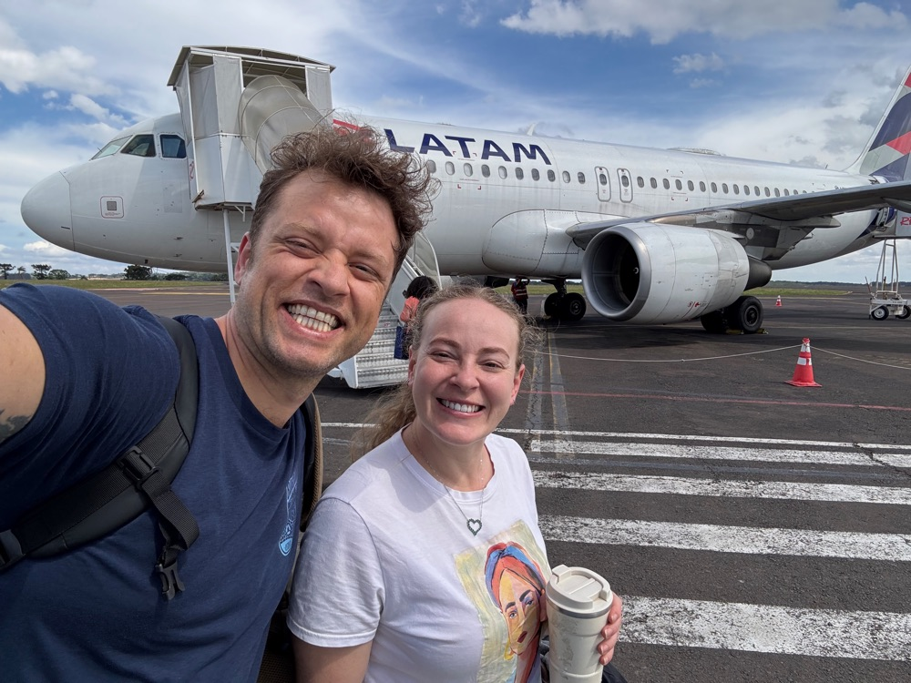](/images/amazon-2026/full/boarding-latam-flight-to-manaus-full.jpg)
*October 3: Boarding our flight with Vanessa to begin a full month in the Amazon.*

---

## Week 1: Ponta Negra and the Infinite Ashes in the Air

We spent our first week based in **Ponta Negra**, on the banks of the Rio Negro in Manaus. Stepping out onto the promenade at night, the warmth of the river breeze was immediately mixed with something unsettling: the smell of burning forest and a fine, endless veil of ash suspended in the air.

[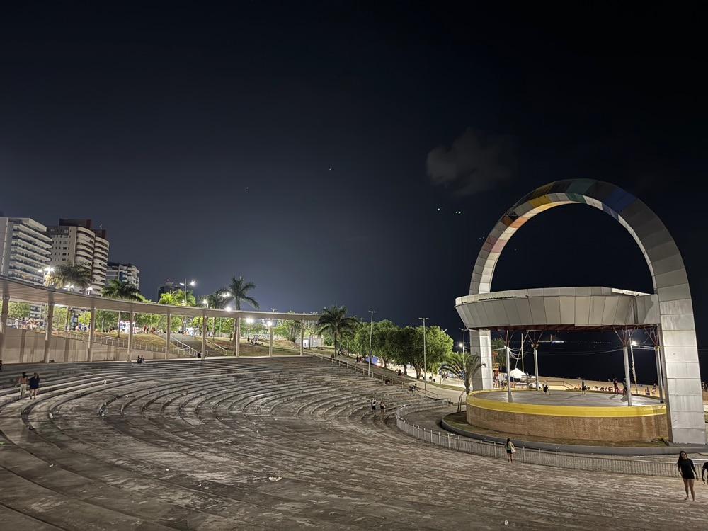](/images/amazon-2026/full/ponta-negra-amphitheater-night-full.jpg)
*First night at the Ponta Negra amphitheater on the edge of the Rio Negro.*

[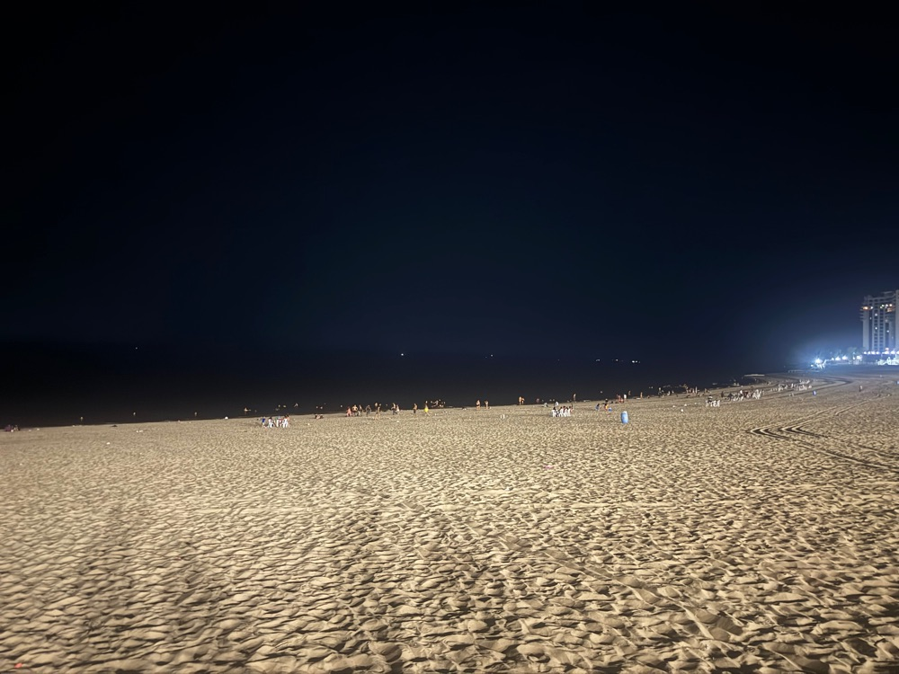](/images/amazon-2026/full/ponta-negra-river-beach-night-full.jpg)
*The wide sandy stretch of Ponta Negra beach at night, exposed by the low river levels.*

During the day, the scale of the smoke became undeniable. Crossing the monumental **Ponte Rio Negro**, the horizon simply dissolved into a thick, gray-amber haze. It felt almost post-apocalyptic—as if an infinite curtain of ashes had been drawn across the largest tropical rainforest on Earth.

  

    <a href="/images/amazon-2026/full/crossing-ponte-rio-negro-smoke-haze-full.jpg">
      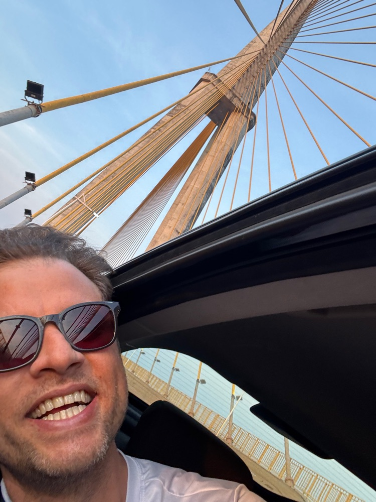
    </a>
    
<em>Crossing the Ponte Rio Negro under the heavy October haze.</em>

  

  

    <a href="/images/amazon-2026/full/rio-negro-bridge-view-drought-smoke-full.jpg">
      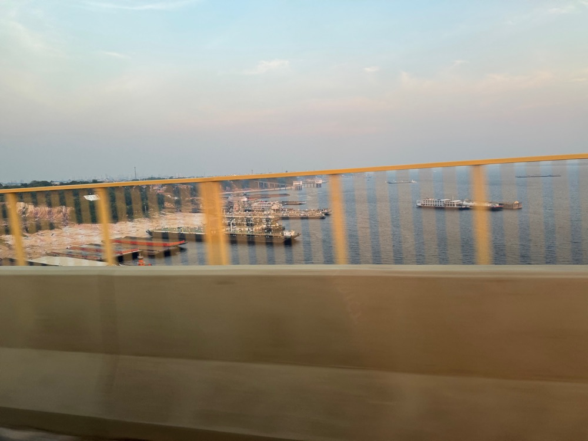
    </a>
    
<em>Looking out from the bridge: exposed riverbanks below and a wall of smoke erasing the horizon.</em>

  

Between days on the river, we took shelter inside the historic **Teatro Amazonas**, where the 19th-century gilded mirrors and painted ceilings offered a quiet refuge from the smoky air outside.

  

    <a href="/images/amazon-2026/full/teatro-amazonas-interior-stage-full.jpg">
      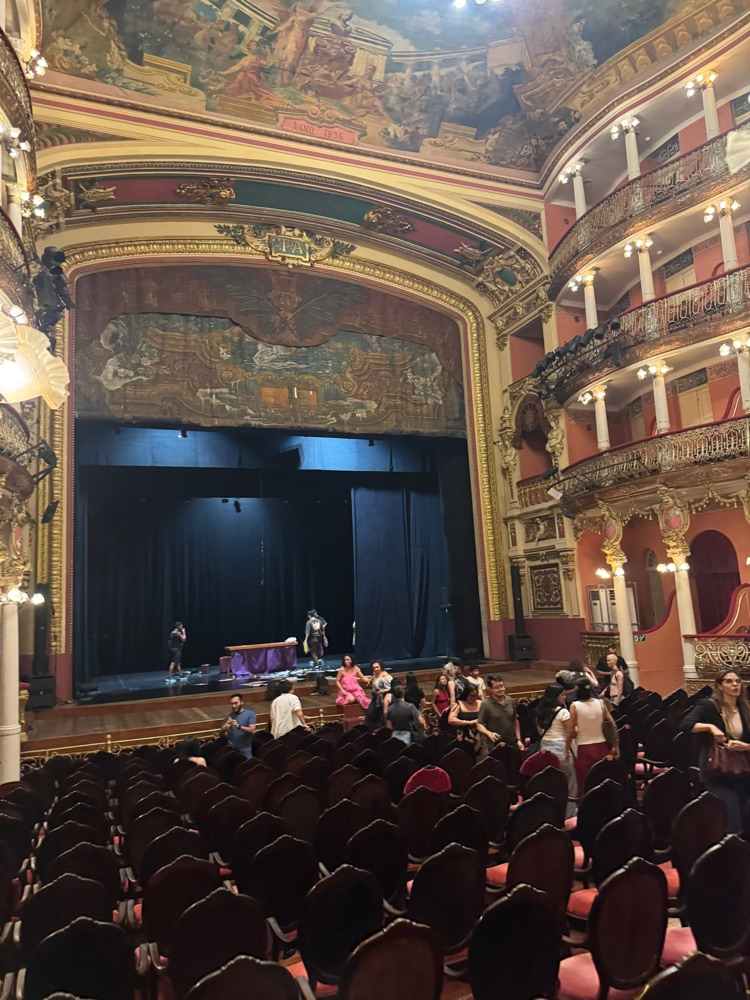
    </a>
    
<em>Inside the main hall of Teatro Amazonas (built in 1896).</em>

  

  

    <a href="/images/amazon-2026/full/teatro-amazonas-golden-mirror-selfie-full.jpg">
      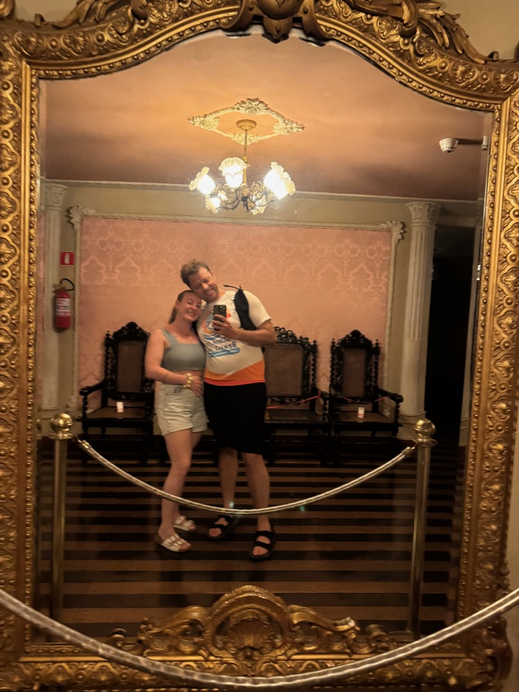
    </a>
    
<em>Reflected in the ornate golden mirrors of the opera house salon.</em>

  

Out on the water, we saw firsthand how the drought and the smoke intertwined. Floating houses (*flutuantes*) that normally bob over deep black water were sitting high and dry on massive tree-trunk pontoons over cracked mud.

[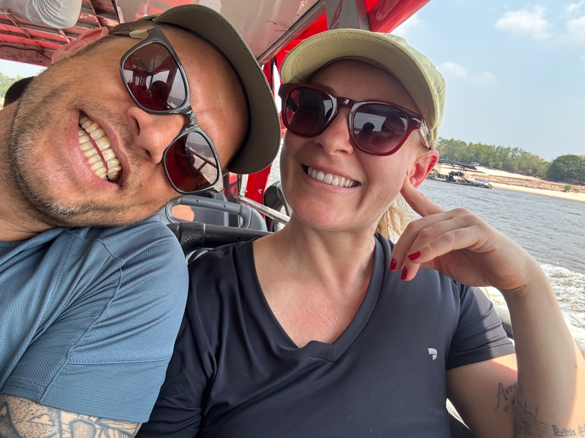](/images/amazon-2026/full/rio-negro-boat-ride-under-smoky-sky-full.jpg)
*Heading out by boat from Ponta Negra across the Rio Negro.*

  

    <a href="/images/amazon-2026/full/floating-houses-on-hazy-rio-negro-full.jpg">
      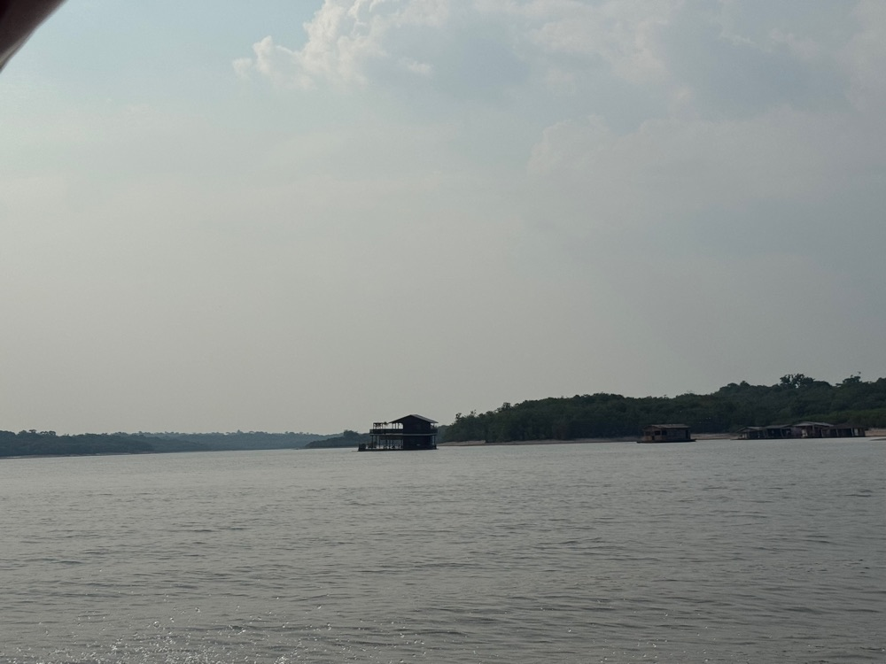
    </a>
    
<em>Floating houses silhouetted against the ash-filled sky.</em>

  

  

    <a href="/images/amazon-2026/full/stranded-floating-house-giant-log-drought-full.jpg">
      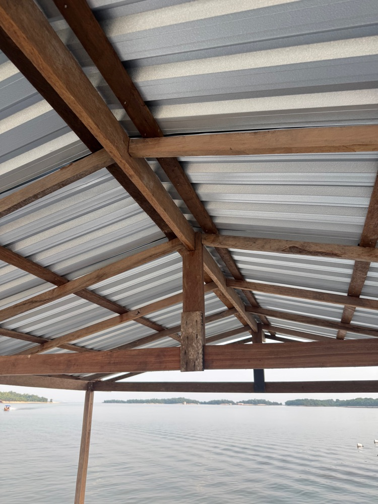
    </a>
    
<em>A floating structure resting on its massive hardwood log pontoon above the receded riverbank.</em>

  

Yet even the smoke produced a haunting, surreal beauty. Every late afternoon, the ash particles scattered the sunlight into a deep, molten copper glow over the water, while the exposed riverbeds revealed intricate seeds carved like tiny labyrinths.

  

    <a href="/images/amazon-2026/full/vanessa-sunset-glow-through-amazon-smoke-full.jpg">
      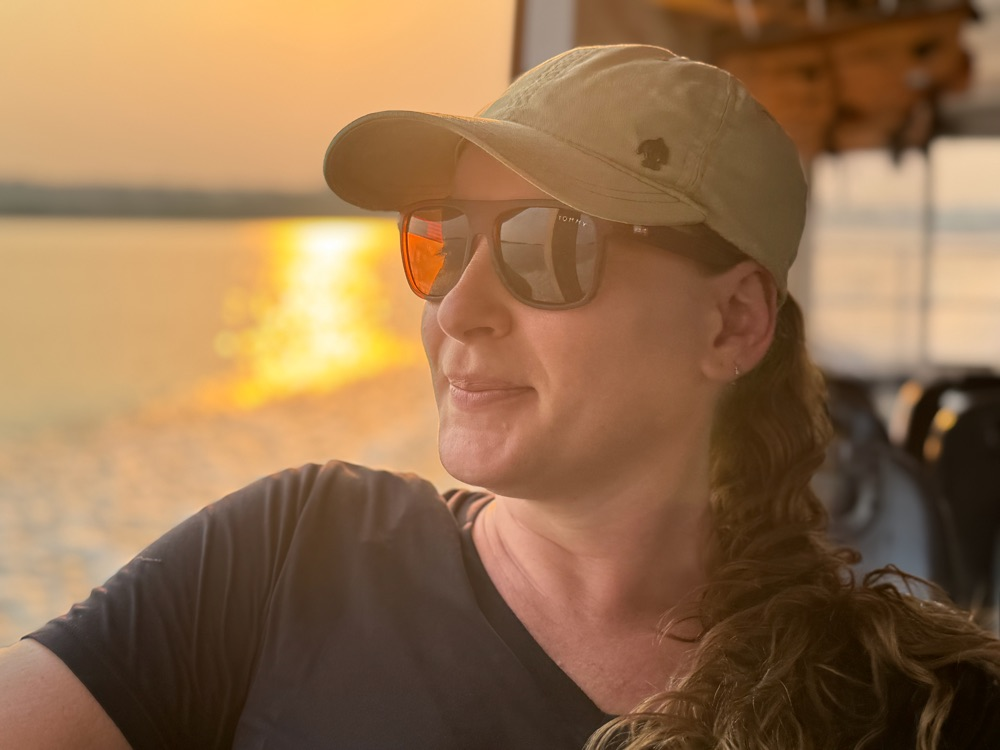
    </a>
    
<em>The late-afternoon sun filtered through the smoke into a deep amber glow.</em>

  

  

    <a href="/images/amazon-2026/full/sculpted-amazon-riverbed-seed-in-hand-full.jpg">
      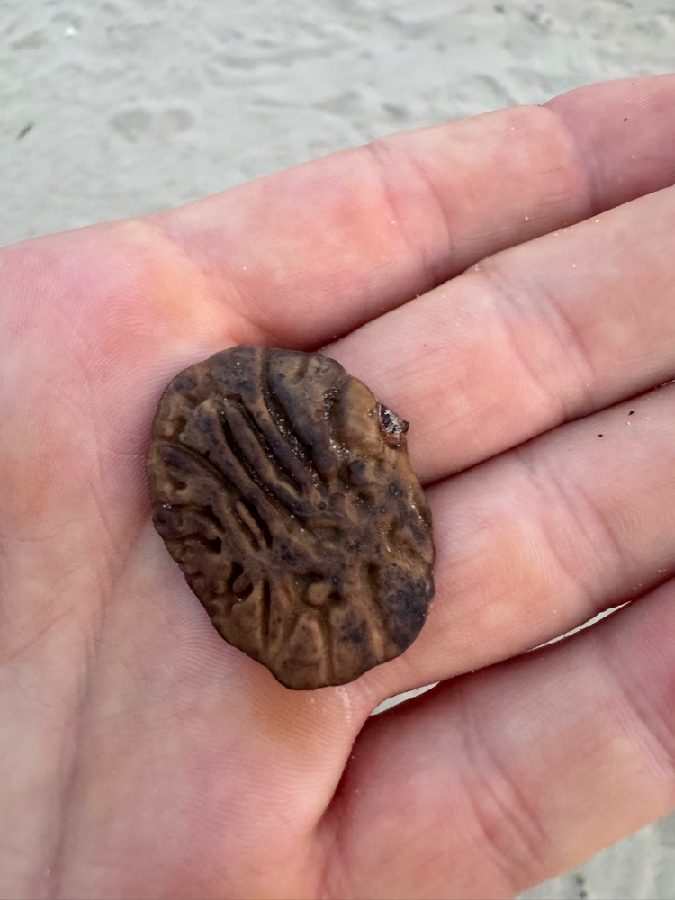
    </a>
    
<em>A brain-like, labyrinthine seed found along the exposed sandy shore—a preview of the labyrinths to come.</em>

  

---

## Week 2: Presidente Figueiredo and the Amazing Caverns

For our second week, we drove north on the BR-174 to **Presidente Figueiredo**—the "Land of Waterfalls" (*Terra das Cachoeiras*). Leaving the smoky river basin behind and stepping onto the rainforest trails felt like entering another planet, one carved out of Paleozoic sandstone, emerald moss, and subterranean rivers.

[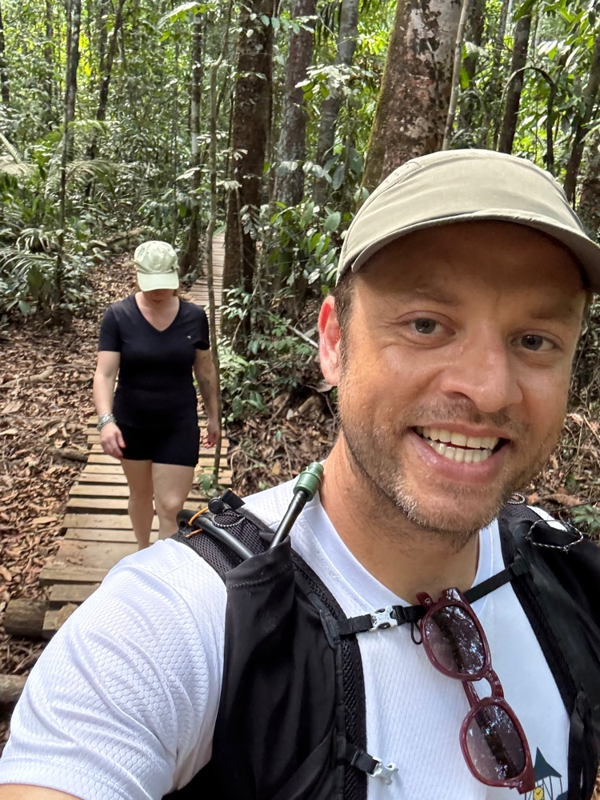](/images/amazon-2026/full/hiking-boardwalk-presidente-figueiredo-forest-full.jpg)
*Hitting the jungle trails of Presidente Figueiredo.*

### The Sandstone Caverns: Refúgio do Maroaga & Judeia

The caverns of Presidente Figueiredo—**Caverna Refúgio do Maroaga** and the **Gruta da Judeia**—are unlike typical limestone caves. Carved by acidic blackwater streams through ancient sandstone, their towering portals are draped with 20-meter aerial roots hanging straight down from the rainforest canopy above, while clear, cool streams flow across white-sand floors inside the rock.

[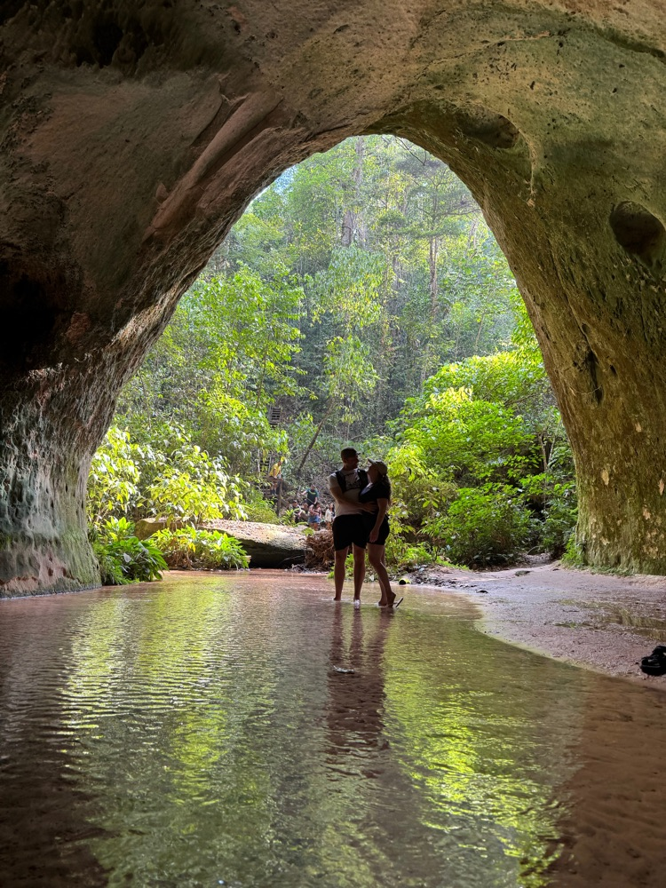](/images/amazon-2026/full/sandstone-cavern-archway-silhouette-reflection-full.jpg)
*Standing in the underground stream at the archway of Gruta da Judeia, where the jungle light reflects off the water onto the cavern vault.*

  

    <a href="/images/amazon-2026/full/refugio-do-maroaga-cavern-roots-and-tunnels-full.jpg">
      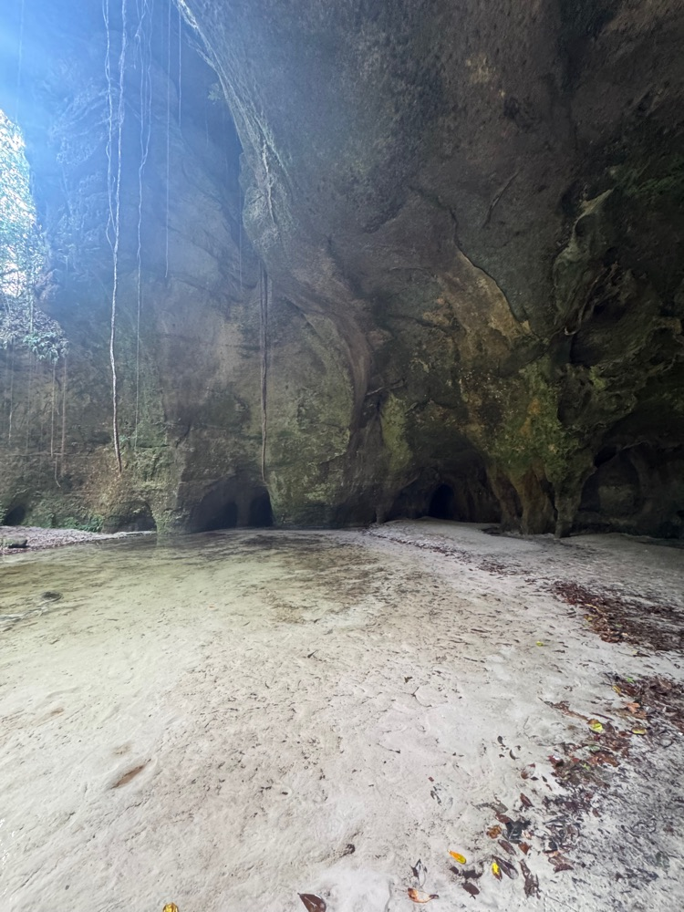
    </a>
    
<em>The monumental entrance of Refúgio do Maroaga, with dark tunnels leading deep into the sandstone.</em>

  

  

    <a href="/images/amazon-2026/full/curupira-cavern-hanging-aerial-roots-full.jpg">
      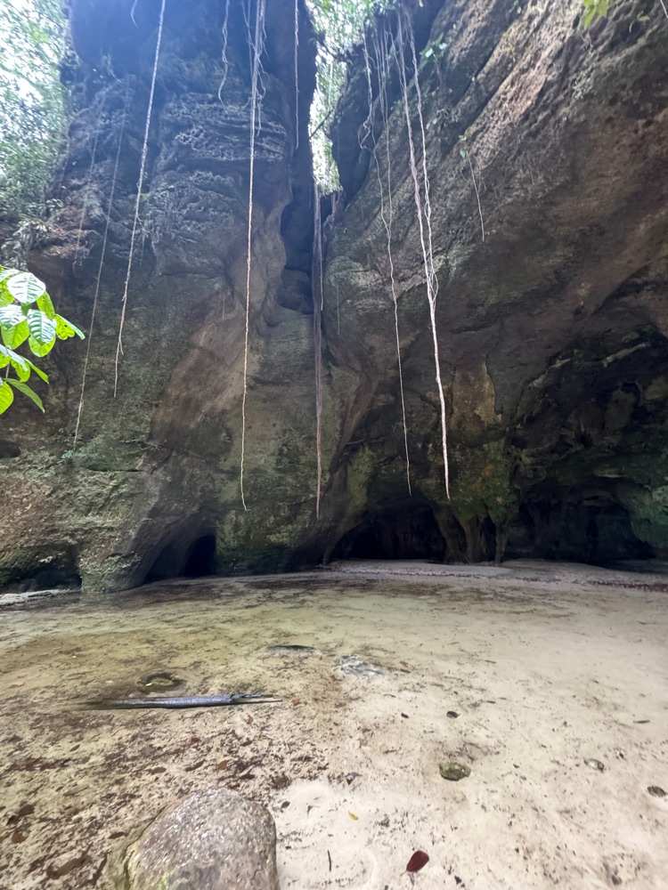
    </a>
    
<em>Aerial roots dropping from the forest roof into the sandy cavern floor.</em>

  

  

    <a href="/images/amazon-2026/full/vanessa-wading-crystal-stream-cavern-canyon-full.jpg">
      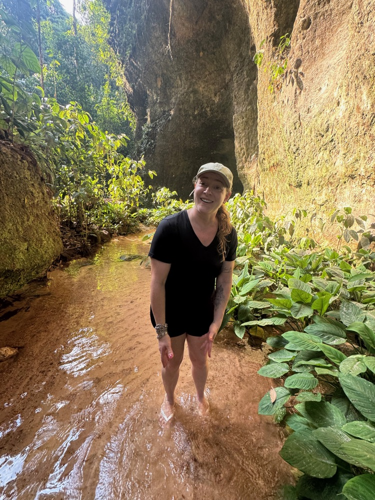
    </a>
    
<em>Wading barefoot through the cool, iron-tinted canyon stream between the caves.</em>

  

  

    <a href="/images/amazon-2026/full/emerald-moss-sandstone-cavern-wall-full.jpg">
      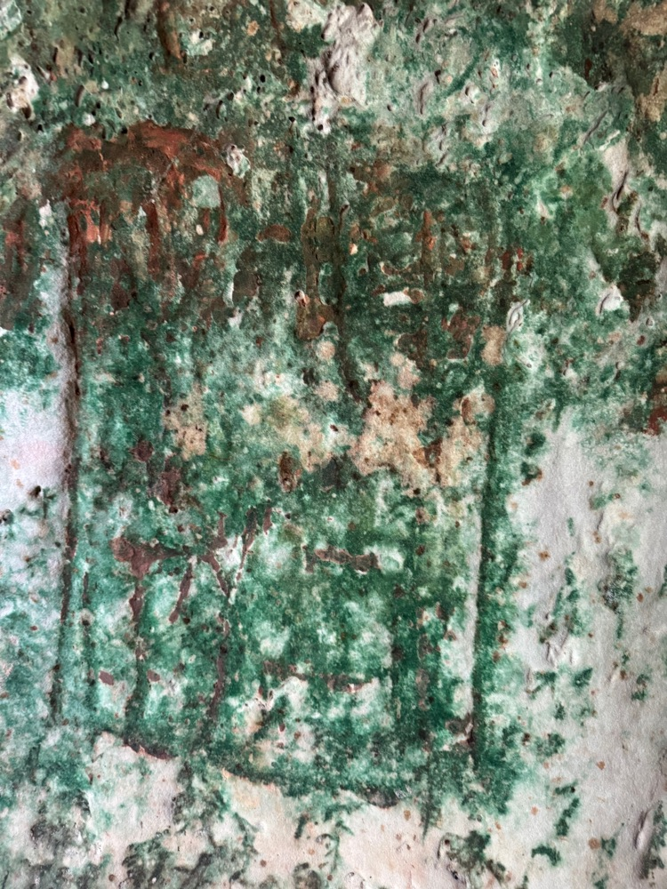
    </a>
    
<em>Close-up of the cavern wall: emerald-green moss and oxidized mineral textures on ancient sandstone.</em>

  

### Waterfalls, Natural Marmitas & Liquid Gold

Every day in Presidente Figueiredo brought a new waterfall, a new canyon, or a spring-fed lagoon. Because the streams are rich in organic tannins from fallen leaves—yet completely free of mud or sediment—the water looks like dark tea in the deep pools (*marmitas*) and glows like **liquid gold** over shallow rock ledges.

[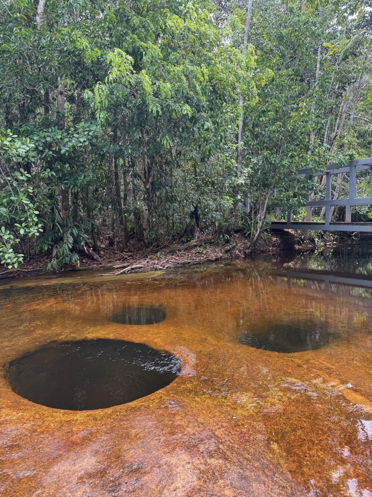](/images/amazon-2026/full/natural-marmitas-potholes-amber-riverbed-full.jpg)
*Natural circular pools (*marmitas*) carved into the golden bedrock by centuries of swirling water and pebbles.*

  

    <a href="/images/amazon-2026/full/pink-sandstone-ledges-blackwater-waterfall-full.jpg">
      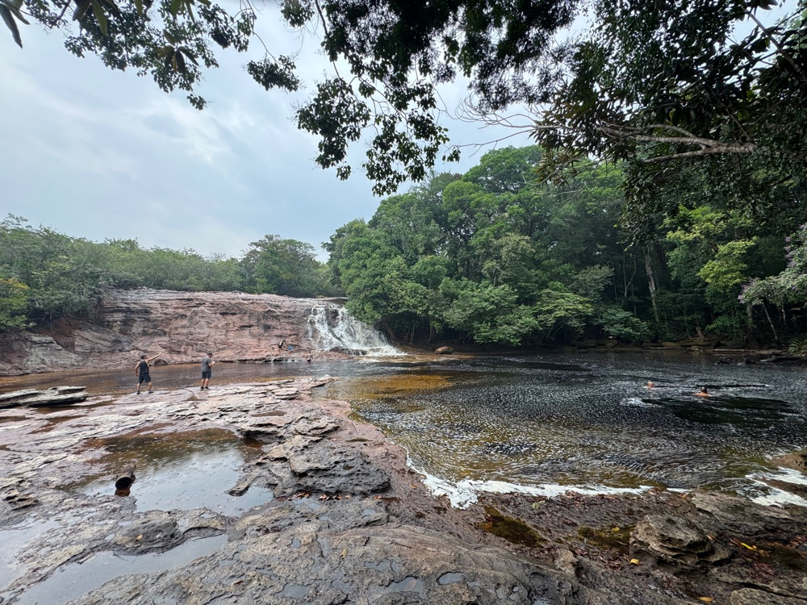
    </a>
    
<em>Layered pink sandstone ledges meeting a dark, mirror-like waterfall pool.</em>

  

  

    <a href="/images/amazon-2026/full/balbina-bridge-over-uatuma-river-full.jpg">
      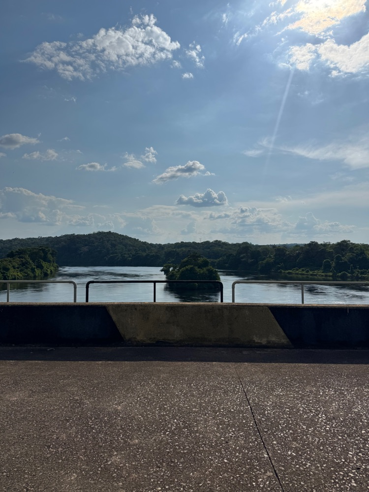
    </a>
    
<em>Looking out over the Uatumã River along the road toward Balbina.</em>

  

[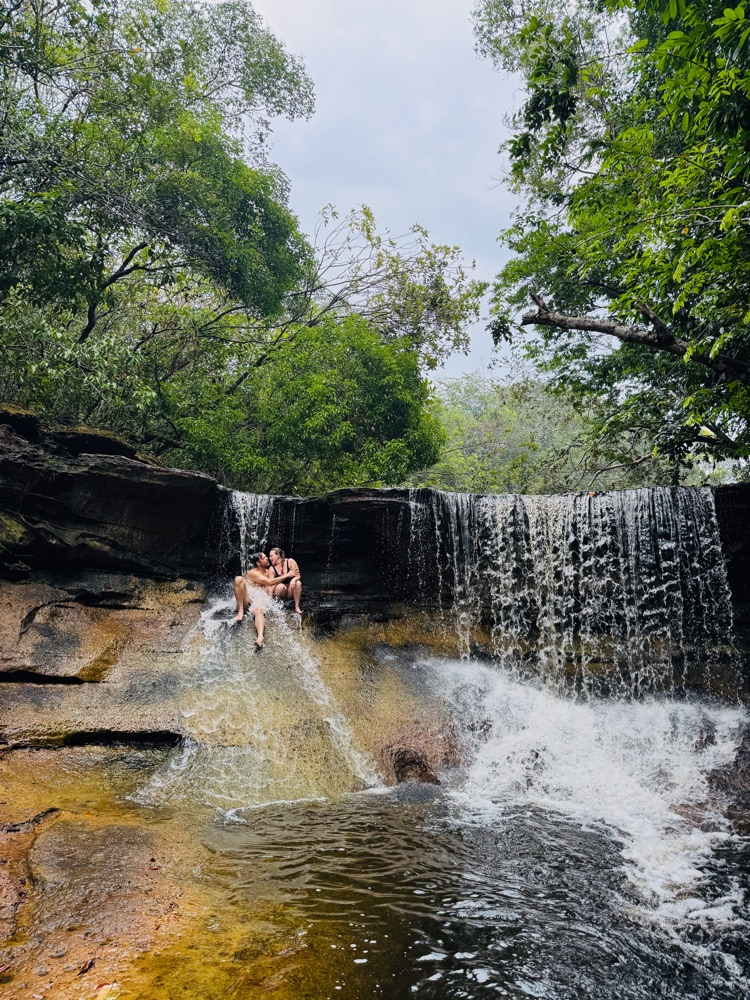](/images/amazon-2026/full/couple-sitting-inside-waterfall-curtain-full.jpg)
*Sitting right on the sandstone ledge behind the cascading curtain of water.*

  

    <a href="/images/amazon-2026/full/warrior-yoga-pose-inside-amazon-waterfall-full.jpg">
      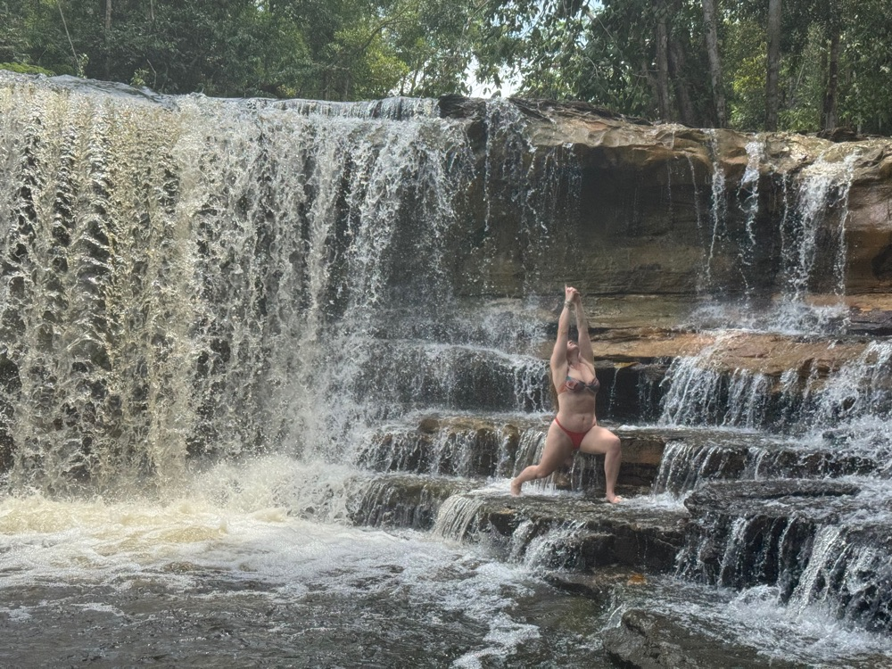
    </a>
    
<em>Virabhadrasana I (Warrior I) right inside the waterfall cascades.</em>

  

  

    <a href="/images/amazon-2026/full/selfie-at-presidente-figueiredo-waterfall-full.jpg">
      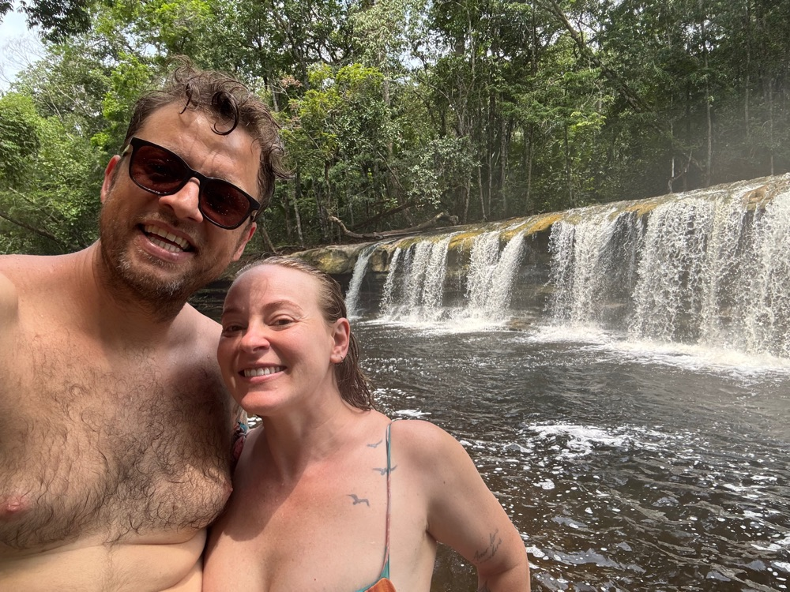
    </a>
    
<em>Soaking in the cool, tannin-rich waters after a humid jungle hike.</em>

  

On the forest floor, you had to watch every step—not just for the intricate web of tree roots, but for the tiny masters of camouflage hiding in plain sight.

  

    <a href="/images/amazon-2026/full/hiking-over-rainforest-tree-roots-full.jpg">
      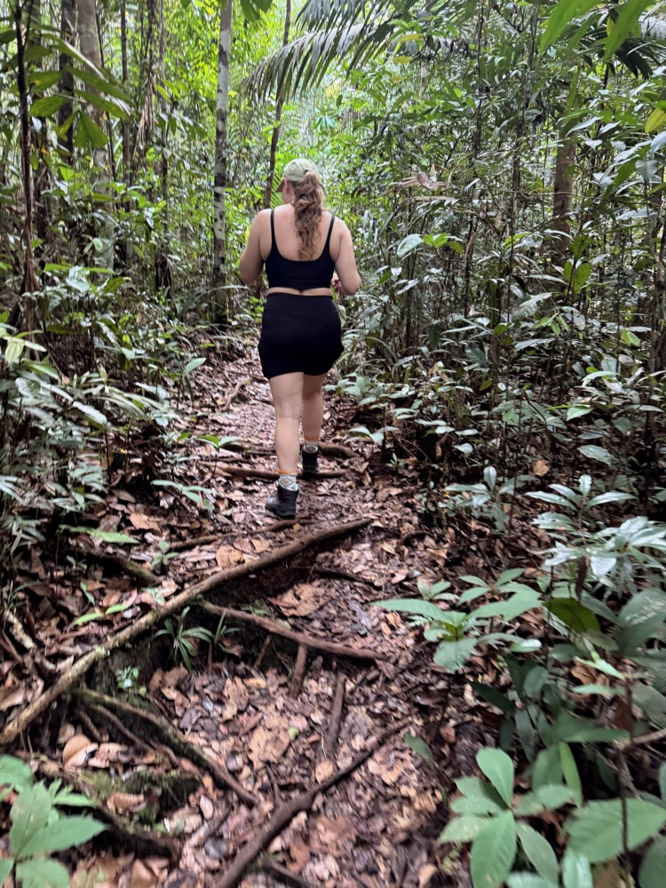
    </a>
    
<em>A natural staircase of roots through the dense forest.</em>

  

  

    <a href="/images/amazon-2026/full/sandals-on-wet-red-rainforest-leaves-full.jpg">
      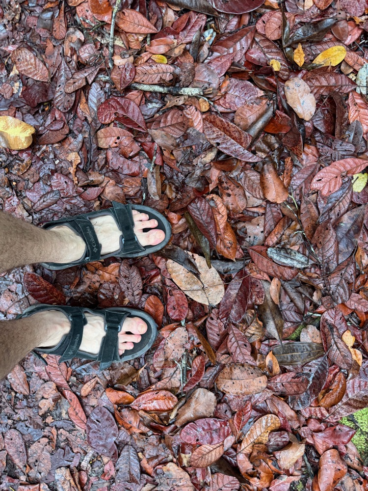
    </a>
    
<em>The carpet of crimson and copper leaves that gives the rivers their tea color.</em>

  

  

    <a href="/images/amazon-2026/full/tiny-green-frog-camouflaged-in-dead-leaves-full.jpg">
      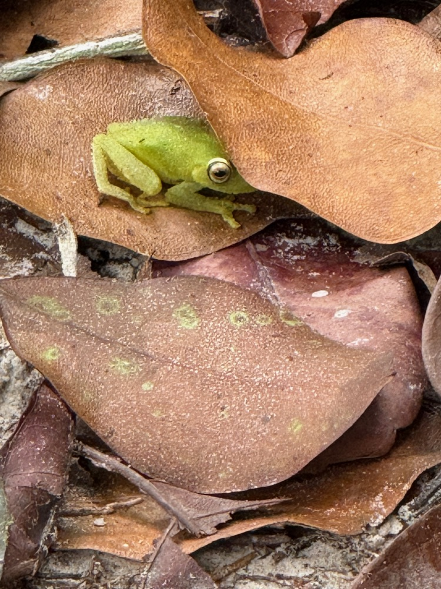
    </a>
    
<em>A tiny lime-green frog peeking out from under a dry leaf.</em>

  

### Trail to Cachoeira da Neblina: Arboreal Ants & Hunter's Scent Camouflage

On the trail to **Cachoeira da Neblina** in Presidente Figueiredo, we came across large, teardrop-shaped nests attached high up on the tree trunks. Because the forest streams and lowland basins flood during the rainy season, these ants have evolved to build their colonies high up in the trees to stay above the rising water.

[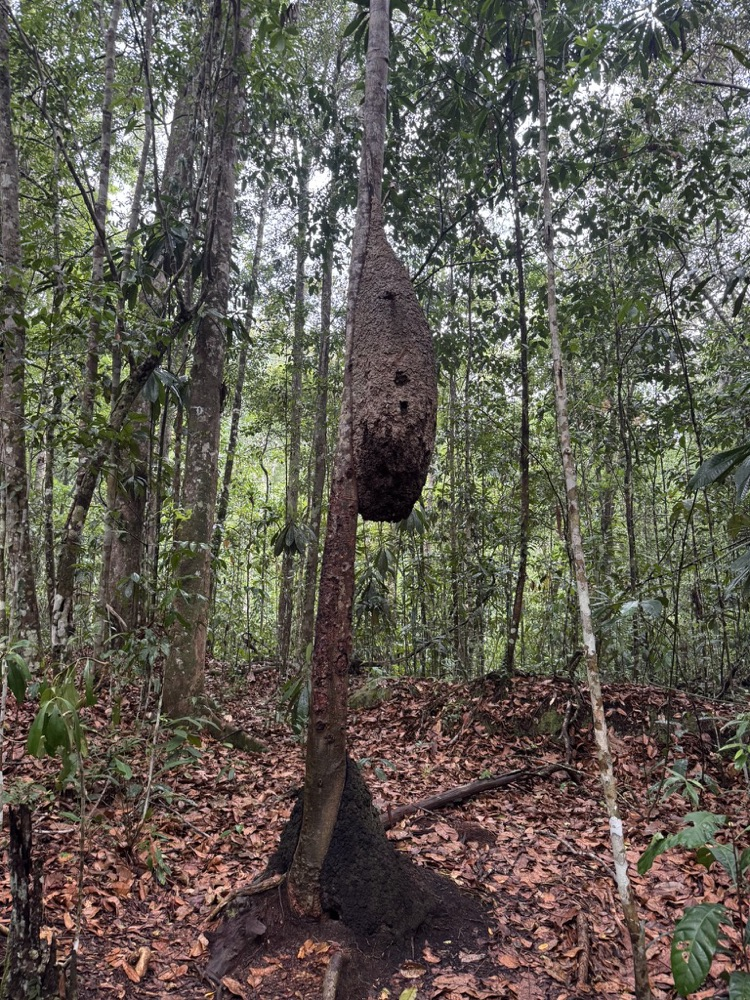](/images/amazon-2026/full/arboreal-ant-nest-flood-line-smell-camouflage-full.jpg)
*On the way to Cachoeira da Neblina: an arboreal ant nest built high up on the trunk to escape the floods—and used by traditional hunters as scent camouflage.*

Along the trail, we learned a remarkable piece of traditional forest wisdom: indigenous and primitive hunters scratch the surface of the nest and rub the crushed ants and nest material directly onto their skin before hunting. The ants (*tapiba* / arboreal ants) release a strong, woodsy, citrus-like pheromone that masks human scent and sweat—giving the hunter an olfactory camouflage that blends right into the smell of the rainforest.

And then, in the middle of a region famous for dark tea-colored rivers, we reached **Lagoa Azul**—an underground water table spring that bubbles up over pure white silica sand, turning the lagoon an impossible Caribbean turquoise right in the middle of the jungle.

[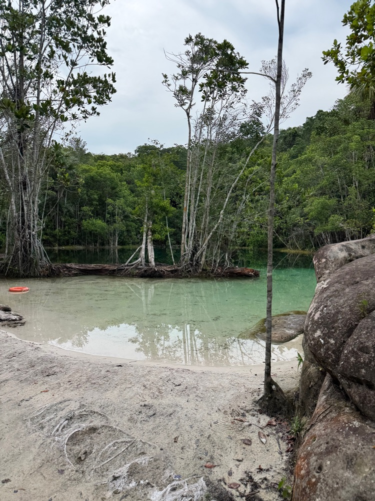](/images/amazon-2026/full/lagoa-azul-turquoise-spring-white-sand-full.jpg)
*The surreal emerald-turquoise water of a spring-fed lagoon in Presidente Figueiredo.*

  

    <a href="/images/amazon-2026/full/swimming-in-emerald-waters-of-presidente-figueiredo-full.jpg">
      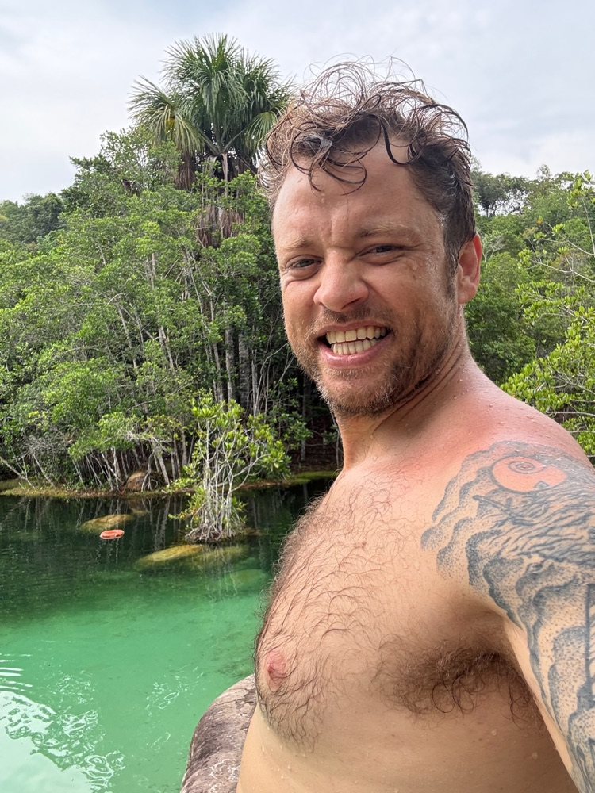
    </a>
    
<em>Refreshing dip in the crystal-clear spring water.</em>

  

  

    <a href="/images/amazon-2026/full/vanessa-floating-in-crystal-clear-lagoon-full.jpg">
      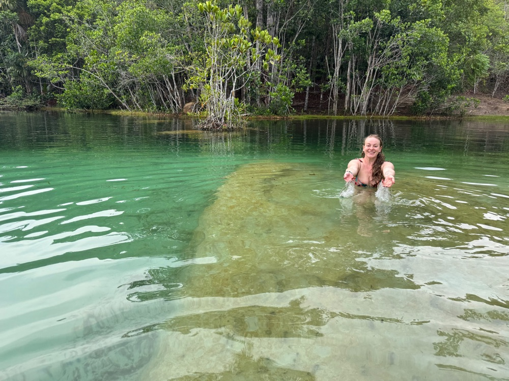
    </a>
    
<em>Zero sediment, pure spring water, and complete silence in the forest.</em>

  

  

    <a href="/images/amazon-2026/full/liquid-gold-ripples-amber-stream-bed-full.jpg">
      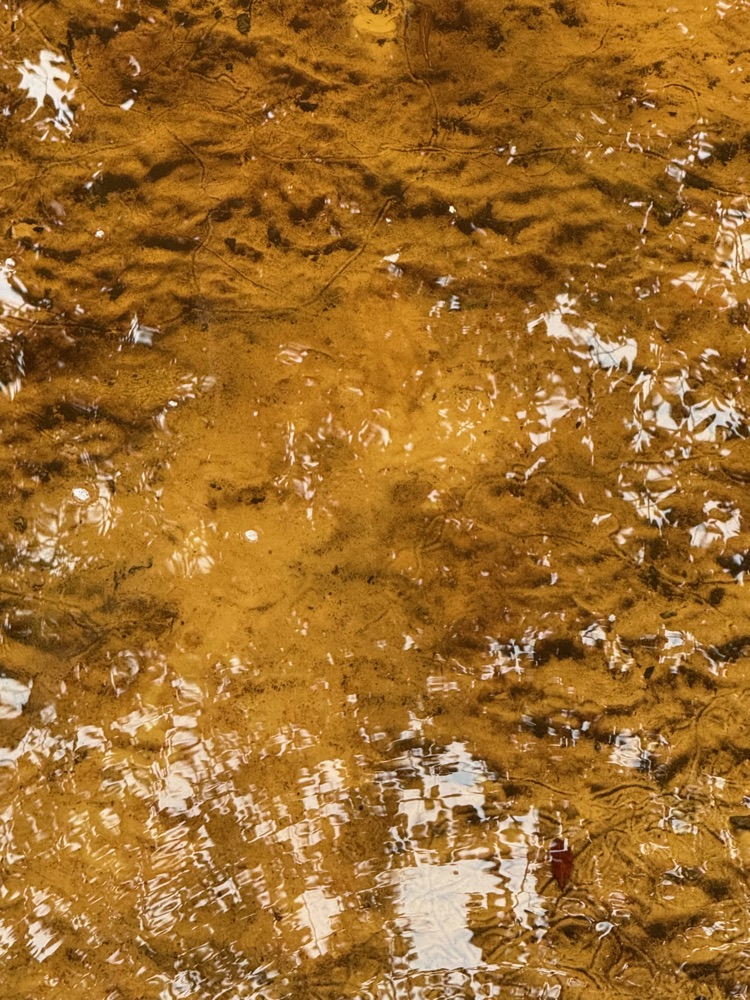
    </a>
    
<em>Sunlight and ripples turning a shallow stream into liquid gold.</em>

  

  

    <a href="/images/amazon-2026/full/ancient-rock-canyon-channel-through-jungle-full.jpg">
      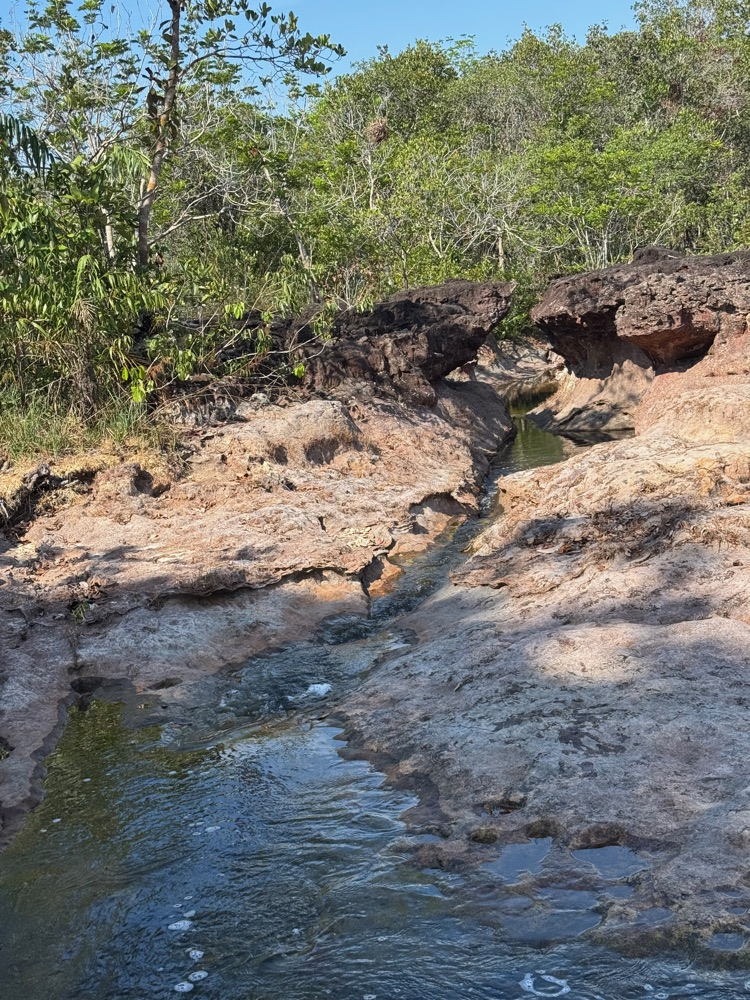
    </a>
    
<em>A narrow canyon channel carved straight through the rock.</em>

  

  

    <a href="/images/amazon-2026/full/relaxing-on-golden-rock-rapids-waterfall-full.jpg">
      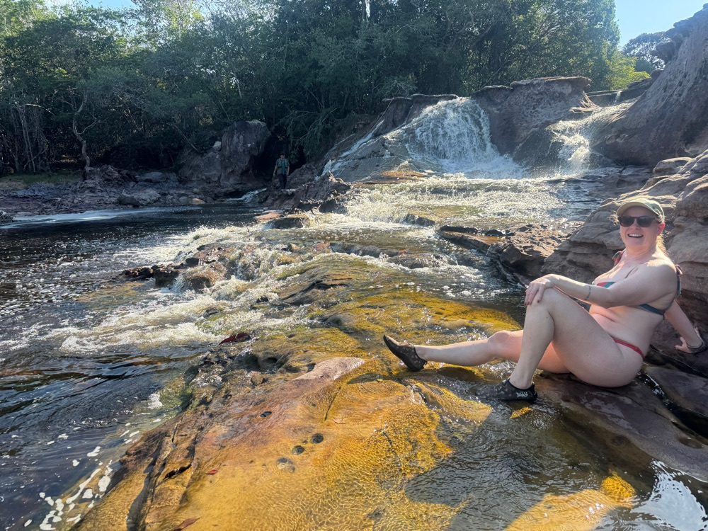
    </a>
    
<em>Closing out our week in Presidente Figueiredo on the golden rapids.</em>

  

---

## Weekend in Novo Airão & the Ilhas Anavilhanas Labyrinths

On the weekend of October 17–18, we headed west across the Rio Negro to **Novo Airão**, the gateway to **Parque Nacional de Anavilhanas**—one of the largest freshwater archipelagos on Earth, made up of more than 400 islands, hundreds of channels (*paranás* and *furos*), and flooded forests (*igapós*).

Novo Airão welcomed us with two classic Amazonian moments: a colossal grasshopper the size of a hand resting in a mango tree, and a nighttime swim in the warm black waters of the Rio Negro.

  

    <a href="/images/amazon-2026/full/giant-amazon-grasshopper-in-novo-airao-full.jpg">
      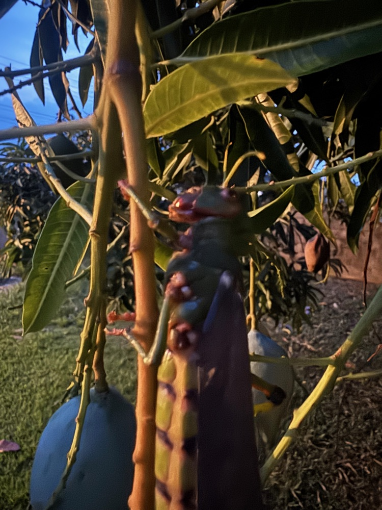
    </a>
    
<em>Everything in the Amazon scales up: a giant grasshopper in Novo Airão at dusk.</em>

  

  

    <a href="/images/amazon-2026/full/night-swim-glowing-eyes-in-rio-negro-novo-airao-full.jpg">
      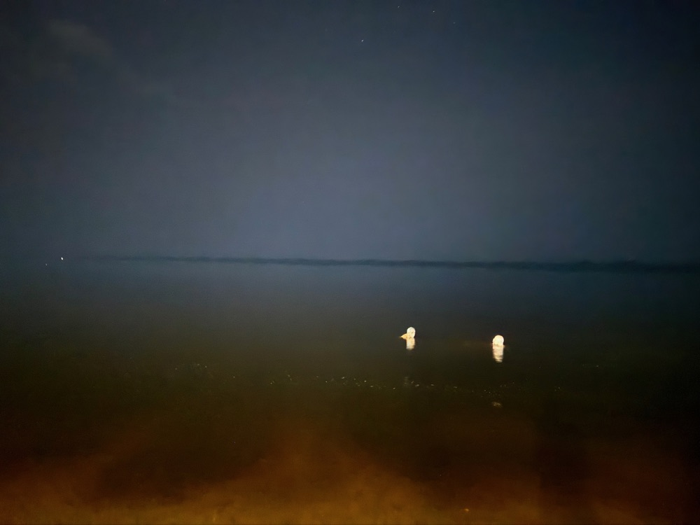
    </a>
    
<em>Floating in the warm, pitch-black Rio Negro at night under the stars.</em>

  

After a sudden tropical downpour washed the air clean, we boarded a small aluminum boat (*voadeira*) and set off into the **Ilhas Anavilhanas** labyrinths.

  

    <a href="/images/amazon-2026/full/boat-departure-from-novo-airao-to-anavilhanas-full.jpg">
      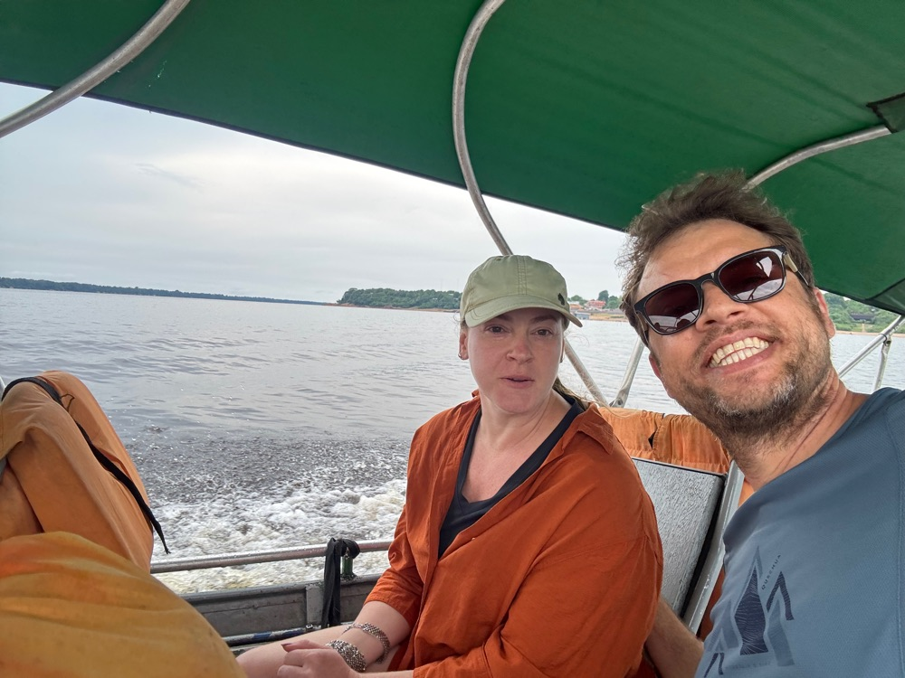
    </a>
    
<em>Leaving Novo Airão behind as we enter the archipelago.</em>

  

  

    <a href="/images/amazon-2026/full/entering-anavilhanas-archipelago-water-labyrinth-full.jpg">
      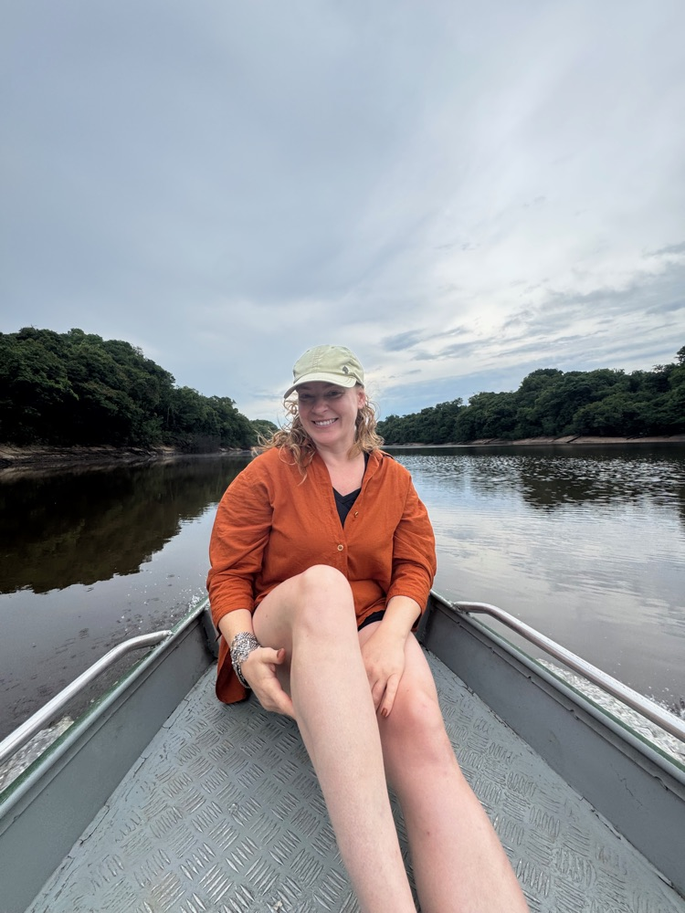
    </a>
    
<em>Gliding into the silent blackwater channels of Ilhas Anavilhanas.</em>

  

Inside the archipelago, the wind disappears and the dark water of the Rio Negro becomes a flawless black mirror. Every channel looks identical to the untrained eye—a true natural labyrinth where islands curves into hidden lagoons, and sky and forest merge on the surface of the water.

[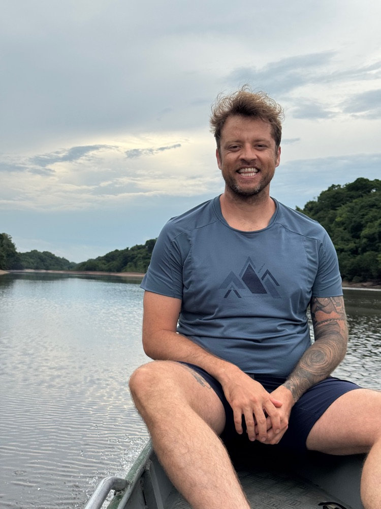](/images/amazon-2026/full/navigating-silent-water-labyrinths-of-anavilhanas-full.jpg)
*Deep inside the Anavilhanas labyrinth, where the acidic blackwater reflects the sky like obsidian glass.*

### Meeting the Queen of the Forest: The Giant Samaúma

Deep in the forest of Anavilhanas, we stepped off the boat and hiked inland to meet the undisputed giant of the Amazon: an ancient **Samaúma** (*Ceiba pentandra*). Standing between its tabular buttress roots (*sapopemas*)—which rise like cathedral walls from the forest floor—you feel like an ant at the foot of a living monument that has been pumping water from the soil into the sky for centuries.

[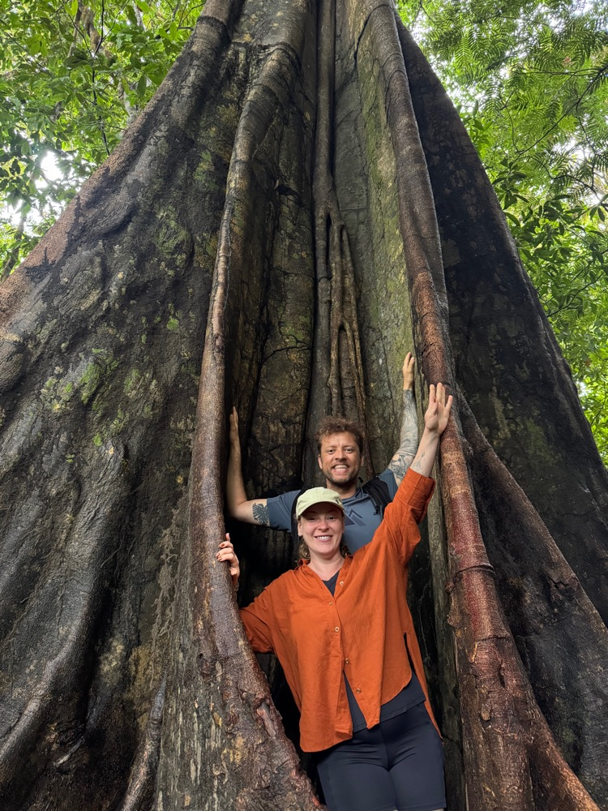](/images/amazon-2026/full/standing-inside-samauma-buttress-roots-full.jpg)
*Standing inside a single fold of the Samaúma's massive buttress roots.*

  

    <a href="/images/amazon-2026/full/giant-samauma-tree-panorama-anavilhanas-full.jpg">
      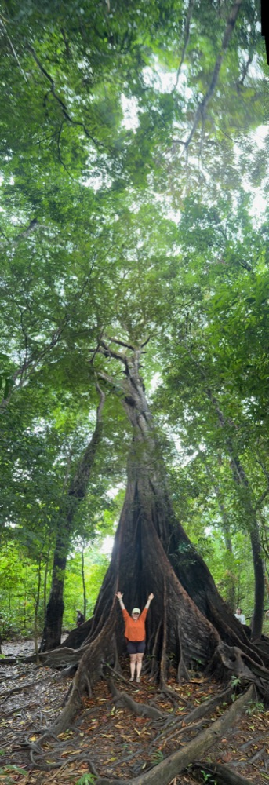
    </a>
    
<em>Full vertical panorama from the root flare to the crown towering above the canopy.</em>

  

  

    <a href="/images/amazon-2026/full/scale-of-ancient-samauma-tree-in-the-jungle-full.jpg">
      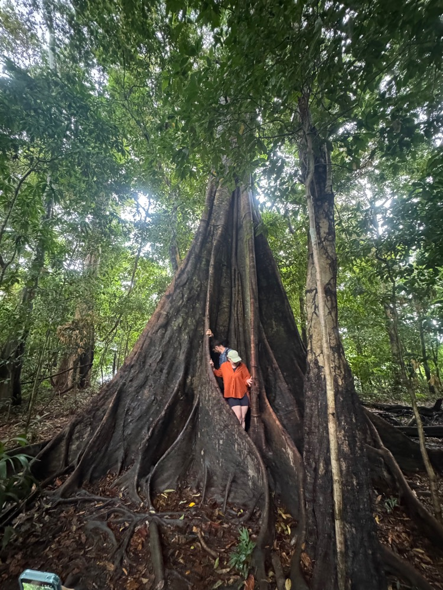
    </a>
    
<em>Stepping back to take in the true scale of the trunk.</em>

  

  

    <a href="/images/amazon-2026/full/bright-orange-fungi-growing-on-fallen-log-full.jpg">
      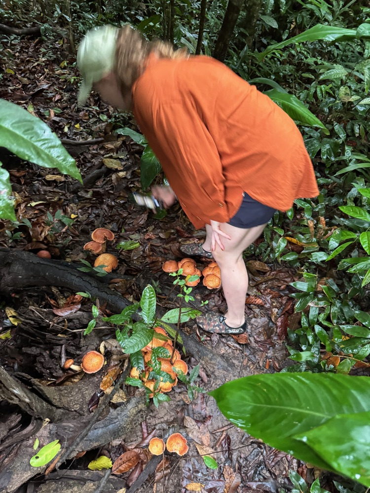
    </a>
    
<em>At the feet of the giants, bright orange fungi recycling fallen wood on the forest floor.</em>

  

---

## Final Weeks: Above the Canopy & the Return of the Rains

Back in Manaus for the second half of our month, the rhythm of our days settled into forest walks, concerts at the Teatro Amazonas, and watching the season begin to turn.

We climbed the 42-meter observation tower at **MUSA (Museu da Amazônia)** in the Adolpho Ducke Forest Reserve to see the rainforest from above—where you realize the canopy is an entire undulating ocean of green stretching to the horizon.

[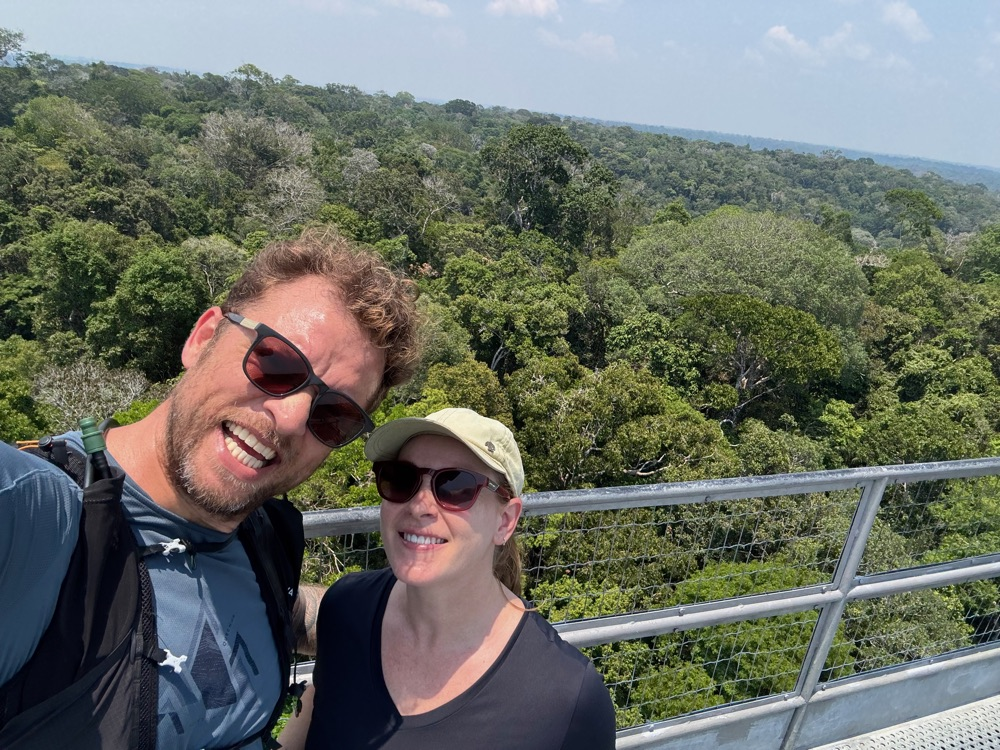](/images/amazon-2026/full/above-the-rainforest-canopy-observation-tower-musa-full.jpg)
*42 meters up: looking out across the unbroken sea of the Amazon canopy.*

### Serendipity in the Forest: Running into Tim Bernardes at MUSA

Right there at MUSA, we had one of the luckiest moments of the entire trip. Both Vanessa and I are huge fans of **Tim Bernardes**, and we had been bummed out after missing his concert in town—only to unexpectedly run right into him exploring the forest reserve at MUSA! Sometimes the jungle gives back what you missed in the best possible way.

[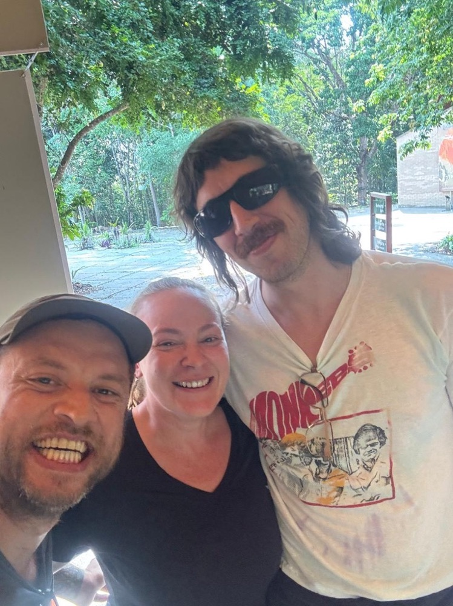](/images/amazon-2026/full/meeting-tim-bernardes-at-musa-manaus-full.jpg)
*Pure serendipity at MUSA: running into Tim Bernardes in the middle of the Amazon forest reserve after missing his concert!*

### Dry Lab Meets Wet Lab: Presenting `amazonzyme_poc` at AmazonZyme Labs

Another huge milestone of this month in Manaus was visiting **AmazonZyme Labs** alongside my brother **Rufo Paganini** to meet the founders and present [**amazonzyme_poc**](https://github.com/jonatas/amazonzyme_poc) to them—and we even wrote a deep-dive blog post together on [engineering fungal enzyme cocktails and Terra Preta with `pg_bio`](/amazonzyme-fungal-cocktails-terra-preta-pg-bio).

[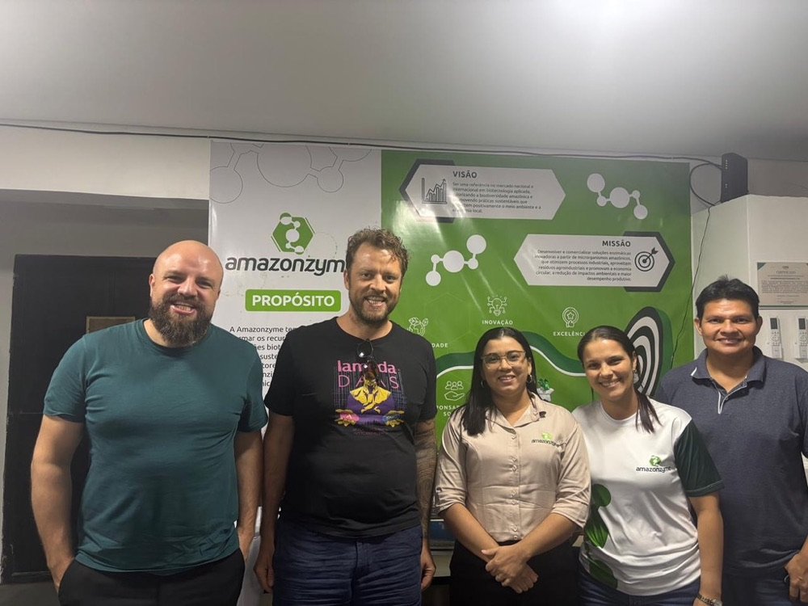](/images/amazon-2026/full/amazonzyme-lab-visit-with-rufo-paganini-and-founders-full.jpg)
*With my brother Rufo Paganini and the founders and researchers at AmazonZyme Labs in Manaus.*

I'm so happy to validate my hobby bioinformatics tooling directly with PhDs working on the front lines of Amazonian biotechnology—and to start moving forward from curiosity-driven experiments to building real science in my own dry lab.

  

    <a href="/images/amazon-2026/full/wooden-log-slice-mosaic-pathway-in-forest-full.jpg">
      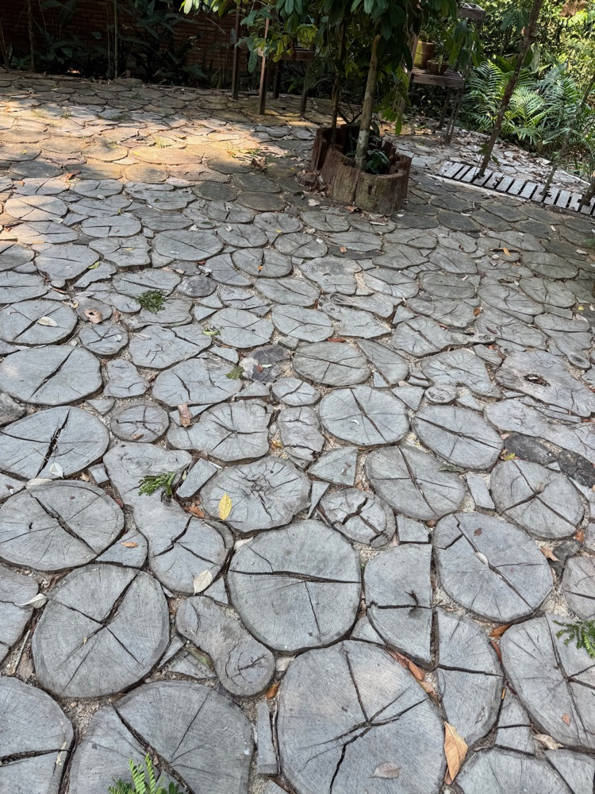
    </a>
    
<em>A mosaic pathway of cross-cut tree trunks winding through the reserve.</em>

  

  

    <a href="/images/amazon-2026/full/castanha-do-brasil-pod-with-agouti-gnawed-hole-full.jpg">
      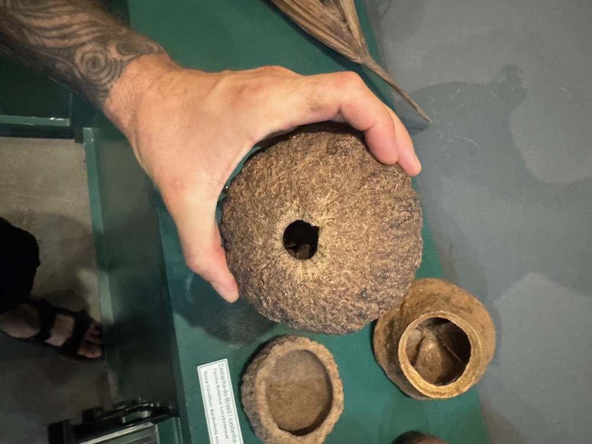
    </a>
    
<em>A woody Castanha-do-Brasil pod gnawed open by a cutia (agouti)—the only forest animal strong enough to crack it and disperse its seeds.</em>

  

  

    <a href="/images/amazon-2026/full/handful-of-amazonian-seeds-and-monkey-pot-full.jpg">
      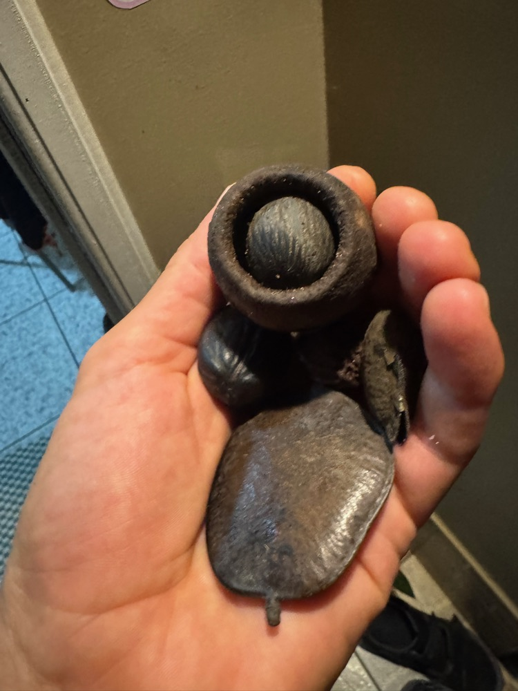
    </a>
    
<em>Botanical engineering in the palm of a hand: woody seed capsules from the forest trail.</em>

  

By our final days at the end of October, the skies finally opened up with heavy, cleansing Amazonian rainstorms—washing away the last traces of the early-October ashes and drumming loud against the thatched roofs of the floating decks on the Rio Negro.

[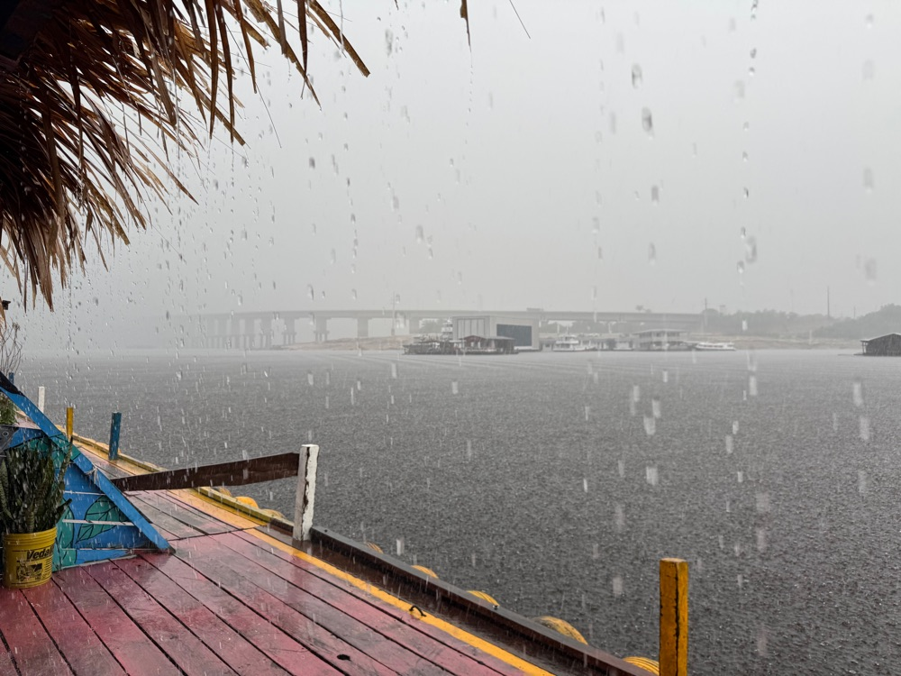](/images/amazon-2026/full/heavy-amazon-rainstorm-from-floating-deck-full.jpg)
*October 30: A torrential Amazon rainstorm pouring over the Rio Negro, with the Ponte Rio Negro in the distance.*

  

    
    
<em>Sunset over the multi-deck regional riverboats (recreios) in Manaus harbor.</em>

  

  

    
    
<em>One last evening walk along the Rio Negro under clear, rain-washed skies.</em>

  

*October 31 at 5:33 AM: Watching the sunrise above the clouds as we fly out of Manaus after an unforgettable month.*

---

## Final Reflections: South and North, and Prisoners of Geography

Looking out the airplane window as we left the Amazon basin to fly back down to Southern Brazil, I couldn't stop thinking about how much we are all **prisoners of the geography where we are born**.

Born in the far South of Brazil, you grow up shaped by frost, rolling hills, European-style seasons, and roads that connect every town. In the North, in the heart of the Amazon, geography dictates a completely different existence: rivers are the highways, the rising and falling of the water by 15 meters defines the calendar, and entire communities live at the mercy of drought, smoke, or torrential rain. Even within the same country—speaking the same language under the same flag—South and North feel like two different planets.

Most human beings spend their entire lives within the boundaries of the landscape they were born into. So few people have the privilege to see the world, or even to travel across their own country and experience how differently life unfolds a few thousand kilometers away. Seeing the stranded floating houses on the Rio Negro, walking through the ancient caverns of Presidente Figueiredo, and listening to local guides in Novo Airão reminded me that travel isn't just about sightseeing—it's about breaking out of the invisible walls of our native geography and expanding our empathy for how others live.

I feel deeply grateful for my life, for sharing this journey with Vanessa, and for my work at [**Hubstaff**](https://hubstaff.com) that allows me to work 100% remotely with a flexible schedule. Being able to spend a full month living in the Amazon—writing code, exploring subterranean waterfalls between work sessions, and even walking into a biotech lab in Manaus to talk enzymes with PhDs—is a rare privilege that I never take for granted.
