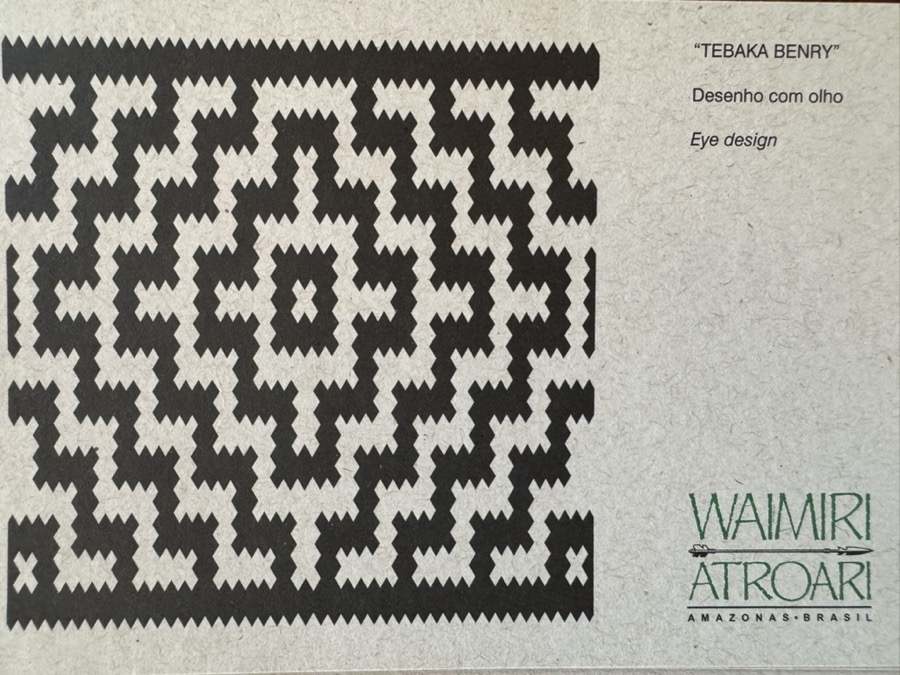
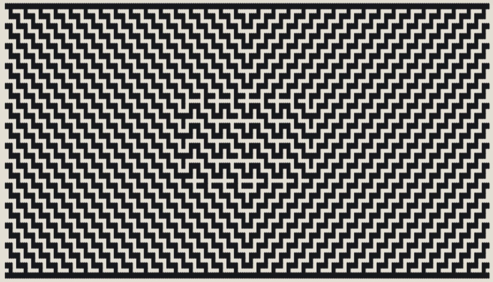

The **Waimiri Atroari**—who call themselves **Kinja** (*"The True People"*)—did not record their history in ink or stone. Speaking an oral Cariban language (*Kinja Iara*), they encoded their cosmology, their riverine taxonomy, and their clan memory into the binary geometry of split **arumã** cane (*Ischnosiphon arouma*). Every sieve (*urupema*), burden basket (*jamaxi*), and lidded *balainho* is a primary text: dark vertical warp splints dyed black with **jenipapo** (*Genipa americana*) and carbon soot intersecting light horizontal weft splints of natural cream *arumã* or terracotta **urucum** (*Bixa orellana*).

As you scroll through this essay, look closely at the background behind these words: **the page itself is a living Kinja loom**. As each chapter enters view, the background tapestry dynamically interpolates cell-by-cell through the traditional **Benry** (*design/writing*) matrices—morphing from **Tebaka Benry** (*The Jaguar's Eye*) to **Xirminja Benry** (*The Flooded River Currents*), **Weri Nahpy Benry** (*The Ancestral Anaconda's Ribs*), and **Dja Benry** (*The Saved Seed*).

Today we are launching the [**Waimiri Atroari Weaving Patterns Playground (`/waimiri-atroari-patterns/`)**](/waimiri-atroari-patterns/)—an offline-first, interactive ethnomathematical loom where you can learn how to weave all **12 traditional Benry patterns** step-by-step from their simplest primitives, inspect their run-length row equations, and **unroll** single motifs into giant repeating tapestries and 3D cylindrical baskets. And right inside this post, you can weave and unroll those patterns live while exploring the history of a people whose survival is one of the fiercest stories of resistance in the Amazon.

<!--more-->

<!-- Decorative Woven Scroll Progress Bar -->

<!-- Full-Viewport Interpolating Arumã Tapestry Canvas -->
<canvas id="kinja-ambient-bg-canvas" aria-hidden="true"></canvas>

---

<section id="chapter-unwritten-code" markdown="1" tabindex="-1" data-chapter-pattern="1">

## 1. An Unwritten Language Woven in Binary Twill (*Benry*)

For centuries along the basins of the **Alalaú**, **Camanaú**, **Curiaú**, and **Uatumã** rivers in the central-northern Amazon (spanning southern Roraima and northern Amazonas), the **Kinja** passed down their entire civilization without a written alphabet. Yet to say the Waimiri Atroari had no writing is to misunderstand what writing is.

When a Kinja master weaver splits the outer stem of the **arumã** herb (*Ischnosiphon arouma*), scrapes the pith, dyes the vertical warp splints (*urdidura*) jet-black with fermented **jenipapo** juice and charcoal soot, and interlaces horizontal weft splints (*trama*) dyed crimson-ochre with **urucum**, they are executing a strict mathematical grammar called **Benry** (*graphic pattern / inscription*).


flowchart LR
    A["Arumã Cane\n(Ischnosiphon arouma)"] --> B["Vertical Warp (Urdidura)\nDyed Black with Jenipapo + Soot\nBit = 1 (Weft UNDER ▼)"]
    A --> C["Horizontal Weft (Trama)\nNatural Cream or Urucum Red\nBit = 0 (Weft OVER ▲)"]
    B & C --> D["Even Rows (2, 4, 6...)\nStructural [▲1 ▼3] Twill Cadence\nPhase A (0 mod 4) / Phase B (2 mod 4)"]
    B & C --> E["Odd Rows (3, 5, 7...)\nSymbolic Float Pickups (▼1)\nEyes, Ribs, Seeds & River Frets"]
    D & E --> F["Kinja Benry Matrix\n4-Quadrant Dihedral Symmetry\nOral Cosmology & Clan Memory"]


By digitizing and analyzing 12 traditional Waimiri Atroari pattern cards and physical baskets in [`assets/js/weaving-patterns.js`](/assets/js/weaving-patterns.js), a remarkable structural law emerges across every single pattern:

1. **The Structural Spine (Even Rows, `r = 2, 4, 6...`)**: Every even-numbered row inside the basket frame obeys an invariant **`[▲1 ▼3]` 1/3 twill cadence**—the horizontal weft passes **Over 1 (`0`)** and **Under 3 (`1, 1, 1`)** vertical warps, shifting phase by $2$ columns (`Phase A: c % 4 !== 0` vs. `Phase B: (c + 2) % 4 !== 0`) to lock the basket's mechanical tension.
2. **The Semantic Pickups (Odd Rows, `r = 1, 3, 5...`)**: Every odd-numbered row is a long light weft float (`▲ Over`) punctuated by deliberate single-warp **`▼1` pickups** at odd column coordinates. Those single-bit pickups bridge consecutive twill rows to form $45^\circ$ stepped ribs, diamond eyes (**Tebaka**), seed crosses (**Dja**), agouti knee hooks (**Axiwi Se'me**), and meandering river frets (**Xirminja**).
3. **Seamless Modularity ($C - 1 \equiv 0 \pmod 4$)**: Because a canonical pattern unit has $C = 33$, $37$, or $29$ columns, its horizontal repeating stride $C - 1 \in \{28, 32, 36\}$ is an exact multiple of $4$. When unrolled around a cylindrical basket (*paneiro*) or across a wide sleeping mat, the `[▲1 ▼3]` twill phase **never breaks at the seam**.

</section>

---

<section id="chapter-balbina-flood" markdown="1" tabindex="-1" data-chapter-pattern="9">

## 2. Pulled From Their Territory: Highway BR-174 and the Great Flood of Balbina

To look at **Xirminja Benry** (*Desenho da água* — the labyrinthine water pattern now morphing into the background of this page) is to confront the trauma that nearly ended the Kinja world in the late twentieth century.

For generations, the Waimiri Atroari defended their forest territory against rubber tappers, Brazil-nut extractors, and state intrusion. Then, under Brazil's military regime in the late 1960s and 1970s, two megaprojects tore directly through the heart of Kinja territory:

  <strong>1968–1977 — The Cutting of Highway BR-174:</strong> Sliced north-to-south through ancestral Kinja hunting and village grounds to connect Manaus to Boa Vista, the construction of BR-174 was accompanied by military pacification campaigns, disease outbreaks, and violent confrontations later investigated by Brazil's <em>Comissão Nacional da Verdade</em> (National Truth Commission). By <strong>1983</strong>, a people who had numbered in the thousands a century earlier were reduced to just <strong>332 survivors</strong>.

Before the survivors could recover, a second catastrophe arrived by water. In **October 1987**, the floodgates of the **Balbina Hydroelectric Dam (*Usina Hidrelétrica de Balbina*)** were closed on the **Uatumã River**.

* **A Forest Drowned for Minimal Power**: Built across flat Amazonian topography rather than a steep canyon, the Balbina reservoir inundated roughly **2,928 $\text{km}^2$ of primary rainforest** to generate an average output often below $115\text{ MW}$—one of the worst flooded-area-to-megawatt ratios in human history.
* **Forced Removal & 3,500 Dead Islands**: Entire Kinja communities—including the *aldeias* of **Taquari** and **Tapupunã** along the Uatumã and Santo Antônio do Abonari tributaries—were forcibly pulled out of their ancestral lands as the waters rose. Nearly **30,000 hectares** of officially demarcated Waimiri Atroari territory were submerged, and sacred rapids, burial sites, petroglyphs, and riverside *arumã* stands disappeared under a stagnant reservoir of over 3,500 isolated hill-islands.
* **The Acidic Deadwater (*Água Morta*)**: Because the military utility did not clear the forest before closing the dam, tens of millions of giant hardwood trees rotted underwater, turning the Uatumã—once the lifeblood painted in *Waraki Benry* (Aracu fish) and *Xirminja Benry* (Water currents)—into anoxic, hydrogen-sulfide-laden water that killed the fish downstream for decades.

</section>

---

<section id="chapter-lucidity-resistance" markdown="1" tabindex="-1" data-chapter-pattern="2">

## 3. An Ethic of Radical Lucidity: No Fermented Drinks, No Ayahuasca, No Sugar

How did **332 survivors** in 1983 resist total erasure, rebuild their villages, expel invaders, and grow into a thriving population of **over 2,600 Kinja** across more than 60 *aldeias* today?

Anthropologists, indigenists, and the Kinja themselves point to an extraordinary cultural ethic of **bodily discipline, sobriety, and cognitive lucidity** that sets the Waimiri Atroari apart from many neighboring Amazonian societies:

  

    <h4>🚫 Zero Fermented Liquids or Alcohol</h4>
    

      While many lowland South American groups ferment manioc into alcoholic <em>caxiri</em> for festivals, the Kinja strictly prohibit fermentation and alcohol. Their traditional drinks—such as fresh fruit pulps (<em>bacaba</em>, <em>açaí</em>, <em>buriti</em>) and unfermented sweet manioc porridge (<em>kiskis</em>)—are consumed fresh before any fermentation can begin.
    

  

  

    <h4>🌿 No Ayahuasca or Hallucinogens</h4>
    

      The Kinja do not drink <em>ayahuasca</em> (<em>yagé</em>), do not inhale <em>paricá</em> snuffs, and do not use intoxicants. In Kinja philosophy, losing control of one's senses or speech is seen as a dangerous vulnerability—a state of spiritual and physical defenselessness.
    

  

  

    <h4>🍯 Rejection of Refined Sugar</h4>
    

      Traditionally, the Kinja reject industrial refined sugar, salt excesses, and processed foods—preserving physical endurance, dental and metabolic health, and an acute sensitivity to seasonal wild forest honeys and fruits.
    

  

  

    <h4>🧠 Mathematical Memory in the Loom</h4>
    

      Without paper diagrams or intoxicants, every adult weaver holds dozens of $21 \times 37$ binary matrices in working memory—counting <em>"Over 1, Under 3, Over 5, Under 1"</em> with total concentration while singing historical songs (<em>Maryba</em>).
    

  

When you weave a pattern like **Weri Nahpy Benry** (*Desenho da costela da cobra grande* — the ancestral anaconda whose markings taught humanity the art of basketry), a single miscounted splint on row 5 breaks the symmetry of row 15. For the Kinja, **sobriety and geometry are the same discipline**: keeping the mind clear so the pattern—and the people—never lose their center.

</section>

---

<section id="chapter-interactive-loom" markdown="1" tabindex="-1" data-chapter-pattern="6">

## 4. Interactive Embedded Loom: Weave & Unroll the 12 *Benry* Patterns Live

Below is a live embedded version of our [**Waimiri Atroari Weaving Patterns Studio (`/waimiri-atroari-patterns/`)**](/waimiri-atroari-patterns/). Choose any of the **12 documented patterns**, step through its **5 primitive construction stages**, switch between the **Serrated Kinja Card** and **3D Arumã & Urucum Basket Weave**, or click **Desenrolar Tapete (3×2)** and **Cesto 3D** to see how a single primitive cell unrolls across a larger surface! You can also **click directly on the canvas** to toggle or stamp splints with 4-quadrant symmetry.

  

    

      <label for="post-pattern-select" class="small fw-bold text-warning me-1">Padrão Kinja:</label>
      <select id="post-pattern-select" class="post-loom-btn" style="background:#0f141e; color:#f8fafc; font-weight:700;"></select>
    

    

      <button type="button" class="post-loom-btn" data-post-lens="kinja" aria-pressed="true">✨ Grafismo Kinja</button>
      <button type="button" class="post-loom-btn" data-post-lens="basket" aria-pressed="false">▦ Cesto 3D (Arumã)</button>
      <button type="button" class="post-loom-btn" data-post-lens="blueprint" aria-pressed="false">📐 Matriz ▼/▲</button>
    

    

      <button type="button" class="post-loom-btn" data-post-scale="1x1" aria-pressed="true">Peça 1×1</button>
      <button type="button" class="post-loom-btn" data-post-scale="3x1" aria-pressed="false">Faixa 3×1</button>
      <button type="button" class="post-loom-btn" data-post-scale="3x2" aria-pressed="false">Tapete 3×2</button>
      <button type="button" class="post-loom-btn" data-post-scale="concentric" aria-pressed="false">Ondas 4×3</button>
      <button type="button" class="post-loom-btn" data-post-scale="cylinder" aria-pressed="false">🏺 Cesto Cilíndrico 3D</button>
    

  

  

    

      <canvas id="post-interactive-canvas" width="700" height="510" tabindex="0" role="application" aria-label="Interactive Waimiri Atroari weaving canvas. Click to edit splints with 4-quadrant symmetry."></canvas>
      

        

          <strong id="post-loom-caption-title" style="color:#f59e0b; font-size:0.86rem;">TEBAKA BENRY — Desenho com olho</strong>
          19×33 talas
        

        

      

    

    

      

        Construção Passo a Passo
        <button type="button" class="post-loom-btn active" id="post-btn-animate-steps" aria-pressed="false">▶ Animar</button>
      

      

      

        
Foto de Referência Original:

        
      

      <a href="/waimiri-atroari-patterns/" class="post-loom-btn active" style="text-align:center; text-decoration:none; padding:0.55rem;">
        Abrir Playground Completo (/waimiri-atroari-patterns/) →
      </a>
    

  

### Emergent Complexity When Unrolling: The Indigenous Flag Woven in the Forest

What happens when a single $19 \times 33$ primitive matrix is unrolled concentrically across a $4 \times 3$ tapestry ($55 \times 129 = 7,095$ splint intersections)? Look at what emerges when we expand **3. Weri Nahpy Benry** (*Desenho feito pela mulher* / *Costela de cobra*) in **Ondas 4×3 (`concentric`)** mode:

<figure style="background-color:#0e131d !important; border:1px solid rgba(245, 158, 11, 0.45); border-radius:16px; padding:1.1rem; margin:1.75rem 0; box-shadow:0 20px 50px rgba(0,0,0,0.6);">
  
  <figcaption style="margin-top:0.85rem; display:flex; align-items:center; justify-content:space-between; gap:1rem; flex-wrap:wrap;">
    

      <strong style="color:#f59e0b;">Weri Nahpy Benry — Expansão Concêntrica 4×3 (55×129 talas = 7.095 cruzamentos):</strong> A partir de uma única célula primitiva $4 \times 8$, as ondas diagonais de $45^\circ$ da sarja <code>[▲1 ▼3]</code> irradiam um imenso <strong>losango central dentro do retângulo</strong> abrigando um núcleo constelado de cruzes — uma geometria ancestral que lembra de forma impressionante a <strong>Bandeira do Brasil</strong>, tecida em arumã séculos antes do Estado moderno existir.
    

    <button type="button" class="post-loom-btn active" id="btn-load-brazil-flag-preset" style="flex-shrink:0;">
      🇧🇷 Testar esta Configuração no Tear Acima
    </button>
  </figcaption>
</figure>

There is a profound visual and historical poetry in this emergent image:

* **From Local Rule to Global Flag**: The weaver never sketches a giant diamond in advance. By locking the central $19 \times 33$ core of *Weri Nahpy Benry* (with its constellation of four-armed crosses) and propagating the Manhattan distance wave `abs(r - r0) + abs(c - c0) (mod 4)` across the surrounding `[▲1 ▼3]` twill rows, the $45^\circ$ stepped diagonals automatically converge at the top, bottom, left, and right midpoints—inscribing a **giant diamond (*losango*) inside the outer rectangular selvedge frame** with a starry core at its center.
* **An Ancestral Mirror of the Brazilian Flag**: It is impossible to look at this $55 \times 129$ unrolled matrix without seeing the iconic silhouette of the **Brazilian Flag**—the outer rectangle, the radiating central diamond, and the inner constellation. Yet this geometry was not borrowed from positivist heraldry: it is the mathematical consequence of Amazonian 1/3 twill basketry practiced by the **Kinja** long before highways or hydroelectric dams cut through their forest.

### Quick Reference: All 12 Documented Patterns in the Catalog

| # | Kinja Name (*Benry*) | Portuguese Name | English Translation | Matrix Size | Core Mathematical Motif |
| :--- | :--- | :--- | :--- | :---: | :--- |
| **1** | **Waraki Benry** | *Desenho do aracu* | Aracu fish design | `19 × 33` | Nested fish-scale diamond with twin lateral hooks |
| **2** | **Tebaka Benry** | *Desenho com olho* | Eye / Jaguar eye design | `17 × 29` | Concentric stepped eye with `1×1` pupil at `(8, 14)` and 4 corner eyes |
| **3** | **Weri Nahpy Benry** | *Desenho feito pela mulher* | Snake rib / Woman's design | `19 × 33` | Continuous translational `(8, 8)` cross lattice with paired double-row twill |
| **4** | **Dja Benry** | *Desenho da semente* | Seed design | `21 × 37` | Staggered cross lattice enclosing 30 white `X`-seeds in `6 × 5` chambers |
| **5** | **Manjiki Preny Benry** | *Desenho da aba do peixe* | Fish fin design | `17 × 29` | Three vertical dorsal spines (`c=6, 14, 22`) with 5-unit pectoral fin bars |
| **6** | **Axiwi Se'me Benry** | *Desenho do joelho da cutia* | Agouti's knee design | `19 × 33` | Bent-knee angular hooks (`L`-chevrons) around a central cross |
| **7** | **Weri Bixi Benry** | *Desenho da pele da mulher* | Coral snake / Woman's skin | `21 × 37` | Central 5-seed cross medallion with stepped chevrons and triple-seed corners |
| **8** | **Nana Bixi Benry** | *Desenho da casca do abacaxi* | Pineapple peel design | `21 × 37` | Staggered checkerboard of 5-`X` diamond scales across `21 × 37` splints |
| **9** | **Panapna Benry** | *Desenho da borboleta grande* | Great butterfly design | `23 × 31` | Five Morpho butterfly medallions with twin vertical white wing diamonds (`♦ ♦`) |
| **10** | **Xirminja Nahpy Benry** | *Desenho feito pela entidade mitológica da água* | Water mythologic entity design | `21 × 23` | Dual register split at Row 6: twin-eye fret boxes above, river vortex below |
| **11** | **Kinja Paneiro (Urucum)** | *Trama Física Tricolor* | Urucum & Arumã physical weave | `19 × 33` | Close-up 3D splint interlacing with terracotta *urucum* weft |
| **12** | **Kinja Paneiro (Natural)** | *Trama Física Natural* | Natural & Black Arumã weave | `17 × 29` | Physical orthogonal cane weave of *Manjiki Preny Benry* |

</section>

---

<section id="chapter-literature" markdown="1" tabindex="-1" data-chapter-pattern="3">

## 5. Essential Literature: Understanding the Waimiri Atroari (*Kinja*) Struggle

If you want to study the history, ethnomathematics, and territorial resistance of the Waimiri Atroari beyond the loom, this curated bibliography brings together indigenous-authored texts, anthropological monographs, ecological forensics of the Balbina Dam, and human-rights archives:

  <h4 style="margin:0 0 0.35rem 0; color:#fcd34d; font-size:0.96rem;">
    1. <em>Waimiri Atroari: História e Cultura Kinja</em> — Kinja Educators &amp; Programa Waimiri Atroari
  </h4>
  

    Authored with Kinja teachers and elders in bilingual schools along the Alalaú and Camanaú rivers. Documents oral histories of how the ancient people learned basketry from the markings of the great anaconda (<em>Weri</em>), alongside botanical knowledge of <em>arumã</em> harvesting, natural dyes, and the strict dietary ethic rejecting fermented drinks and sugar.
  

  <h4 style="margin:0 0 0.35rem 0; color:#fcd34d; font-size:0.96rem;">
    2. Egydio Schwade &amp; Doroti Alice Schwade — <em>A Ditadura Militar e o Genocídio do Povo Waimiri-Atroari</em> / Arquivo Mawa
  </h4>
  

    Chronicles the impact of Highway BR-174 and the first literacy and memory exchanges in the village of <em>Yawará</em> (1985–1986), where young Kinja drew on paper for the first time the massacres and village displacements their elders had survived, alongside the geometric patterns that anchored their collective identity.
  

  <h4 style="margin:0 0 0.35rem 0; color:#fcd34d; font-size:0.96rem;">
    3. Stephen Grant Baines — <em>É a FUNAI que sabe: A frente de atração Waimiri-Atroari</em> (UnB / Museu Goeldi)
  </h4>
  

    A foundational ethnographic monograph examining the forced attraction front, the demographic collapse to 332 people in 1983, the forced relocation of the <em>Taquari</em> and <em>Tapupunã</em> villages prior to the closing of the Balbina Hydroelectric Dam in 1987, and the subsequent demographic recovery of the Kinja.
  

  <h4 style="margin:0 0 0.35rem 0; color:#fcd34d; font-size:0.96rem;">
    4. Philip M. Fearnside — <em>Brazil's Balbina Dam: Environment versus the Legacy of the Pharaohs in Amazonia</em> (Environmental Management, 1989)
  </h4>
  

    The definitive ecological and hydrological analysis of the Balbina Dam on the Uatumã River—quantifying how nearly $3,000\text{ km}^2$ of primary forest and indigenous territory were submerged into 3,500 islands of rotting biomass and methane emissions for a fraction of Manaus's electricity demand.
  

  <h4 style="margin:0 0 0.35rem 0; color:#fcd34d; font-size:0.96rem;">
    5. Relatório Final da Comissão Nacional da Verdade (CNV, Vol. II, Texto 5, 2014) — <em>Violações de Direitos Humanos dos Povos Indígenas</em>
  </h4>
  

    Official Brazilian state investigation documenting the violence against the Waimiri Atroari during the opening of BR-174 and the flooding of their territory by Balbina, establishing historical recognition of Kinja resistance and territorial rights.
  

---

### Launch the Full Interactive Loom & Tapestry Unroller

Ready to weave your own variations, test your accuracy against all 12 Kinja matrices, or unroll a 6×3 mural?

👉 **[Launch the Waimiri Atroari Weaving Patterns Playground (`/waimiri-atroari-patterns/`)](/waimiri-atroari-patterns/)**

</section>

